[English](https://github.com/storytold/pdfcraft/blob/main/README.md) · [Русский](https://github.com/storytold/pdfcraft/blob/main/README.ru.md) · Français

<p align="center">
  <a href="https://getartcraft.com/">
    <picture>
      <source media="(prefers-color-scheme: dark)" srcset="docs/brand/artcraft-logo-white.svg">
      
    </picture>
  </a>
</p>


<p align="center">
  
</p>

<h1 align="center">PdfCraft</h1>

<p align="center">
  <b>L'espace de travail PDF : un lecteur et éditeur PDF moderne à code source ouvert, écrit entièrement en Rust.</b><br>
  Lisez, organisez, combinez, divisez et sécurisez les PDF dans une application native rapide, écrite en Rust de zéro.<br>
  macOS · Windows · Linux · FreeBSD · le web
</p>

<p align="center">
  
  
  
  
  <br>
  <a href="https://sonarcloud.io/project/overview?id=storytold_pdfcraft"></a>
  <a href="https://coderabbit.ai"></a>
</p>

<p align="center">
  <a href="https://discord.gg/artcraft"></a>
</p>

<p align="center">
  <a href="https://getartcraft.com/apps/pdfcraft"><b>PdfCraft sur getartcraft.com</b></a> ·
  <a href="https://getartcraft.com/">ArtCraft</a> ·
  <a href="https://getartcraft.com/apps">Toutes les applications Crafting</a>
</p>

<br>

<p align="center">
  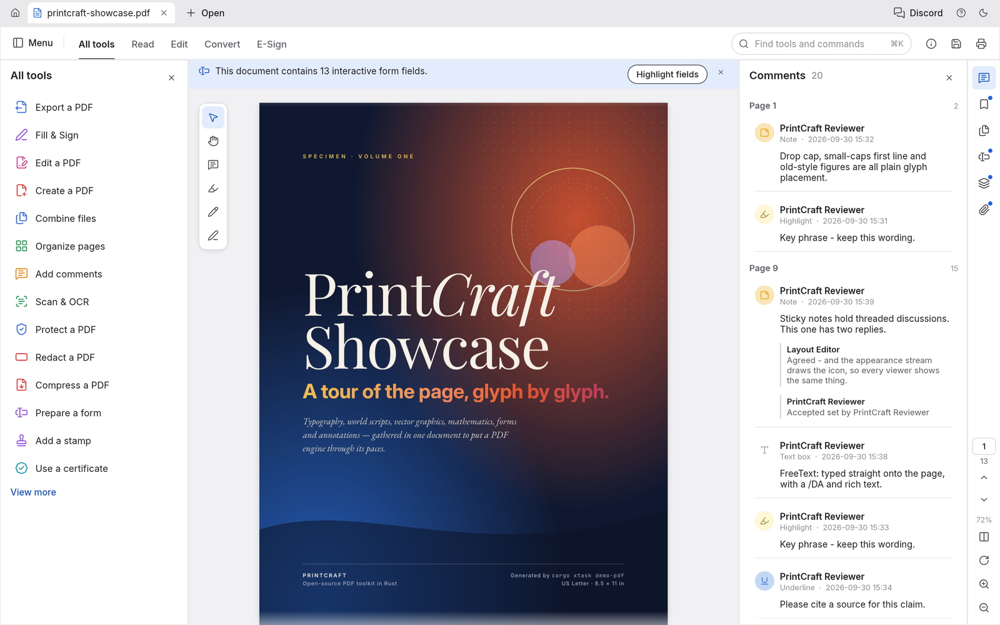
  <br>
  <sub>Le PdfCraft Showcase, un PDF spécimen de 13 pages, ouvert avec le panneau All tools et les commentaires enfilés.</sub>
</p>

> [!NOTE]
> **ArtCraft est une communauté d'artistes de tous horizons.** Numérique, génératif, musique,
> jeux — si vous créez des choses, vous êtes des nôtres. **[Venez dire bonjour sur Discord](https://discord.gg/artcraft).**

<p align="center">
  <a href="#points-forts">Points forts</a> ·
  <a href="#lire-les-pdf-avec-élégance">Lire</a> ·
  <a href="#rechercher-sélectionner-copier">Rechercher</a> ·
  <a href="#organiser-les-pages-comme-des-cartes">Organiser</a> ·
  <a href="#fusionner-et-diviser-sans-rien-perdre">Combiner et diviser</a> ·
  <a href="#ouvrir-les-documents-protégés-et-respecter-leurs-règles">Protéger</a> ·
  <a href="#commentaires-formulaires-calques-et-pièces-jointes">Formulaires et calques</a> ·
  <a href="#fonctionne-partout-reste-à-vous">Partout</a> ·
  <a href="#conçu-aussi-pour-les-agents">Agents</a> ·
  <a href="#architecture-du-projet">Comment c'est construit</a> ·
  <a href="#prise-en-main">Pour commencer</a> ·
  <a href="#et-maintenant">Et ensuite</a> ·
  <a href="#téléchargements">Téléchargements</a> ·
  <a href="#les-applications-crafting">Applications Crafting</a>
</p>

---

## Communauté

PdfCraft fait partie d'[ArtCraft](https://getartcraft.com). Venez dire bonjour, obtenir de l'aide et suivre le développement :

- **Discord : [discord.gg/artcraft](https://discord.gg/artcraft)**. C'est le moyen le plus rapide d'obtenir de l'aide et de partager des retours. L'application a un bouton Discord dans sa barre de titre.
- **Page web :** [getartcraft.com/apps/pdfcraft](https://getartcraft.com/apps/pdfcraft)
- **Source :** [github.com/storytold/pdfcraft](https://github.com/storytold/pdfcraft)

Le nom ArtCraft et les logos dans `docs/brand/` sont des marques de l'équipe ArtCraft et ne sont pas open source. Ils ne peuvent être utilisés que non modifiés, et uniquement dans le cadre de PdfCraft (voir `docs/brand/LICENSE-brand.txt`). Les forks et versions modifiées doivent les supprimer.

## Points forts

<table>
<tr>
<td width="33%" valign="top">

### Fidélité
Typographie du monde réel : écritures du monde, japonais vertical, emoji en couleur, dégradés, masques doux et transparence. Tout s'affiche comme l'auteur l'a voulu.

</td>
<td width="33%" valign="top">

### Robustesse
Les enregistrements ordinaires ajoutent vos modifications et laissent les octets d'origine intacts. Les modifications d'objets endommagés dont les générations xref et d'en-tête ne concordent pas utilisent une réécriture complète, en gardant les deux références acceptées connectées au même objet réparé. Les écritures sont atomiques, l'historique d'annulation est complet, et rien n'est perdu si vous fermez par erreur.

</td>
<td width="33%" valign="top">

### Confidentialité
Pas de compte, pas de télémétrie, pas de cloud. Fonctionne hors ligne et s'ouvre instantanément. Le moteur, le CLI et l'application sont tous open source.

</td>
</tr>
</table>

---

## Lire les PDF avec élégance

PdfCraft affiche les PDF avec soin pour les détails qui font qu'une page se sent juste : crénage et ligatures, écriture de droite à gauche et scripts complexes, CJK vertical, emoji en couleur, ombrages, modes de fusion, masques doux et contenu optionnel.

<p align="center">
  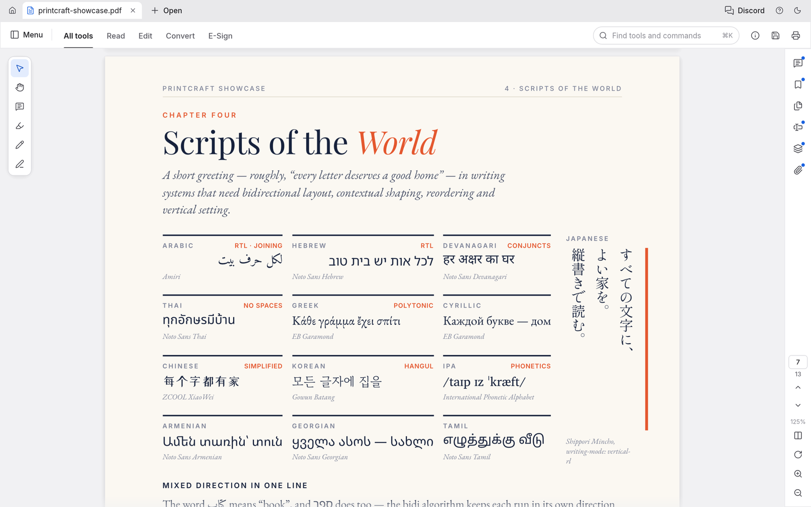
  <br>
  <sub>Douze systèmes d'écriture sur une page, plus le japonais vertical, à 125 %.</sub>
</p>

- **Le zoom profond reste net.** Les grandes pages sont rendues en tuiles, donc le texte reste net à n'importe quel agrandissement.
- **Conçu pour survivre aux mauvais fichiers.** Chaque page est rendue isolément et les documents endommagés sont réparés. Sur le corpus de test de 983 fichiers de pdf.js, le résultat est 0 plantage.
- **Mises en page pour chaque tâche :** continue, page unique, double page, rotation de vue, plein écran et mode Lecture sans distraction.
- **Thèmes clair et sombre**, tous deux conçus pour être doux pour les yeux lors de longues sessions.

<table>
<tr>
<td width="50%">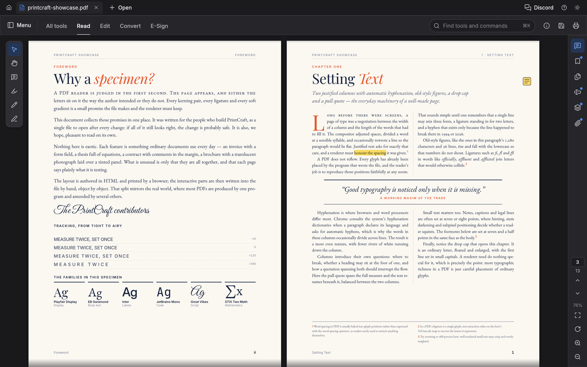</td>
<td width="50%">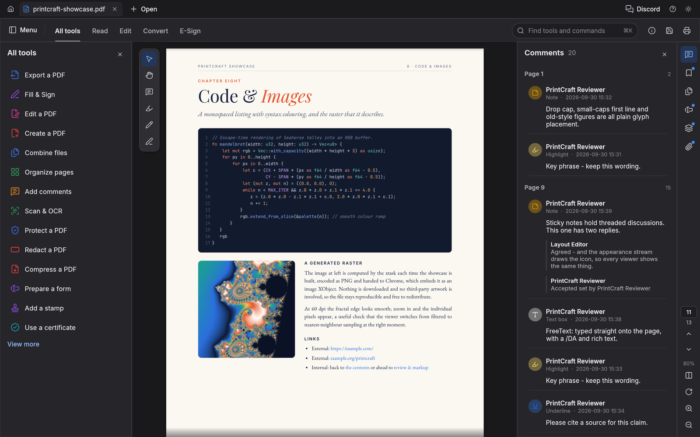</td>
</tr>
<tr>
<td align="center"><sub>Mode Lecture double page, prêt pour la lecture longue</sub></td>
<td align="center"><sub>Le thème sombre, avec le panneau des commentaires ouvert</sub></td>
</tr>
</table>

## Rechercher, sélectionner, copier

Recherchez dans tout le document au fur et à mesure de la saisie, parcourez les correspondances avec <kbd>⌘G</kbd>, et sélectionnez le texte qui sort dans le bon ordre de lecture. Cela vaut aussi pour les colonnes, les passages de droite à gauche et le CJK.

## Naviguer dans les longs documents

Lancez avec `pdfcraft --two-paged file.pdf` (ou `pdfcraft file.pdf --two-paged`) pour ouvrir chaque PDF de la ligne de commande en vue non continue à deux pages. Cette option de lancement facultative ne modifie pas les préférences de mise en page par défaut enregistrées ni les PDF restaurés de la session précédente. Une option `--layout` explicite a la priorité sur le document actif quel que soit l'ordre des arguments ; `--default-layout` conserve son comportement existant pour les documents ouverts ensuite.

Cliquez avec le bouton droit sur un onglet PDF pour le fermer, rouvrir le dernier onglet fermé basé sur un fichier, ou révéler son fichier. La fermeture demande toujours les modifications non enregistrées. La réouverture lit le fichier enregistré depuis le disque ; elle ne restaure pas les modifications abandonnées. Révéler sélectionne le fichier dans l'Explorateur ou le Finder. Sous Linux et FreeBSD, il demande `org.freedesktop.FileManager1.ShowItems`, avec repli sur l'ouverture du répertoire contenant via `xdg-open` lorsque ce service est indisponible. Réouvrir et Révéler sont indisponibles sur le web ; Révéler est aussi indisponible pour les documents sans chemin.

Les signets, les miniatures de pages et les étiquettes de pages propres au document (i, ii, 1, 2…) vous gardent orienté dans les longs documents. Recherchez les titres de signets dans le panneau Signets pour trouver des entrées imbriquées même lorsque leurs parents sont repliés. Les correspondances gardent leurs ancêtres pour le contexte ; Effacer restaure l'arbre non filtré sans changer son état d'expansion.

Dans **Inspector > Pages**, utilisez **Thumbnail size** et les boutons plus petit/plus grand pour afficher plus de pages ou inspecter de plus grandes prévisualisations (50–150 %). Cela ne change que les miniatures, en gardant la sélection multi-pages et la page courante en vue. La taille appartient à la vue du document ouvert et survit au rechargement de son fichier ; elle n'est pas mémorisée après un redémarrage. Les agents peuvent la définir avec `ui.set {"key":"thumbnail-zoom","value":"75"}` et lire `active.thumbnail_zoom` depuis `ui.state`.

<table>
<tr>
<td width="50%">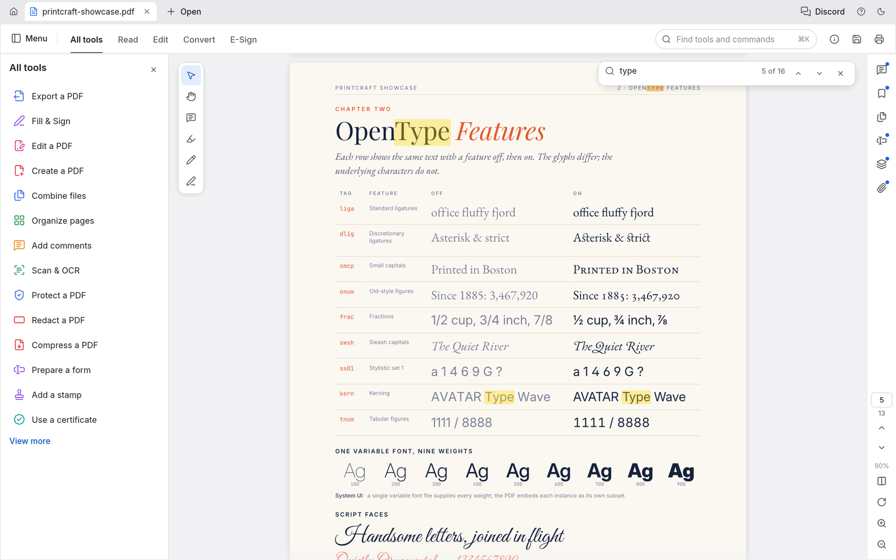</td>
<td width="50%">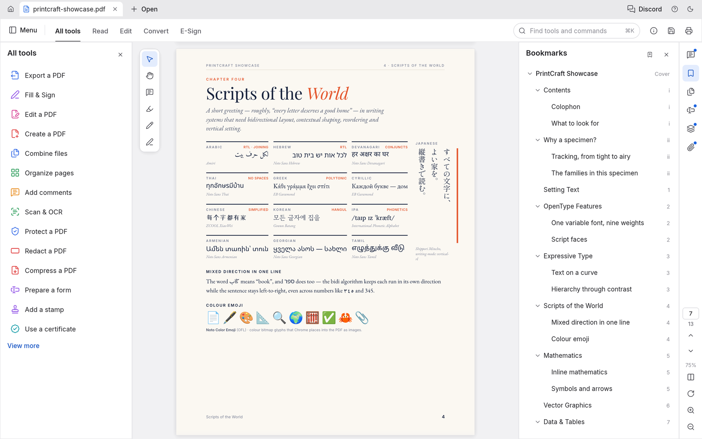</td>
</tr>
<tr>
<td align="center"><sub>Recherche au fur et à mesure : correspondance 10 sur 16</sub></td>
<td align="center"><sub>Signets imbriqués avec les étiquettes de pages propres au document</sub></td>
</tr>
</table>

---

## Organiser les pages comme des cartes

Ouvrez **Organize pages** pour voir toutes les pages à la fois :
- **Sélectionnez les pages :** clic, <kbd>⌘</kbd>-clic ou <kbd>⇧</kbd>-clic.
- **Modifiez-les :** tournez, supprimez, insérez des pages blanches, insérez des pages d'un autre fichier, et déplacez-les plus tôt ou plus tard.
- **Annulez n'importe quoi :** <kbd>⌘Z</kbd>, puis enregistrez.

<p align="center">
  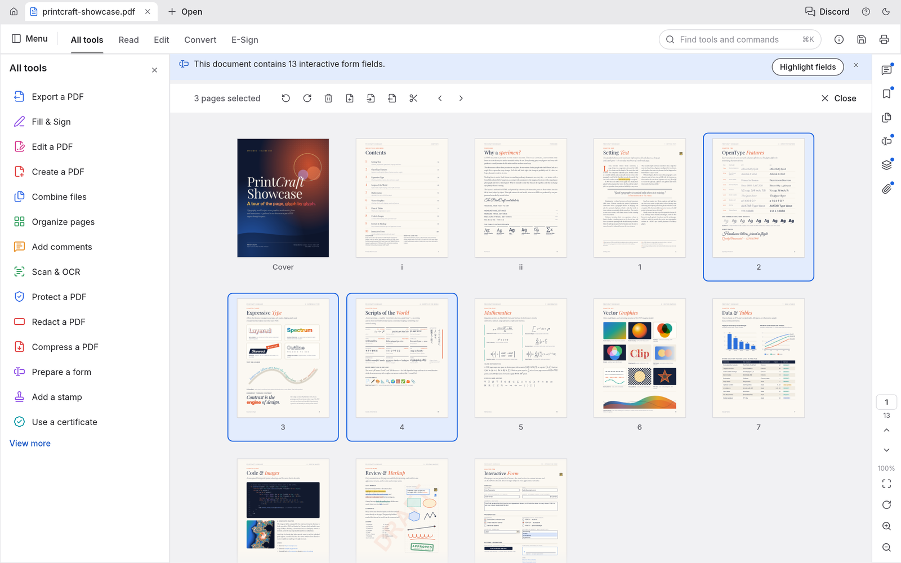
  <br>
  <sub>Organiser les pages avec trois pages sélectionnées et les outils de page dans la barre d'outils au-dessus.</sub>
</p>

<table>
<tr>
<td width="50%" valign="top">

**Un historique d'annulation complet.** Chaque modification est une étape dans un historique que vous pouvez parcourir en arrière et en avant. Le menu Édition nomme l'étape (« Annuler la rotation des pages »), et l'annulation fonctionne encore après l'enregistrement.

**Des enregistrements auxquels on peut faire confiance :**
- *Incrémentaux :* les octets d'origine restent intacts octet par octet.
- *Atomiques :* le fichier est écrit dans une copie temporaire, puis échangé.
- *Vérifiés :* contrôlés indépendamment avec qpdf, à chaque exécution CI.

Lorsque les documents ouverts dépassent la largeur de la fenêtre, faites défiler la barre d'onglets avec la molette de la souris ou le pavé tactile, ou utilisez sa barre de défilement horizontale. Ouvrir ou basculer vers un document amène son onglet en vue.

Les documents non enregistrés portent un point sur leur onglet, et fermer ou quitter demande avant que quelque chose soit perdu. Les modifications sont auto-enregistrées chaque minute. Si PdfCraft quitte jamais de façon inattendue, il propose de récupérer votre travail au prochain démarrage. Les documents chiffrés restent chiffrés sur le disque.

</td>
<td width="50%" valign="top">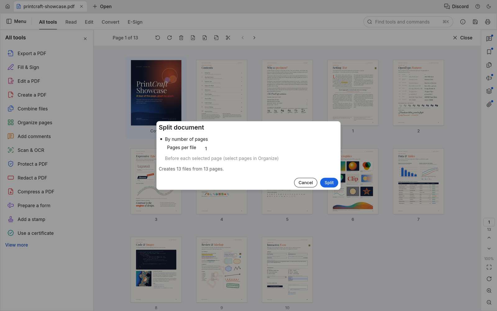<br><sub>Diviser le document : une page par fichier produit 13 fichiers.</sub></td>
</tr>
</table>

## Fusionner et diviser sans rien perdre

**Combine files** fusionne n'importe quel nombre de PDF en un seul. Chaque fichier obtient un signet, avec ses propres signets imbriqués en dessous.

**Extract** copie les pages que vous sélectionnez dans un nouveau document. **Split** divise un document toutes les *n* pages, ou avant les pages que vous choisissez.

Rien ne disparaît silencieusement en chemin :
- les liens et destinations nommées sont reconnectés aux pages copiées ;
- les champs de formulaire restent interactifs ;
- les calques conservent leurs valeurs par défaut on/off ;
- les pièces jointes viennent avec.

Chaque page d'un document combiné s'affiche pixel-identique à sa source.

```sh
pdfcraft-cli combine report.pdf appendix.pdf --out combined.pdf
pdfcraft-cli extract report.pdf --pages 1,3,5-8 --out highlights.pdf
pdfcraft-cli split   report.pdf --every 10 --out-dir parts/
```

---

## Ouvrir les documents protégés et respecter leurs règles

PdfCraft implémente complètement le gestionnaire de sécurité standard PDF :
- chaque révision, du RC4 40 bits à l'AES-256 ;
- mots de passe utilisateur et propriétaire, y compris les mots de passe Unicode normalisés avec SASLprep ;
- filtres cryptographiques et chiffrement des pièces jointes uniquement.

Les documents restreints par leur auteur affichent un avis clair, et PdfCraft respecte leurs permissions. Entrez le mot de passe propriétaire et les restrictions se lèvent. Les modifications des documents chiffrés sont enregistrées chiffrées, sous les mêmes clés.

<table>
<tr>
<td width="50%" valign="top">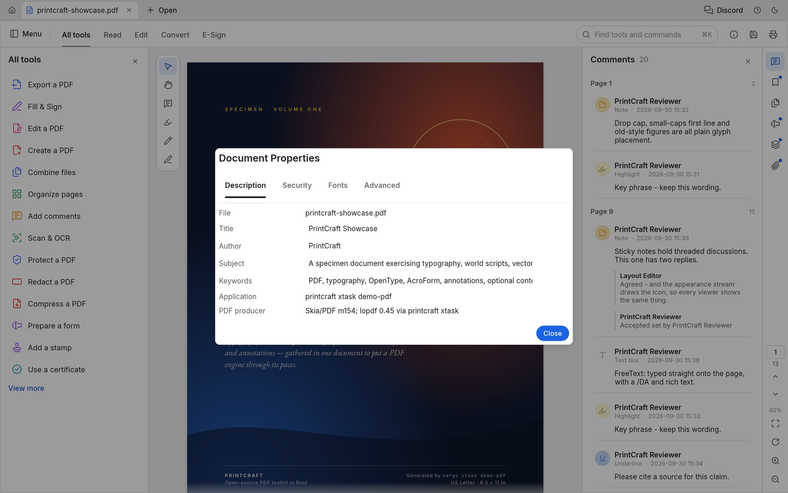<br><sub>Propriétés du document, onglet Description</sub></td>
<td width="50%" valign="top">

**Document Properties** affiche :
- le titre, l'auteur, le sujet et les mots-clés du document, que vous pouvez modifier ;
- les polices qu'il utilise et si chacune est incorporée ;
- la version PDF, la taille de page, les balises, les champs, les calques et les pièces jointes ;
- le tableau complet de sécurité : méthode de chiffrement, quel mot de passe l'a ouvert, et chaque permission.

</td>
</tr>
</table>

## Commentaires, formulaires, calques et pièces jointes

<table>
<tr>
<td width="50%">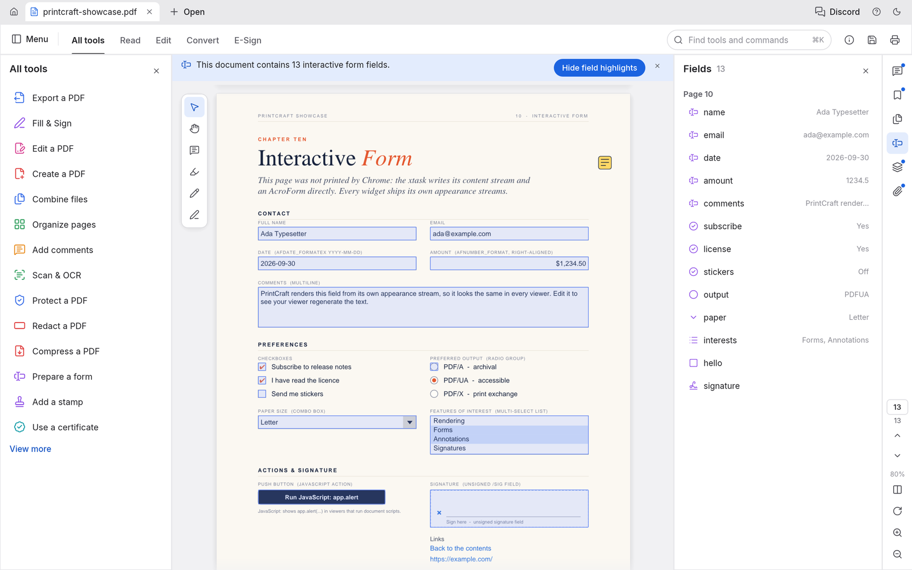</td>
<td width="50%">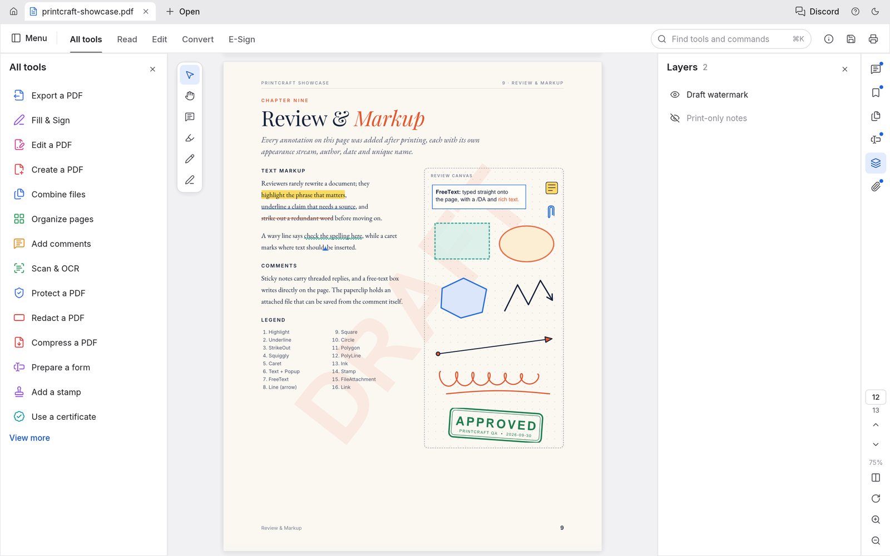</td>
</tr>
<tr>
<td valign="top"><b>Formulaires</b> : chaque champ avec sa valeur actuelle, la mise en évidence des champs, et les cases à cocher, boutons radio, listes et signatures dessinés comme leur auteur les a conçus.</td>
<td valign="top"><b>Calques</b> : activez et désactivez le contenu optionnel et la page se redessine instantanément. Les <b>commentaires</b> apparaissent comme des conversations enfilées, et les <b>pièces jointes</b> peuvent être ouvertes ou enregistrées.</td>
</tr>
</table>

## Numériser les pages, puis vérifier le texte reconnu

**Scan & OCR ▸ Recognize text** transforme un scan en texte recherchable — la page courante, une plage, ou un dossier de fichiers écrits comme copies recherchables — avec un nettoyage optionnel avant la lecture (auto-rotation, redressement, débruitage, binarisation ; les boîtes de mots se rapportent au scan d'origine) et un second moteur : un Tesseract installé rejoint le moteur intégré, fusionné selon votre stratégie. Un résultat recherchable s'applique comme une seule étape annulable ; la sortie **Editable text** ouvre l'écran **OCR Verify**, où chaque mot porte la confiance du moteur comme une couleur, les suspects sont à une touche, et les corrections, un dictionnaire utilisateur et le re-OCR d'une région ou d'une page se font avant que Accept n'écrive le nouveau document. **Scan & OCR ▸ Correct recognized text** revoit toute reconnaissance là avant qu'elle ne soit appliquée.

<p align="center">
  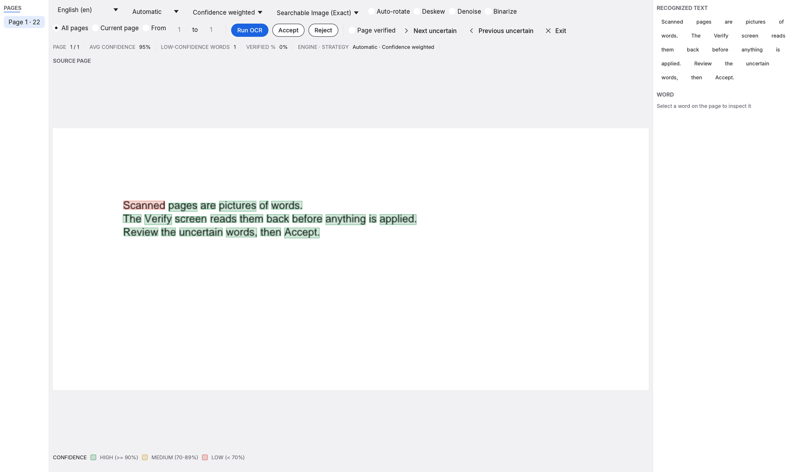
  <br>
  <sub>L'écran OCR Verify : mots colorés par confiance — la légende explique les seuils — revus et corrigés avant que quoi que ce soit ne soit appliqué.</sub>
</p>

---

## Tous les outils à portée de raccourci

Appuyez sur <kbd>⌘K</kbd> pour rechercher chaque outil et commande, ou parcourez le catalogue **All tools**. Les outils encore en développement sont marqués de l'étape qui les livrera.

<table>
<tr>
<td width="50%">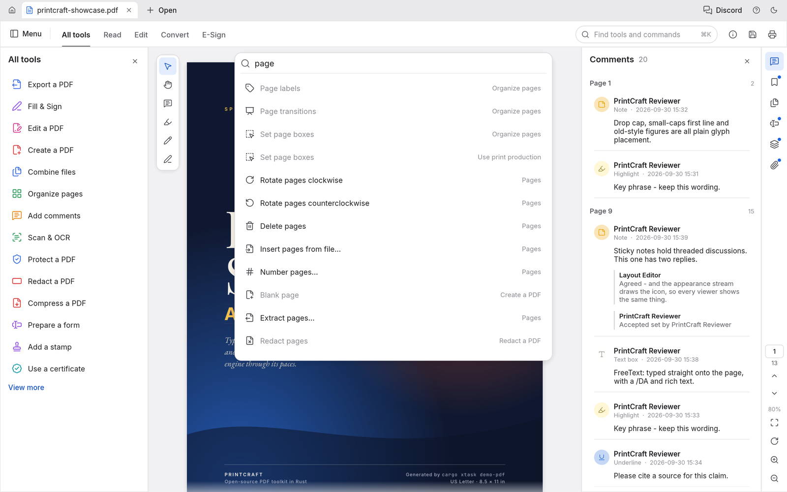</td>
<td width="50%">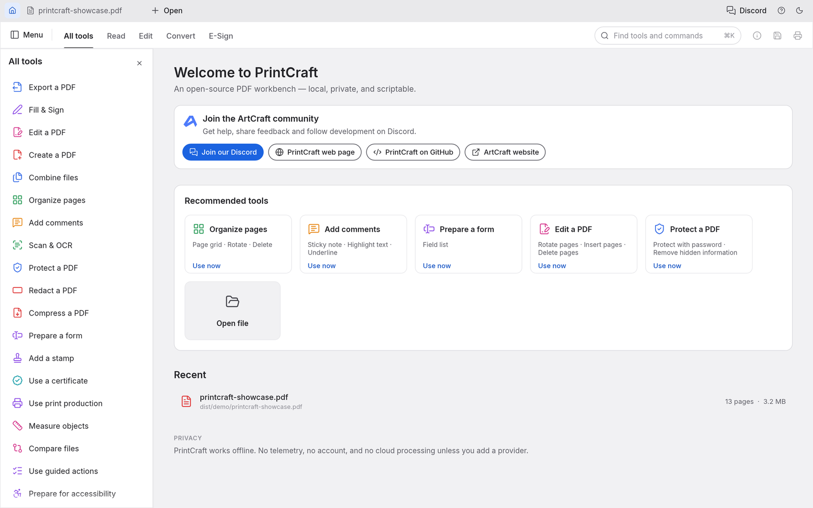</td>
</tr>
<tr>
<td align="center"><sub>La palette de commandes <kbd>⌘K</kbd></sub></td>
<td align="center"><sub>L'écran d'accueil et le catalogue All tools</sub></td>
</tr>
</table>

---

## Fonctionne partout, reste à vous

- **Natif sur macOS, Windows, Linux et FreeBSD**, et **dans le navigateur** via WebAssembly, à partir de la même base de code Rust. Les builds Windows existent pour x64, x86 et ARM64 (Windows on ARM, sans émulation) ; chaque changement ARM64 est testé sur du matériel ARM64 dans le CI.
- **Privé par conception.** Les documents ne quittent jamais votre machine. Il n'y a ni compte, ni télémétrie, ni traitement cloud.
- **Le moteur d'abord.** L'analyse, le rendu et l'édition vivent dans des crates de bibliothèque réutilisables. L'interface est une couche interchangeable au-dessus.
- **Scriptable.** L'outil `pdfcraft-cli` (voir [Built for agents, too](#built-for-agents-too)) couvre l'inspection, le rendu, l'extraction de texte, l'édition, la combinaison, l'extraction de pages et la division. Les balayages de robustesse s'exécutent sur le même moteur que l'application.

```sh
pdfcraft-cli info  form.pdf                                  # structure en JSON
pdfcraft-cli text  paper.pdf --page 3                        # texte dans l'ordre de lecture
pdfcraft-cli edit  in.pdf --rotate 1,2:90 --delete 5 --title "Q3" --out out.pdf
```

---

## Conçu aussi pour les agents

Chaque fonctionnalité du moteur est accessible sans l'interface graphique, via une table d'outils décrits en JSON Schema : ouvrir, inspecter, rendre des pages en PNG, extraire et trouver du texte, tourner, supprimer, déplacer et insérer des pages, éditer les signets et étiquettes de pages, ajouter, répondre, restyler et supprimer des commentaires (surligner une phrase en la nommant simplement), lister et remplir les champs de formulaire, protéger par mots de passe, définir les métadonnées, annuler et rétablir, enregistrer, combiner, extraire et diviser. Trois portes d'entrée la partagent :

- **`pdfcraft-cli run`**, pour les appels ponctuels et les scripts JSON :

  ```sh
  pdfcraft-cli tools                                        # chaque outil et son JSON Schema
  pdfcraft-cli run text_find doc=1 query=invoice            # key=value ; les valeurs s'analysent comme JSON
  pdfcraft-cli run --script review.json                     # ex. comment_add {"type": "highlight", "find": "total due"}
  pdfcraft-cli run --script steps.json --root ./work        # plusieurs étapes dans une session
  pdfcraft-cli run --script steps.json --report             # un document JSON : pour chaque étape son numéro, outil, statut, résultat ou erreur
  ```

  Avec `--root`, chaque fichier que les étapes du script lisent ou écrivent reste dans ce répertoire, y compris le PNG qu'une étape enregistre avec `"out"` (le script lui-même est lu depuis l'endroit que vous indiquez).

- **Un serveur MCP**, pour les agents IA comme Claude. **Il est opt-in :** PdfCraft ne le démarre jamais tout seul, et n'ouvre aucun port réseau. Il ne tourne que pendant qu'un agent lance `pdfcraft-cli mcp`, parle via stdin/stdout, et s'arrête quand l'agent se déconnecte. Pour l'activer, ajoutez-le à la configuration MCP de votre agent :

  ```json
  { "mcpServers": { "pdfcraft": { "command": "pdfcraft-cli", "args": ["mcp", "--root", "/path/to/your/pdfs"] } } }
  ```

  `--compact` réduit la liste d'outils que l'agent doit lire : `tools/list` renvoie environ dix outils principaux plus `tool_search` et `tool_call`, qui trouvent et exécutent tous les autres, donc la liste coûte bien moins de tokens. Chaque outil fonctionne encore.

  `--root` confine chaque fichier que l'agent peut lire ou écrire à un seul répertoire. Les builds qui ne doivent pas inclure le serveur du tout peuvent utiliser `cargo build -p pdfcraft-cli --no-default-features`.

- **L'API Rust** (`pdfcraft_automation::Automation::call`), pour l'intégration.

Les modifications restent en mémoire, annulables, jusqu'à `doc_save`. Enregistrer dans le même fichier ajoute une mise à jour incrémentale, donc les octets d'origine sont préservés, et l'écriture est atomique. Les modifications non enregistrées ne sont jamais abandonnées silencieusement.

### Piloter l'application elle-même

Démarrez l'application de bureau avec `pdfcraft --control ~/.pdfcraft-control.json` et un agent peut voir et piloter l'interface réelle : l'arbre des widgets avec labels et positions (depuis l'arbre d'accessibilité), clics, saisie, touches, commandes, options de vue et captures d'écran. C'est aussi désactivé par défaut. Il n'écoute que sur loopback, et chaque connexion doit présenter le jeton aléatoire écrit dans ce fichier, que vous seul pouvez lire.

Gardez le fichier de contrôle dans un dossier où vous seul pouvez écrire, pas un partagé comme `/tmp` : un autre utilisateur pourrait y créer le fichier en premier et recevoir vos commandes. `pdfcraft-cli ui` refuse un fichier de contrôle qui est un lien symbolique, ou qui appartient à un autre utilisateur, ou qu'un autre utilisateur ou un groupe comme Administrators peut lire ou écrire : sous macOS, Linux et FreeBSD par son propriétaire et son mode (l'application l'écrit en mode 600), sous Windows par son propriétaire et sa liste d'accès (l'application lui donne une liste avec seulement vous et SYSTEM). L'application ne démarre pas si elle ne peut pas écrire le fichier. Sous Windows, cmd.exe n'étend pas `~` : utilisez `%USERPROFILE%\.pdfcraft-control.json`.

```sh
pdfcraft-cli ui --control ~/.pdfcraft-control.json inspect query=rotate      # trouver des widgets
pdfcraft-cli ui --control ~/.pdfcraft-control.json click label="Organize pages"
pdfcraft-cli ui --control ~/.pdfcraft-control.json key key=K modifiers='["command"]'
pdfcraft-cli ui --control ~/.pdfcraft-control.json command id=comment.square   # choisir un outil, puis dessiner :
pdfcraft-cli ui --control ~/.pdfcraft-control.json drag from='[400,300]' to='[600,420]'
pdfcraft-cli ui --control ~/.pdfcraft-control.json screenshot --out window.png
pdfcraft-cli ui --control ~/.pdfcraft-control.json resize width=1200 height=800
pdfcraft-cli ui --control ~/.pdfcraft-control.json focus label="Read"
pdfcraft-cli ui --control ~/.pdfcraft-control.json inspect focused=true
pdfcraft-cli ui --control ~/.pdfcraft-control.json quit
```

`ui.panel` ouvre, ferme ou redimensionne un panneau latéral : `{"panel":"tools"|"side","open":true|false,"width":320}`.
`tools` est le panneau Tools et `side` le panneau que le rail ouvre (le rouvrir montre celui ouvert en dernier).
`width` est borné aux limites du panneau (Tools 240–520, panneau latéral 260–520 points). `ui.dock.reset`
réinitialise les panneaux latéraux : Tools ouvert à gauche, largeurs par défaut. Le canal de contrôle accepte ces
méthodes directement ; `ui.command` accepte aussi `{"id":"ui.panel","params":{...}}`. Les préférences enregistrées gardent
le côté Tools, les panneaux ouverts et leurs largeurs. Les requêtes invalides renvoient une erreur sans changer
le document ou les panneaux.


`resize` demande une taille de fenêtre intérieure native en points logiques (chaque dimension doit être entre 320 et 8192) ; le gestionnaire de fenêtres peut la contraindre. `state` rapporte les `window.width`, `window.height` et `window.pixels_per_point` observés. `focus` accepte exactement un `id` de widget ou un `label` unique activé et focalisable ; les requêtes `key` suivantes traversent ou activent les vrais widgets. `inspect` inclut la focalisabilité et accepte un filtre `focused`. `quit` ne prend aucun paramètre : les documents propres quittent normalement, tandis que les modifications non enregistrées ou la saisie ouvrent l'invite existante Enregistrer/Ne pas enregistrer/Annuler et renvoient `quitting: false, needs_confirmation: true`. Elle n'abandonne jamais silencieusement le travail. Le redimensionnement de fenêtre et la sortie de l'application sont natifs uniquement.

---

## Architecture du projet

PdfCraft est un espace de travail Cargo de crates ciblés, empilés de sorte que le cœur ne dépende jamais de l'UI :

| Crate | Ce qu'il fait |
|---|---|
| `pdfcraft-filters` | Chaque filtre de flux PDF (Flate, LZW, ASCII85, RunLength, prédicteurs), encode et décode, testé par propriétés |
| `pdfcraft-crypt` | Le gestionnaire de sécurité standard : RC4, AES-128/256, révisions 2–6, permissions |
| `pdfcraft-cos` | La couche d'objets PDF : analyse tolérante, réparation, modifications copy-on-write, écriture incrémentale et complète |
| `pdfcraft-organize` | Opérations de pages, combiner / extraire / diviser, signets, étiquettes de pages, informations du document |
| `pdfcraft-fonts` | Métriques de polices et encodages pour les apparences générées |
| `pdfcraft-annot` | Commentaires : constructeurs et flux d'apparence pour notes, marquage de texte, formes, encre et zones de texte ; réponses, statut, modifications |
| `pdfcraft-forms` | Formulaires interactifs : le modèle de champs, remplissage avec apparences régénérées, Clear form |
| `pdfcraft-render` | Rendu, inspection et extraction de texte avec ordre de lecture |
| `pdfcraft-engine` | La façade que chaque frontend utilise : sessions, modifications, annulation, enregistrement, le catalogue d'outils |
| `pdfcraft-automation` | Contrôle d'agents : la table d'outils headless, `pdfcraft-cli run`, et le serveur MCP opt-in |
| `pdfcraft-ui-egui` | L'interface bureau et web |

**Portes de qualité.** Chaque changement passe les mêmes contrôles automatisés :
- formatage, et Clippy avec avertissements comme erreurs ;
- plus de 200 tests unitaires, de propriétés et d'UI ;
- règles de couches de crates et vérification de build WebAssembly ;
- audit de licences des ressources.

Par-dessus, deux balayages de corpus s'exécutent sur des fichiers du monde réel :
- **Ouverture et rendu :** sur les 983 fichiers de test pdf.js, 963 s'ouvrent et se rendent proprement, avec 0 plantage.
- **Allers-retours ouvrir, éditer et enregistrer :** 958 réussissent.

La sortie est vérifiée contre des implémentations indépendantes : hayro et qpdf à chaque exécution CI, et
poppler sur le corpus à la demande (`cargo xtask text-oracle`).

PdfCraft est une implémentation from scratch. Son comportement vient de la spécification ISO 32000 et d'observations en boîte noire, jamais du code de quelqu'un d'autre. Chaque icône, police et image est sous licence ouverte et listée dans [ATTRIBUTION.md](ATTRIBUTION.md).

## Prise en main

La compilation nécessite Rust 1.95 ou plus récent.

```sh
git clone https://github.com/storytold/pdfcraft
cd pdfcraft
cargo xtask models                                # récupérer les modèles OCR dont Scan & OCR a besoin (les builds de release les incluent)
cargo run --release -p pdfcraft -- some.pdf     # application de bureau
cargo xtask demo-pdf                              # construire le PDF showcase utilisé dans ces captures
cargo xtask screenshots                           # régénérer chaque capture de ce README
```

La langue de l'interface est choisie dans **Menu → Edit → Preferences…** (Command-virgule sous macOS,
Ctrl-virgule ailleurs, aussi sans document ouvert ; Auto suit la langue système ;
voir [docs/localization.md](docs/localization.md)) et enregistrée. Le japonais couvre les commandes,
dialogues, panneaux et raccourcis clavier. La recherche de commandes accepte le libellé traduit, le
libellé anglais et l'id de commande stable ; les noms de fichiers, le contenu PDF, les noms d'auteurs, les noms d'actions
personnalisées et les détails d'erreur du moteur ou du système d'exploitation gardent leur propre texte.

Les polices japonaises viennent de [craft-fonts](https://github.com/storytold/craft-fonts), une entrée de build
optionnelle que chaque release inclut. Pour compiler avec elles (texte d'interface japonais, et texte japonais dans
les PDF édités) :

```sh
git clone https://github.com/storytold/craft-fonts ../craft-fonts
CRAFT_FONTS_DIR=../craft-fonts cargo run --release -p pdfcraft -- some.pdf
```

Chaque [release GitHub](https://github.com/storytold/pdfcraft/releases) a des builds prêts pour macOS,
Windows, Linux (AppImage, Flatpak, `.deb`, `.rpm` et une archive tar), FreeBSD et le web ; voir
[Downloads](#downloads). Sous Gentoo, l'overlay communautaire [::snakebyte
overlay](https://github.com/switch87/snakebyte-overlay) empaquette la release Linux en
`app-text/pdfcraft-bin` (non maintenu par l'équipe PdfCraft) :

```sh
eselect repository add snakebyte git https://github.com/switch87/snakebyte-overlay.git
emaint sync -r snakebyte
echo 'app-text/pdfcraft-bin ~amd64' >> /etc/portage/package.accept_keywords/pdfcraft
emerge --ask app-text/pdfcraft-bin
```

Les journaux, variables d'environnement et autres notes de développement sont dans [docs/development.md](docs/development.md).

## Et maintenant

PdfCraft est jeune et avance vite. L'objectif est un atelier où vous pouvez visualiser, organiser, annoter, remplir, signer et éditer des PDF, pour les flux professionnels et quotidiens.

**Où il en est (octobre 2026), honnêtement :** PdfCraft est **alpha**. La plupart des fonctionnalités PDF hors ligne essentielles existent sous une forme ou une autre (57 % des fonctionnalités suivies dans [docs/target-app-parity.md](docs/target-app-parity.md), 94 % des essentiels). Pour le travail quotidien (visualisation, commentaires, remplissage et signature de formulaires, organisation de pages) la maturité est d'environ 55 % ; sur tous les flux professionnels, environ 49 % ; pour quelqu'un qui n'a besoin que des essentiels, environ 66 %. Chaque flux quotidien peut être terminé, mais la conversion et le partage sont faibles : pas de office-document-to-PDF, et un export .docx qui perd la mise en page.

- **Bon aujourd'hui :** visualisation et recherche ; organisation, combinaison et division ; la plupart des types de commentaires ; remplissage et création de formulaires (avec JavaScript sandboxé) ; mots de passe, rédaction et assainissement ; signatures numériques de base ; impression ; Accessibility Checker ; contrôle d'agents via le CLI et MCP.
- **Encore emprunté :** les pages sont dessinées par le crate `hayro` pendant que notre propre moteur de rendu est construit.
- **Mince ou manquant :** édition fiable du texte existant (surtout CJK et droite-à-gauche), OCR au-delà du latin, import/export de documents bureautiques, jetons de signature et validation à long terme en ligne, Preflight et PDF/X/UA, impression depuis le build web, fidélité d'imprimante physique, et formulaires XFA complets.
- **Durcissement :** le fuzzing trouve encore des plantages et blocages sur des fichiers hostiles ; chacun est corrigé avec un test de régression. La qualité n'a pas encore été comparée côte à côte.

**Ensuite, dans l'ordre :** office-document-to-PDF et un export .docx qui conserve la mise en page, les bugs signalés et la police d'interface chinoise, un banc de fidélité contre un moteur de rendu de référence, l'édition du contenu existant, puis les flux professionnels (OCR, formats bureautiques, Preflight, signatures, balisage d'accessibilité) et le polish 1.0.

Le résumé est dans **[ROADMAP.md](ROADMAP.md)** ; l'évaluation complète par dimension et domaine est dans [docs/target-app-parity.md](docs/target-app-parity.md), les écarts classés dans [docs/gaps.md](docs/gaps.md), et les jalons dans [docs/roadmap.md](docs/roadmap.md).

---

## Téléchargements

**Nouveau sur PdfCraft ?** Téléchargez-le depuis la [page PdfCraft sur getartcraft.com](https://getartcraft.com/apps/pdfcraft). C'est le moyen le plus simple de l'installer.

**Vous voulez un build ou un format spécifique ?** Sur GitHub, la [dernière release](https://github.com/storytold/pdfcraft/releases/latest) a tous les builds listés ci-dessous, et [toutes les releases](https://github.com/storytold/pdfcraft/releases) ont les versions antérieures et leurs notes. `<ver>` dans les noms de fichiers est le numéro de version, et `SHA256SUMS.txt` liste une somme de contrôle pour chaque fichier.

### Windows

| Build | Installateur | Portable |
|---|---|---|
| x64 (64-bit Intel/AMD) | `pdfcraft-<ver>-windows-x64.msi` | `pdfcraft-<ver>-windows-x64-portable.zip` |
| arm64 (Snapdragon et autres PC ARM) | `pdfcraft-<ver>-windows-arm64.msi` | `pdfcraft-<ver>-windows-arm64-portable.zip` |
| x86 (32-bit) | `pdfcraft-<ver>-windows-x86.msi` | `pdfcraft-<ver>-windows-x86-portable.zip` |

Les installateurs et exécutables sont signés.

Le zip portable s'exécute depuis n'importe quel dossier, clé USB comprise. Son `portable.txt` garde les réglages,
journaux et récupération de plantage dans un dossier `PdfCraftData` à côté de `pdfcraft.exe`, donc rien n'est écrit dans
`%APPDATA%` ; supprimez ce fichier pour utiliser les dossiers utilisateur normaux.
Windows n'offre pas la copie portable comme application PDF par défaut tout seul, puisqu'elle n'enregistre rien ;
`portable.txt` a les lignes PowerShell qui l'enregistrent pour votre utilisateur uniquement, et comment les annuler.

Le MSI installe par défaut pour votre compte uniquement, sans privilèges administrateur. Choisissez
« Everyone on this computer » sur sa première page, ou passez `ALLUSERS=1` depuis un terminal élevé, pour installer
pour tous les utilisateurs. Il ajoute « Edit with PdfCraft »
et « Combine files in PdfCraft » (sélectionnez plusieurs PDF : ils atterrissent dans l'onglet Combine files du PdfCraft en cours) au menu contextuel des fichiers PDF et « Create PDF with PdfCraft… » au menu contextuel des
images (.png .jpg .jpeg .tif .tiff .gif .bmp .jp2 .j2k .jpx) dans l'Explorateur de fichiers (sous Windows 11, sous
« Show more options »), sans changer quelle application les ouvre par défaut. Pour un déploiement non interactif
sans raccourci bureau (ajoutez `ALLUSERS=1`, depuis un terminal élevé, pour une installation tous utilisateurs) :

```powershell
msiexec /i "pdfcraft-<ver>-windows-x64.msi" /qn /norestart INSTALLDESKTOPSHORTCUT=0
```

| Propriété | `=0` omet |
|---|---|
| `INSTALLDESKTOPSHORTCUT` | le raccourci bureau |
| `INSTALLPDFCONTEXTMENU` | « Edit with PdfCraft » et « Combine files in PdfCraft » sur les fichiers PDF |
| `INSTALLIMAGECONTEXTMENU` | « Create PDF with PdfCraft… » sur les images |

Les trois sont activés pour une première installation. Une mise à jour garde ce que la version installée a : un raccourci
ou une entrée de menu présente reste, et une absente (omise à l'installation, ou un raccourci bureau que quelqu'un a
supprimé) reste absente, donc vous n'avez pas besoin de les repasser. Une valeur en ligne de commande gagne toujours : `=1` en remet un et `=0` l'enlève. La mise à jour depuis une release qui n'avait pas encore le menu (0.6.0 et antérieur pour le menu PDF, 0.2.1 et antérieur pour le menu image)
l'ajoute, comme une première installation. Utilisez le MSI pour votre architecture. Les surcharges d'installation par utilisateur
ne sont pas prises en charge.

Pour installer ailleurs que le dossier par défaut `ArtCraft\PdfCraft`, changez le dossier sur l'écran d'accueil (tapez-le, ou Parcourir…) ou passez-le en ligne de commande :
`INSTALLFOLDER="D:\Apps\PdfCraft"`. Il est installé pour celui que le premier écran a choisi (`ALLUSERS=1`
en ligne de commande pour tout le monde). Une mise à jour garde le dossier que la version installée utilise sauf si
la ligne de commande en donne un autre.

**Épinglez la somme de contrôle, pas seulement la version.** Les candidats de release d'une version partagent sa version MSI
(les versions MSI ne sont que des nombres, donc 1.2.3-rc.1 et 1.2.3 sont tous deux 1.2.3), et l'installateur laisse un
MSI de la même version remplacer l'installé sans demander. Deux MSI `0.7.1` différents ne peuvent pas être distingués par version, donc si votre outil de déploiement vérifie le fichier, épinglez son SHA-256 depuis
`SHA256SUMS.txt` (`Get-FileHash <file> -Algorithm SHA256`).

**Identités de signature.** Les MSI Windows et les deux exécutables sont signés via Azure Trusted
Signing avec un certificat délivré à `Learning Machines Inc` (Atlanta, Georgia, US). L'application macOS
et l'outil en ligne de commande sont signés avec le Developer ID `Learning Machines LLC (DJ6XS33FX8)` et
notarized. Le fabricant du MSI, affiché comme éditeur dans Applications installées, est
`Learning Machines LLC`.

### macOS

| Build | Fichier | Notes |
|---|---|---|
| Application, universelle (Apple silicon + Intel) | `pdfcraft-<ver>-macos-universal.dmg` | Signée et notarized |
| Outil en ligne de commande, universel | `pdfcraft-cli-<ver>-macos-universal.zip` | Signé et notarized |

### Linux

| Format | x86_64 | aarch64 (ARM64) | Notes |
|---|---|---|---|
| AppImage | `pdfcraft-<ver>-linux-x86_64.AppImage` | `pdfcraft-<ver>-linux-aarch64.AppImage` | Tourne partout ; se met à jour lui-même avec [AppImageUpdate](https://github.com/AppImageCommunity/AppImageUpdate) (fichiers `.zsync`) |
| Flatpak | `pdfcraft-<ver>-linux-x86_64.flatpak` | `pdfcraft-<ver>-linux-aarch64.flatpak` | En bac à sable ; `flatpak install --user <file>` |
| Debian/Ubuntu | `pdfcraft-<ver>-linux-x86_64.deb` | `pdfcraft-<ver>-linux-aarch64.deb` | |
| Fedora/RHEL/openSUSE | `pdfcraft-<ver>-linux-x86_64.rpm` | `pdfcraft-<ver>-linux-aarch64.rpm` | |
| Archive tar | `pdfcraft-<ver>-linux-x86_64.tar.gz` | `pdfcraft-<ver>-linux-aarch64.tar.gz` | Décompressez n'importe où |
| Outil en ligne de commande | `pdfcraft-cli-<ver>-linux-x86_64.tar.gz` | `pdfcraft-cli-<ver>-linux-aarch64.tar.gz` | `pdfcraft-cli` seul (et son serveur MCP opt-in), pour serveurs, CI et agents |

Les builds RISC-V (riscv64) ne viennent qu'en archives tar : `pdfcraft-<ver>-linux-riscv64.tar.gz` et `pdfcraft-cli-<ver>-linux-riscv64.tar.gz`. Ils sont cross-compilés et nécessitent glibc 2.39 ou plus récent (Ubuntu 24.04+, Debian 13+).

Chaque autre build Linux nécessite glibc 2.35 ou plus récent (Ubuntu 22.04+, Debian 12+, Fedora 36+, RHEL 10).

### FreeBSD

| Build | Fichier |
|---|---|
| x86_64 | `pdfcraft-<ver>-freebsd-x86_64.tar.gz` |

### Web (WebAssembly)

| Build | Fichier | Notes |
|---|---|---|
| Site statique | `pdfcraft-web-<ver>.zip` | Tourne dans un navigateur moderne ; hébergez-le sur n'importe quel serveur statique |

---

## Les applications Crafting

PdfCraft est l'une des **applications Crafting** : outils créatifs gratuits et open-source de
l'équipe [ArtCraft](https://getartcraft.com/), chacun écrit de zéro en Rust et chacun capable de
tenir seul.

| | Application | À quoi ça sert | Code | En savoir plus |
|:-:|---|---|---|---|
|  | **PhotoCraft** | Édition d'images : calques, masques, texte et vrais fichiers PSD | [GitHub](https://github.com/storytold/photocraft) | [Website](https://getartcraft.com/apps/photocraft) |
|  | **VectorCraft** | Illustration vectorielle | [GitHub](https://github.com/storytold/vectorcraft) | [Website](https://getartcraft.com/apps/vectorcraft) |
|  | **FilmCraft** | Montage vidéo, couleur et son | [GitHub](https://github.com/storytold/filmcraft) | [Website](https://getartcraft.com/apps/filmcraft) |
|  | **LightCraft** | Bibliothèque photo et développement raw | [GitHub](https://github.com/storytold/lightcraft) | [Website](https://getartcraft.com/apps/lightcraft) |
|  | **PdfCraft** | Lecture, organisation et protection de PDF | [GitHub](https://github.com/storytold/pdfcraft) | [Website](https://getartcraft.com/apps/pdfcraft) |
|  | **EffectCraft** | Motion design et effets visuels | [GitHub](https://github.com/storytold/effectcraft) | [Website](https://getartcraft.com/apps/effectcraft) |
|  | **DesignCraft** | Mise en page et publication | [GitHub](https://github.com/storytold/designcraft) | [Website](https://getartcraft.com/apps/designcraft) |
|  | **FigCraft** | Conception d'interfaces et prototypage | [GitHub](https://github.com/storytold/figcraft) | [Website](https://getartcraft.com/apps/figcraft) |
|  | **WordCraft** | Traitement de texte et documents | [GitHub](https://github.com/storytold/wordcraft) | [Website](https://getartcraft.com/apps/wordcraft) |
|  | **SoundCraft** | Enregistrement et édition audio | [GitHub](https://github.com/storytold/soundcraft) | [Website](https://getartcraft.com/apps/soundcraft) |
|  | **DeckCraft** | Présentations et diaporamas | [GitHub](https://github.com/storytold/deckcraft) | [Website](https://getartcraft.com/apps/deckcraft) |
|  | **CADCraft** | Conception assistée par ordinateur | [GitHub](https://github.com/storytold/cadcraft) | [Website](https://getartcraft.com/apps/cadcraft) |
|  | **GridCraft** | Tableurs et données | [GitHub](https://github.com/storytold/gridcraft) | [Website](https://getartcraft.com/apps/gridcraft) |
|  | **TextureCraft** | Peinture de textures 3D | [GitHub](https://github.com/storytold/texturecraft) | [Website](https://getartcraft.com/apps/texturecraft) |
|  | **Craft Anything** | Voyez comment n'importe quel logiciel fonctionne, puis construisez le vôtre | [GitHub](https://github.com/storytold/craft-anything) | [Website](https://getartcraft.com/apps/craft-anything) |
|  | **SolidCraft** | CAO 3D paramétrique par Tangency Labs (application communautaire) | [GitHub](https://github.com/tangency-labs/solidcraft) | |

Et [**ArtCraft**](https://getartcraft.com/) lui-même, notre studio d'images et vidéos IA pour les artistes qui veulent un vrai contrôle.

<br>

<p align="center">
  <a href="https://discord.gg/artcraft"></a>
</p>

<h3 align="center">Venez créer avec nous</h3>

<p align="center">
  Notre Discord est l'endroit où les artistes de toutes sortes se retrouvent : ceux qui peignent, filment, dessinent, montent,
  composent du texte, et ceux qui cherchent encore ce qu'ils aiment créer. Partagez ce sur quoi vous travaillez,
  demandez de l'aide, dites-nous ce qui est cassé, ou ce que vous aimeriez que ces outils puissent faire.
  Quel que soit votre médium et depuis combien de temps vous vous y mettez, vous êtes les bienvenus ici.
</p>

<p align="center">
  <a href="https://discord.gg/artcraft"><b>discord.gg/artcraft</b></a> ·
  <a href="https://getartcraft.com/">getartcraft.com</a> ·
  <a href="https://getartcraft.com/apps">The Crafting Apps</a> ·
  <a href="https://getartcraft.com/apps/pdfcraft">PdfCraft</a>
</p>

---

## Licence et crédits

PdfCraft est distribué sous double licence, au choix : [MIT](LICENSE-MIT) ou [Apache-2.0](LICENSE-APACHE).
Copyright (c) 2026 ArtCraft Team et les contributeurs PdfCraft. Les mentions requises sont dans [NOTICE](NOTICE).

Les polices, icônes, images et autres ressources embarquées gardent leurs propres licences ouvertes ; chacune est listée
avec son auteur, source et licence dans [ATTRIBUTION.md](ATTRIBUTION.md). Les builds de release embarquent aussi
les polices japonaises de [craft-fonts](https://github.com/storytold/craft-fonts/blob/main/ATTRIBUTION.md)
(SIL Open Font License 1.1).

Le nom ArtCraft, le logotype et les logos dans [`docs/brand/`](docs/brand/) sont des marques de
l'équipe ArtCraft et ne sont pas couverts par cette licence. Ils ne peuvent être utilisés que non modifiés, et uniquement comme
partie de ce dépôt et de PdfCraft, sous [`docs/brand/LICENSE-brand.txt`](docs/brand/LICENSE-brand.txt).
Les forks et versions modifiées doivent les supprimer.

<p align="center">
  <a href="https://getartcraft.com/"></a><br>
  <sub>Fait par l'équipe et la communauté <a href="https://getartcraft.com/">ArtCraft</a>.</sub>
</p>

Le panneau Tools se place à gauche, ou à droite via Preferences ▸ Tools panel side. Le rail de navigation reste au bord droit et ouvre un panneau latéral à côté. Faites glisser le bord intérieur d'un panneau pour le redimensionner ; les largeurs sont mémorisées. F4 affiche ou masque le panneau latéral et Shift+F4 le panneau Tools (aussi dans le menu View) ; View ▸ Reset side panels restaure l'arrangement par défaut.
