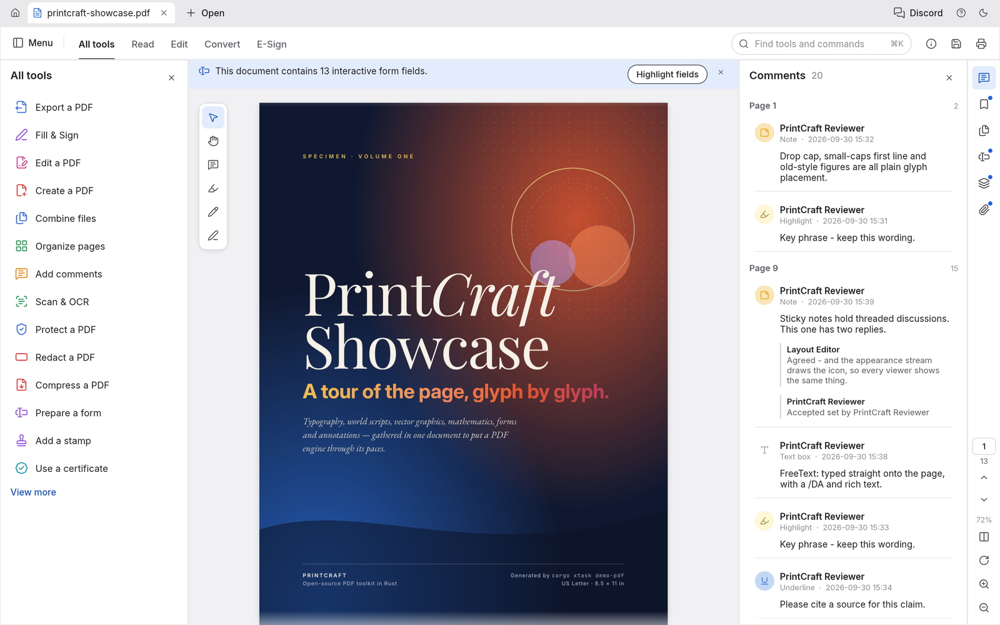
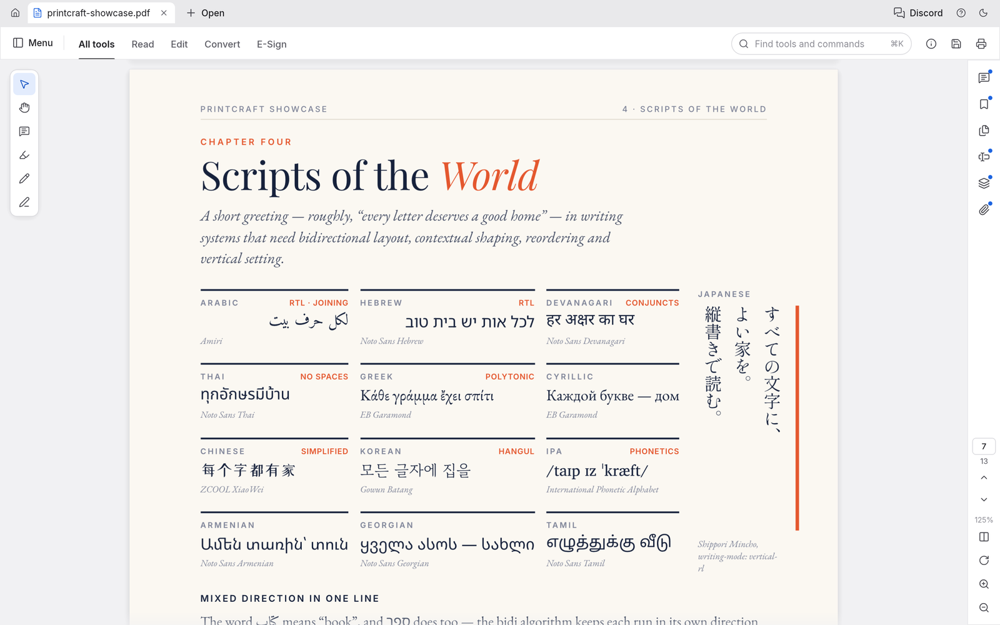
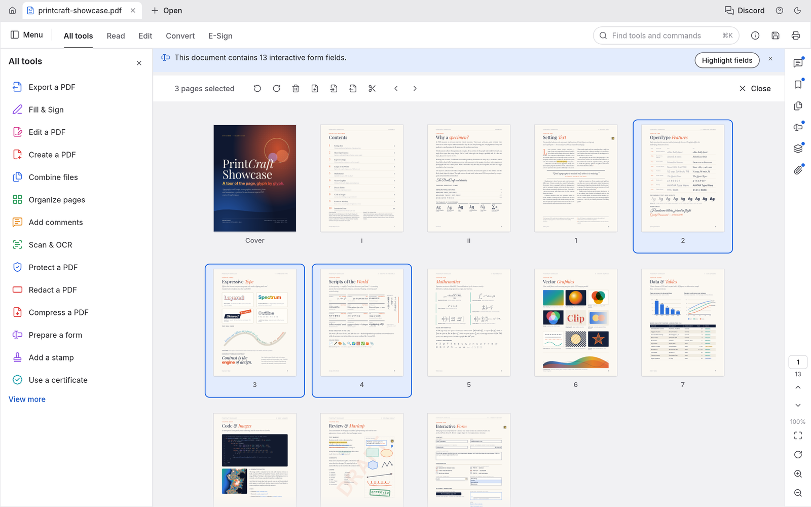
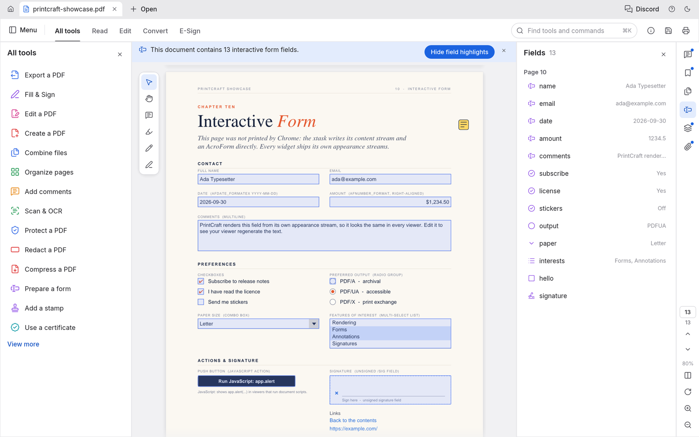
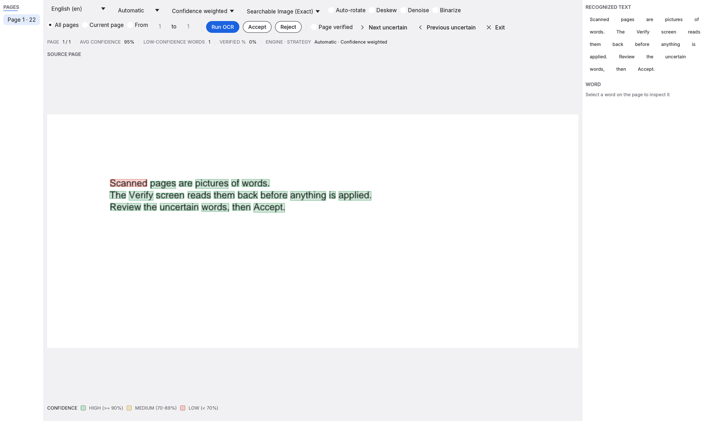

# PdfCraft

[English](README.md) · **Bahasa Indonesia**

**Aplikasi sumber terbuka untuk membaca dan mengolah PDF, ditulis sepenuhnya dengan Rust.**
Gunakan PdfCraft untuk membaca, menata halaman, menggabungkan, memisahkan, dan melindungi dokumen PDF.
Tersedia untuk macOS, Windows, Linux, FreeBSD, dan browser.

[Unduh PdfCraft](https://getartcraft.com/apps/pdfcraft) · [ArtCraft](https://getartcraft.com/) · [Komunitas Discord](https://discord.gg/artcraft)



Dokumen contoh dalam gambar adalah *PdfCraft Showcase*, PDF 13 halaman yang memperagakan kemampuan aplikasi.
Panduan ini mengikuti [README berbahasa Inggris](README.md) pada revisi `175992b5a`.
Angka pengujian dan penilaian kesiapan di bawah mengikuti laporan dalam sumber tersebut beserta periode pengukurannya.

[Membaca](#membaca-dokumen) · [Menata halaman](#menata-halaman) · [Menggabungkan dan memisahkan](#menggabungkan-dan-memisahkan-pdf) · [Keamanan](#dokumen-berkata-sandi) · [Formulir dan komentar](#komentar-formulir-lapisan-dan-lampiran) · [OCR](#memindai-dan-memeriksa-hasil-ocr) · [Otomasi](#otomasi-dan-agen-ai) · [Mulai menggunakan](#mulai-menggunakan) · [Unduhan](#pilihan-unduhan)

## Komunitas

PdfCraft adalah bagian dari [ArtCraft](https://getartcraft.com/), komunitas untuk orang yang berkarya di bidang seni digital, musik, permainan, dan media lainnya.
Temui komunitas, minta bantuan, atau sampaikan masukan melalui [Discord ArtCraft](https://discord.gg/artcraft).
Tombol Discord juga tersedia pada bilah judul aplikasi.

Kode sumber ada di [storytold/pdfcraft](https://github.com/storytold/pdfcraft).
Nama dan logo ArtCraft memiliki ketentuan merek tersendiri; lihat [Lisensi dan atribusi](#lisensi-dan-atribusi).

## Membaca dokumen

PdfCraft menangani detail tampilan PDF seperti kerning, ligatur, aksara dari kanan ke kiri, tata letak CJK vertikal, emoji berwarna, gradasi, transparansi, *soft mask*, mode pencampuran warna, dan konten opsional.

- Halaman besar dirender per ubin agar teks tetap tajam saat diperbesar.
- Setiap halaman dirender secara terpisah. Dokumen rusak dapat diperbaiki saat dibaca.
- Pilihan tampilan mencakup gulir berkelanjutan, satu halaman, dua halaman berdampingan, rotasi tampilan, layar penuh, dan mode Baca.
- Tema terang dan gelap tersedia untuk antarmuka.



Ketik untuk mencari di seluruh dokumen, lalu gunakan `⌘G` untuk berpindah ke hasil berikutnya.
Teks yang dipilih disalin mengikuti urutan baca, termasuk pada dokumen berkolom, teks dari kanan ke kiri, dan CJK.

### Menavigasi dokumen panjang

Bookmark, gambar mini halaman, dan label halaman dari dokumen (misalnya i, ii, 1, 2) membantu menemukan bagian yang dibutuhkan.
Pencarian judul pada panel Bookmark juga menemukan entri bersarang meski induknya diciutkan.
Hasil tetap menampilkan induknya sebagai konteks. Menghapus pencarian mengembalikan daftar tanpa mengubah keadaan buka atau tutup tiap cabang.

Jalankan `pdfcraft --two-paged file.pdf` atau `pdfcraft file.pdf --two-paged` untuk membuka setiap PDF dari baris perintah dalam tampilan dua halaman tanpa gulir berkelanjutan.
Opsi ini tidak mengubah tata letak bawaan yang tersimpan atau dokumen yang dipulihkan dari sesi sebelumnya.
Opsi `--layout` yang diberikan secara eksplisit tetap didahulukan untuk dokumen aktif, apa pun urutan argumennya.
Perilaku `--default-layout` untuk dokumen yang dibuka berikutnya tetap berlaku.

Klik kanan tab PDF untuk menutupnya, membuka kembali tab terakhir yang ditutup, atau menampilkan lokasi filenya.
Penutupan tetap meminta keputusan jika ada perubahan yang belum disimpan.
Membuka kembali tab membaca versi yang tersimpan di disk; perubahan yang sudah dibuang tidak dipulihkan.
Lokasi file ditampilkan di Explorer atau Finder. Di Linux dan FreeBSD, aplikasi memakai `org.freedesktop.FileManager1.ShowItems`, lalu mencoba `xdg-open` pada folder induk jika layanan itu tidak tersedia.
Membuka kembali tab dan menampilkan lokasi file tidak tersedia di web. Dokumen tanpa lokasi file juga tidak dapat ditampilkan di pengelola file.

Pada **Inspector > Halaman**, atur ukuran gambar mini dengan penggeser atau tombol perkecil/perbesar (50–150%).
Pengaturan ini mempertahankan pilihan beberapa halaman dan halaman yang sedang dilihat.
Ukurannya tetap berlaku saat file dimuat ulang, tetapi tidak disimpan setelah aplikasi dimulai ulang.
Otomasi dapat mengaturnya dengan `ui.set {"key":"thumbnail-zoom","value":"75"}` dan membacanya melalui `active.thumbnail_zoom` pada `ui.state`.

## Menata halaman

Buka **Atur halaman** untuk melihat halaman sebagai kumpulan gambar mini.
Klik untuk memilih satu halaman; gunakan `⌘`-klik atau `⇧`-klik untuk memilih beberapa halaman di macOS.
Halaman dapat diputar, dihapus, disisipi halaman kosong atau halaman dari file lain, serta dipindah urutannya.
`⌘Z` membatalkan perubahan, termasuk setelah dokumen disimpan.



Setiap perubahan menjadi satu langkah dalam riwayat yang dapat dibatalkan atau diulangi.
Menu Edit menyebut tindakan yang akan dibatalkan, misalnya pemutaran halaman.

Penyimpanan biasa menambahkan pembaruan inkremental sehingga byte asli tetap dipertahankan.
Perubahan pada objek rusak yang generasi header dan xref-nya berbeda memakai penulisan ulang penuh, dengan kedua referensi tetap mengarah ke objek yang diperbaiki.
Penulisan file bersifat atomik: hasil ditulis ke file sementara, lalu menggantikan tujuan.
Hasil simpan juga diperiksa menggunakan qpdf dalam CI.

Jika tab melebihi lebar jendela, gulir pada deretan tab dengan roda mouse, trackpad, atau bilah gulir horizontal.
Tab yang baru dibuka atau diaktifkan dibawa ke area yang terlihat.
Titik pada tab menandakan perubahan yang belum disimpan. Aplikasi meminta keputusan sebelum menutup dokumen atau keluar.
Perubahan disimpan otomatis setiap menit; setelah aplikasi berhenti secara tak terduga, sesi berikutnya menawarkan pemulihan.
Dokumen terenkripsi tetap dienkripsi pada disk.

Panel Alat dapat ditempatkan di kiri atau kanan melalui Preferensi.
Deretan ikon navigasi tetap di tepi kanan dan membuka satu panel di sebelahnya.
Seret tepi dalam panel untuk mengubah lebar; lebar tersebut disimpan.
`F4` menampilkan atau menyembunyikan panel samping, sedangkan `Shift+F4` mengatur panel Alat.
Menu Tampilan juga menyediakan pilihan tersebut dan perintah untuk mengembalikan susunan panel bawaan.

## Menggabungkan dan memisahkan PDF

**Gabungkan file** menyatukan beberapa PDF. Setiap file mendapat bookmark induk, dengan bookmark aslinya berada di bawahnya.
**Ekstrak** menyalin halaman terpilih ke dokumen baru.
**Pisahkan** membagi dokumen setiap sejumlah halaman atau sebelum halaman tertentu.

Saat halaman disalin, tautan dan tujuan bernama disesuaikan dengan halaman baru, kolom formulir disatukan beserta widget-nya, pengaturan awal lapisan dipertahankan, dan lampiran ikut dibawa.
README sumber melaporkan bahwa halaman hasil penggabungan dirender identik dengan halaman sumbernya.

```sh
pdfcraft-cli combine report.pdf appendix.pdf --out combined.pdf
pdfcraft-cli extract report.pdf --pages 1,3,5-8 --out highlights.pdf
pdfcraft-cli split report.pdf --every 10 --out-dir parts/
```

## Dokumen berkata sandi

PdfCraft menerapkan mekanisme keamanan standar PDF, mulai dari RC4 40-bit hingga AES-256.
Dukungan mencakup kata sandi pengguna dan pemilik, kata sandi Unicode yang dinormalisasi dengan SASLprep, filter kriptografi, serta enkripsi khusus lampiran.

Pembatasan yang ditetapkan pembuat dokumen ditampilkan dan dipatuhi.
Masukkan kata sandi pemilik untuk mencabut pembatasan tersebut.
Perubahan pada dokumen terenkripsi disimpan dengan enkripsi dan kunci yang sama.

**Properti dokumen** menampilkan judul, penulis, subjek, dan kata kunci yang dapat diedit; daftar font beserta status penyematannya; versi PDF dan ukuran halaman; tag, kolom formulir, lapisan, dan lampiran; serta metode enkripsi, jenis kata sandi yang dipakai untuk membuka dokumen, dan setiap izinnya.

## Komentar, formulir, lapisan, dan lampiran

Formulir menampilkan nilai saat ini, penyorotan kolom, kotak centang, tombol radio, daftar, dan tanda tangan sesuai rancangan dokumen.
Lapisan konten opsional dapat dinyalakan atau dimatikan, lalu tampilan halaman diperbarui.
Komentar ditampilkan sebagai percakapan dengan balasan. Lampiran dapat dibuka atau disimpan.



## Memindai dan memeriksa hasil OCR

**Pindai & OCR > Pengenalan teks** mengubah hasil pindai menjadi teks yang dapat dicari.
Proses dapat dijalankan pada halaman saat ini, rentang halaman, atau satu folder yang hasilnya disimpan sebagai salinan.
Pembersihan opsional mencakup rotasi otomatis, pelurusan halaman, pengurangan derau, dan konversi menjadi hitam putih.
Kotak kata dipetakan kembali ke gambar pindai asli.

Tesseract yang terpasang dapat dipakai bersama mesin bawaan. Hasil keduanya digabung sesuai strategi yang dipilih.
Hasil berupa PDF yang dapat dicari diterapkan sebagai satu langkah yang dapat dibatalkan.
Pilihan **Teks yang dapat diedit** membuka layar pemeriksaan OCR lebih dulu.
Di sana, warna menunjukkan tingkat keyakinan pengenalan setiap kata; kata yang meragukan dapat dituju dengan pintasan keyboard.
Perbaiki kata, gunakan kamus pengguna, atau jalankan ulang OCR pada area atau halaman sebelum menerima hasil dan membuat dokumen baru.
**Pindai & OCR > Koreksi teks hasil pengenalan** juga membuka pemeriksaan sebelum hasil diterapkan.



## Menemukan alat

Tekan `⌘K` untuk mencari alat dan perintah, atau telusuri katalog **Semua alat**.
Alat yang masih dikembangkan ditandai dengan tonggak pengembangan yang direncanakan.
Pencarian perintah menerima label terjemahan, label Inggris, dan ID perintah yang tetap.

## Platform dan privasi

Kode Rust yang sama mendukung aplikasi native di macOS, Windows, Linux, dan FreeBSD, serta versi WebAssembly di browser.
Windows menyediakan build x64, x86, dan ARM64; perubahan untuk ARM64 diuji pada perangkat ARM64 di CI.

PdfCraft dapat digunakan secara offline, tanpa akun, telemetri, atau pemrosesan dokumen di cloud.
Mesin pemrosesan berada dalam pustaka yang dapat digunakan kembali, terpisah dari antarmuka.
CLI memakai mesin yang sama untuk membaca struktur, merender halaman, mengekstrak teks, mengedit, menggabungkan, mengekstrak halaman, dan memisahkan dokumen.

```sh
pdfcraft-cli info form.pdf
pdfcraft-cli text paper.pdf --page 3
pdfcraft-cli edit in.pdf --rotate 1,2:90 --delete 5 --title "Q3" --out out.pdf
```

## Otomasi dan agen AI

Fitur mesin dapat dijalankan tanpa antarmuka melalui satu daftar alat dengan skema JSON.
Alatnya mencakup pembukaan dan pemeriksaan dokumen, render PNG, pencarian teks, pengelolaan halaman dan bookmark, komentar, pengisian formulir, kata sandi, metadata, pembatalan, penyimpanan, serta penggabungan dan pemisahan.
ID alat, nama argumen, nama file, dan isi PDF tidak diterjemahkan.

Tiga jalur memakai daftar alat yang sama:

1. **`pdfcraft-cli run`** untuk pemanggilan langsung dan skrip JSON.

   ```sh
   pdfcraft-cli tools
   pdfcraft-cli run text_find doc=1 query=invoice
   pdfcraft-cli run --script review.json
   pdfcraft-cli run --script steps.json --root ./work
   pdfcraft-cli run --script steps.json --report
   ```

   Nilai `key=value` dibaca sebagai JSON jika sesuai formatnya.
   `--report` menghasilkan satu dokumen JSON berisi nomor langkah, alat, status, serta hasil atau galat.
   `--root` membatasi semua file yang dibaca atau ditulis langkah skrip ke folder tersebut, termasuk PNG dari argumen `out`.
   File skrip sendiri dibaca dari lokasi yang diberikan.

2. **Server MCP** untuk agen AI. Server hanya berjalan jika diaktifkan secara eksplisit melalui `pdfcraft-cli mcp`.
   PdfCraft tidak menjalankannya otomatis dan server ini tidak membuka porta jaringan.
   Komunikasi memakai stdin/stdout; server berhenti saat koneksi agen ditutup.

   ```json
   { "mcpServers": { "pdfcraft": { "command": "pdfcraft-cli", "args": ["mcp", "--root", "/path/to/your/pdfs"] } } }
   ```

   Opsi `--compact` membuat `tools/list` menampilkan sekitar sepuluh alat inti beserta `tool_search` dan `tool_call` untuk menemukan serta menjalankan alat lain.
   Seluruh alat tetap tersedia, dengan daftar awal yang lebih ringkas.
   `--root` membatasi akses file agen ke satu folder.
   Untuk build tanpa server MCP, gunakan `cargo build -p pdfcraft-cli --no-default-features`.

3. **API Rust**, melalui `pdfcraft_automation::Automation::call`, untuk integrasi ke aplikasi lain.

Perubahan tetap berada di memori dan dapat dibatalkan sampai `doc_save` dipanggil.
Penyimpanan biasa ke file yang sama menambahkan pembaruan inkremental secara atomik.
Perubahan yang belum disimpan tidak dibuang tanpa pemberitahuan.

### Mengendalikan antarmuka

Jalankan `pdfcraft --control ~/.pdfcraft-control.json` agar agen dapat membaca pohon widget, mengeklik, mengetik, mengirim tombol dan perintah, mengatur tampilan, serta mengambil tangkapan layar.
Fitur ini juga harus diaktifkan secara eksplisit. Koneksi hanya melalui loopback dan memerlukan token acak dalam file kontrol yang hanya dapat diakses pemiliknya.

Simpan file kontrol di folder yang hanya dapat Anda tulisi, bukan folder bersama seperti `/tmp`.
CLI menolak tautan simbolis, pemilik yang berbeda, atau izin yang membuka akses bagi pengguna lain atau grup seperti Administrators.
Di macOS, Linux, dan FreeBSD, aplikasi menulis file dengan mode 600; di Windows, hanya pengguna dan SYSTEM yang diberi akses.
Aplikasi tidak dimulai jika file kontrol tidak dapat ditulis.
Pada cmd.exe, gunakan `%USERPROFILE%\.pdfcraft-control.json` karena shell tersebut tidak mengembangkan `~`.

```sh
pdfcraft-cli ui --control ~/.pdfcraft-control.json inspect query=rotate
pdfcraft-cli ui --control ~/.pdfcraft-control.json click label="Organize pages"
pdfcraft-cli ui --control ~/.pdfcraft-control.json key key=K modifiers='["command"]'
pdfcraft-cli ui --control ~/.pdfcraft-control.json command id=comment.square
pdfcraft-cli ui --control ~/.pdfcraft-control.json drag from='[400,300]' to='[600,420]'
pdfcraft-cli ui --control ~/.pdfcraft-control.json screenshot --out window.png
pdfcraft-cli ui --control ~/.pdfcraft-control.json resize width=1200 height=800
pdfcraft-cli ui --control ~/.pdfcraft-control.json focus label="Read"
pdfcraft-cli ui --control ~/.pdfcraft-control.json inspect focused=true
pdfcraft-cli ui --control ~/.pdfcraft-control.json quit
```

Contoh `label` di atas memakai antarmuka Inggris. Gunakan label yang tampil pada bahasa aktif atau ID widget yang diperoleh dari `inspect`.
`ui.panel` menerima `{"panel":"tools"|"side","open":true|false,"width":320}`.
Lebar dibatasi menjadi 240–520 poin untuk Alat dan 260–520 poin untuk panel samping.
`ui.dock.reset` mengembalikan susunan panel bawaan.
Metode ini juga dapat dipanggil melalui `ui.command` dengan `{"id":"ui.panel","params":{...}}`.
Permintaan yang tidak valid mengembalikan galat tanpa mengubah dokumen atau panel.

`resize` meminta ukuran bagian dalam jendela dalam satuan logis, 320–8192 untuk setiap sisi; pengelola jendela dapat membatasinya lagi.
Ukuran aktual tersedia melalui `window.width`, `window.height`, dan `window.pixels_per_point` pada `state`.
`focus` menerima tepat satu ID widget atau label unik yang aktif dan dapat menerima fokus.
`quit` tidak menerima parameter. Jika masih ada perubahan atau teks yang sedang diketik, dialog Simpan/Jangan simpan/Batal tetap muncul dan hasil melaporkan `quitting: false, needs_confirmation: true`.
Pengubahan ukuran jendela dan perintah keluar hanya tersedia pada versi native.

## Susunan kode dan pengujian

PdfCraft memakai workspace Cargo berlapis agar mesin inti tidak bergantung pada antarmuka.

| Crate | Tugas |
|---|---|
| `pdfcraft-filters` | Enkode/dekode filter stream PDF: Flate, LZW, ASCII85, RunLength, dan prediktor |
| `pdfcraft-crypt` | Enkripsi standar PDF, RC4, AES-128/256, revisi 2–6, dan izin |
| `pdfcraft-cos` | Objek PDF, parsing toleran, perbaikan, pengeditan copy-on-write, penulisan inkremental dan penuh |
| `pdfcraft-organize` | Halaman, gabung/ekstrak/pisah, bookmark, label halaman, dan informasi dokumen |
| `pdfcraft-fonts` | Metrik dan pengodean font untuk tampilan yang dibuat aplikasi |
| `pdfcraft-annot` | Komentar, tampilan anotasi, balasan, status, dan pengeditan |
| `pdfcraft-forms` | Model kolom formulir, pengisian, pembaruan tampilan, dan pengosongan formulir |
| `pdfcraft-render` | Render, pemeriksaan, dan ekstraksi teks menurut urutan baca |
| `pdfcraft-engine` | Sesi, perubahan, riwayat pembatalan, penyimpanan, dan katalog alat |
| `pdfcraft-automation` | Alat tanpa GUI, `pdfcraft-cli run`, dan server MCP opsional |
| `pdfcraft-ui-egui` | Antarmuka desktop dan web |

Pemeriksaan otomatis mencakup format kode, Clippy dengan peringatan sebagai galat, uji unit/properti/antarmuka, aturan lapisan crate, build WebAssembly, dan audit lisensi aset.
Dalam pengukuran korpus yang dicatat README sumber, 963 dari 983 file uji pdf.js terbuka dan dirender dengan baik, tanpa crash; 958 berhasil melewati siklus buka, edit, dan simpan.
Hasil diperiksa dengan implementasi pembanding: hayro dan qpdf pada CI, serta poppler untuk korpus melalui `cargo xtask text-oracle`.

PdfCraft dikembangkan dengan pendekatan *clean room*: perilaku mengacu pada spesifikasi ISO 32000 dan pengamatan keluaran perangkat lunak, tanpa menyalin kode implementasi produk lain.
Sumber dan lisensi ikon, font, gambar, serta aset lain tercatat di [ATTRIBUTION.md](ATTRIBUTION.md).

## Mulai menggunakan

Untuk langsung memakai aplikasi, unduh paket siap pakai dari [halaman PdfCraft](https://getartcraft.com/apps/pdfcraft).
Untuk membangun dari sumber, diperlukan Rust 1.95 atau lebih baru.

```sh
git clone https://github.com/storytold/pdfcraft
cd pdfcraft
cargo xtask models
cargo run --release -p pdfcraft -- some.pdf
cargo xtask demo-pdf
cargo xtask screenshots
```

`cargo xtask models` mengambil model OCR yang diperlukan Pindai & OCR; paket rilis sudah menyertakannya.
Dua perintah terakhir membuat PDF contoh dan tangkapan layar untuk README.
Catatan pengembangan, lokasi log, dan variabel lingkungan ada di [docs/development.md](docs/development.md).

### Memilih Bahasa Indonesia

Paket rilis menyertakan katalog terjemahan. Jika membangun dari sumber dengan perintah di atas,
siapkan `CRAFT_I18N_DIR` lebih dulu seperti contoh berikut. Tanpanya, build hanya menyediakan bahasa Inggris.

Terjemahan antarmuka disimpan dalam [craft-i18n](https://github.com/storytold/craft-i18n), pada `locales/id/common.tsv` dan `locales/id/pdfcraft.tsv`.
Versi yang disertakan dalam aplikasi ditentukan oleh `craft-i18n.rev`.
Terjemahan baru tersedia pada rilis setelah perubahan katalog digabung dan pin aplikasi diperbarui.
Teks yang belum diterjemahkan tetap tampil dalam bahasa Inggris.
Nama file, isi dokumen, nama penulis, nama tindakan buatan pengguna, dan rincian galat mesin atau sistem operasi tetap memakai teks aslinya.

Untuk membangun aplikasi dengan katalog terjemahan di PowerShell:

```powershell
git clone https://github.com/storytold/craft-i18n ../craft-i18n
$env:CRAFT_I18N_DIR = (Resolve-Path ../craft-i18n).Path
cargo run --release -p pdfcraft -- some.pdf
```

Di macOS atau Linux, gunakan shell POSIX:

```sh
git clone https://github.com/storytold/craft-i18n ../craft-i18n
CRAFT_I18N_DIR="$(cd ../craft-i18n && pwd)" cargo run --release -p pdfcraft -- some.pdf
```

Untuk mereproduksi katalog suatu rilis, checkout commit yang tercantum pada `craft-i18n.rev` di repo craft-i18n.
Penjelasan format katalog dan cara menambah bahasa ada di [docs/localization.md](docs/localization.md).

Setelah aplikasi dengan katalog terjemahan dijalankan, buka **Menu > Edit > Preferensi…**,
lalu pilih **Bahasa Indonesia** pada pilihan bahasa antarmuka.
Di macOS, Preferensi dapat dibuka dengan `⌘,`; di platform lain, gunakan `Ctrl+,`.
Pengaturan ini dapat diubah meski belum ada dokumen yang terbuka dan akan disimpan untuk sesi berikutnya.
Pilihan otomatis mengikuti bahasa sistem.

Font Jepang berasal dari [craft-fonts](https://github.com/storytold/craft-fonts), masukan build opsional yang disertakan dalam rilis.
Contoh untuk shell POSIX:

```sh
git clone https://github.com/storytold/craft-fonts ../craft-fonts
CRAFT_FONTS_DIR=../craft-fonts cargo run --release -p pdfcraft -- some.pdf
```

Di Gentoo, overlay komunitas [::snakebyte](https://github.com/switch87/snakebyte-overlay) menyediakan `app-text/pdfcraft-bin`; paket ini tidak dikelola tim PdfCraft.

```sh
eselect repository add snakebyte git https://github.com/switch87/snakebyte-overlay.git
emaint sync -r snakebyte
echo 'app-text/pdfcraft-bin ~amd64' >> /etc/portage/package.accept_keywords/pdfcraft
emerge --ask app-text/pdfcraft-bin
```

## Status pengembangan

PdfCraft masih **alpha** dan berkembang cepat.
Penilaian README sumber untuk Oktober 2026 mencatat sekitar 57% fitur yang dilacak sudah tersedia dalam suatu bentuk dan 94% kebutuhan inti telah tercakup.
Perkiraan kesiapan saat itu: 55% untuk alur kerja harian, 49% untuk seluruh alur kerja profesional, dan 66% untuk penggunaan yang hanya memerlukan fitur dasar.
Angka ini adalah penilaian pada periode tersebut, bukan jaminan kelengkapan versi terbaru.

Membaca, mencari, menata halaman, berkomentar, mengisi formulir, kata sandi, sensor, tanda tangan dasar, pencetakan, pemeriksaan aksesibilitas, serta CLI/MCP sudah tersedia.
Render halaman masih memakai hayro selama renderer proyek sendiri dikembangkan.
Bagian yang masih perlu ditingkatkan mencakup pengeditan teks yang andal (terutama CJK dan kanan-ke-kiri), OCR di luar aksara Latin, impor/ekspor dokumen kantor, token tanda tangan dan validasi jangka panjang, Preflight dan PDF/X/UA, pencetakan web, ketepatan hasil printer fisik, serta XFA.
Fuzzing masih menemukan crash dan hang pada file bermasalah; perbaikannya disertai uji regresi.

Urutan prioritas dalam README sumber: konversi dokumen kantor ke PDF dan ekspor DOCX yang mempertahankan tata letak, bug yang dilaporkan dan font antarmuka Tionghoa, pengujian ketepatan render, pengeditan konten, lalu alur kerja profesional dan penyempurnaan menuju 1.0.
Lihat [ROADMAP.md](ROADMAP.md), [penilaian kemampuan](docs/target-app-parity.md), [daftar kekurangan](docs/gaps.md), dan [tonggak pengembangan](docs/roadmap.md) untuk rinciannya.

## Pilihan unduhan

[Rilis terbaru di GitHub](https://github.com/storytold/pdfcraft/releases/latest) menyediakan paket berikut.
[Semua rilis](https://github.com/storytold/pdfcraft/releases) memuat versi sebelumnya dan catatan perubahan.
`<ver>` pada nama file berarti nomor versi; `SHA256SUMS.txt` berisi checksum setiap paket.

### Windows

| Arsitektur | Installer | Portabel |
|---|---|---|
| x64, Intel/AMD 64-bit | `pdfcraft-<ver>-windows-x64.msi` | `pdfcraft-<ver>-windows-x64-portable.zip` |
| ARM64, termasuk Snapdragon | `pdfcraft-<ver>-windows-arm64.msi` | `pdfcraft-<ver>-windows-arm64-portable.zip` |
| x86, 32-bit | `pdfcraft-<ver>-windows-x86.msi` | `pdfcraft-<ver>-windows-x86-portable.zip` |

Installer dan executable memiliki tanda tangan kode.
Paket portabel dapat dijalankan dari folder mana pun, termasuk flashdisk.
File `portable.txt` membuat pengaturan, log, dan pemulihan disimpan di folder `PdfCraftData` di sebelah `pdfcraft.exe`, tanpa menulis ke `%APPDATA%`.
Hapus file tersebut untuk kembali memakai folder pengguna biasa.
Versi portabel tidak mendaftarkan diri sebagai aplikasi PDF bawaan di Windows.
`portable.txt` memuat perintah PowerShell untuk mendaftarkannya bagi pengguna saat ini dan membatalkan pendaftaran tersebut.

MSI memasang aplikasi untuk akun saat ini secara bawaan, tanpa hak administrator.
Untuk semua pengguna, pilih “Everyone on this computer” pada halaman pertama atau jalankan dari terminal administrator dengan `ALLUSERS=1`.
Menu klik kanan menyediakan “Edit with PdfCraft” dan “Combine files in PdfCraft” untuk PDF, serta “Create PDF with PdfCraft…” untuk gambar `.png .jpg .jpeg .tif .tiff .gif .bmp .jp2 .j2k .jpx`.
Pada Windows 11, pilihan ini ada di “Show more options”. Aplikasi bawaan tidak diubah.
Beberapa PDF yang dipilih untuk digabung dibuka pada tab Gabungkan file di aplikasi yang sedang berjalan.

Contoh instalasi tanpa interaksi dan tanpa pintasan desktop:

```powershell
msiexec /i "pdfcraft-<ver>-windows-x64.msi" /qn /norestart INSTALLDESKTOPSHORTCUT=0
```

| Properti bernilai `0` | Yang tidak dipasang |
|---|---|
| `INSTALLDESKTOPSHORTCUT` | Pintasan desktop |
| `INSTALLPDFCONTEXTMENU` | Menu klik kanan PDF |
| `INSTALLIMAGECONTEXTMENU` | Menu klik kanan gambar |

Ketiganya aktif pada instalasi pertama.
Pembaruan mempertahankan pilihan instalasi dan pintasan yang sudah dihapus pengguna.
Argumen eksplisit tetap didahulukan: `=1` memasang kembali, `=0` meniadakan.
Pembaruan dari versi sebelum menu tersebut ada menambahkannya seperti instalasi pertama (0.6.0 dan sebelumnya untuk menu PDF, 0.2.1 dan sebelumnya untuk gambar).
Gunakan MSI yang sesuai arsitektur. Penggantian pengaturan instalasi per pengguna tidak didukung.

Folder instalasi dapat diubah melalui halaman awal atau argumen `INSTALLFOLDER="D:\Apps\PdfCraft"`.
Pembaruan mempertahankan folder lama kecuali diberi lokasi lain secara eksplisit.
Lingkup pengguna tetap mengikuti pilihan pada halaman awal atau `ALLUSERS=1`.

Untuk deployment, patok checksum selain nomor versi.
MSI hanya memakai angka pada versinya, sehingga `1.2.3-rc.1` dan `1.2.3` sama-sama tercatat sebagai `1.2.3`; paket dengan versi sama dapat saling menggantikan.
Gunakan SHA-256 dari `SHA256SUMS.txt`, lalu periksa dengan `Get-FileHash <file> -Algorithm SHA256`.

MSI dan kedua executable Windows ditandatangani melalui Azure Trusted Signing dengan sertifikat `Learning Machines Inc` (Atlanta, Georgia, AS).
Publisher MSI pada daftar aplikasi terpasang adalah `Learning Machines LLC`.

### macOS

| Paket universal, Apple silicon dan Intel | File |
|---|---|
| Aplikasi | `pdfcraft-<ver>-macos-universal.dmg` |
| CLI | `pdfcraft-cli-<ver>-macos-universal.zip` |

Keduanya ditandatangani dengan Developer ID `Learning Machines LLC (DJ6XS33FX8)` dan dinotarisasi.

### Linux

| Format | x86_64 | aarch64/ARM64 |
|---|---|---|
| AppImage | `pdfcraft-<ver>-linux-x86_64.AppImage` | `pdfcraft-<ver>-linux-aarch64.AppImage` |
| Flatpak | `pdfcraft-<ver>-linux-x86_64.flatpak` | `pdfcraft-<ver>-linux-aarch64.flatpak` |
| Debian/Ubuntu | `pdfcraft-<ver>-linux-x86_64.deb` | `pdfcraft-<ver>-linux-aarch64.deb` |
| Fedora/RHEL/openSUSE | `pdfcraft-<ver>-linux-x86_64.rpm` | `pdfcraft-<ver>-linux-aarch64.rpm` |
| Tarball | `pdfcraft-<ver>-linux-x86_64.tar.gz` | `pdfcraft-<ver>-linux-aarch64.tar.gz` |
| CLI saja | `pdfcraft-cli-<ver>-linux-x86_64.tar.gz` | `pdfcraft-cli-<ver>-linux-aarch64.tar.gz` |

AppImage mendukung pembaruan melalui [AppImageUpdate](https://github.com/AppImageCommunity/AppImageUpdate) dan file `.zsync`.
Flatpak berjalan dalam sandbox dan dapat dipasang dengan `flatpak install --user <file>`.
Tarball dapat diekstrak ke lokasi pilihan.
Paket CLI ditujukan untuk server, CI, dan agen, termasuk server MCP yang harus diaktifkan secara eksplisit.

Build RISC-V hanya tersedia sebagai `pdfcraft-<ver>-linux-riscv64.tar.gz` dan `pdfcraft-cli-<ver>-linux-riscv64.tar.gz`.
Keduanya dibangun silang dan memerlukan glibc 2.39 atau lebih baru (Ubuntu 24.04+, Debian 13+).
Build Linux lainnya memerlukan glibc 2.35 atau lebih baru (Ubuntu 22.04+, Debian 12+, Fedora 36+, RHEL 10).

### FreeBSD dan web

FreeBSD x86_64 tersedia sebagai `pdfcraft-<ver>-freebsd-x86_64.tar.gz`.
Versi web tersedia sebagai `pdfcraft-web-<ver>.zip`; isinya dapat dihosting sebagai situs statis dan dijalankan di browser modern.

## Crafting Apps

PdfCraft termasuk dalam keluarga aplikasi kreatif sumber terbuka dari tim ArtCraft.
Masing-masing ditulis dari awal dengan Rust dan dapat digunakan sendiri.

| Aplikasi | Kegunaan | Kode |
|---|---|---|
| [PhotoCraft](https://getartcraft.com/apps/photocraft) | Pengeditan gambar, lapisan, mask, teks, dan PSD | [GitHub](https://github.com/storytold/photocraft) |
| [VectorCraft](https://getartcraft.com/apps/vectorcraft) | Ilustrasi vektor | [GitHub](https://github.com/storytold/vectorcraft) |
| [FilmCraft](https://getartcraft.com/apps/filmcraft) | Pengeditan video, warna, dan suara | [GitHub](https://github.com/storytold/filmcraft) |
| [LightCraft](https://getartcraft.com/apps/lightcraft) | Pustaka foto dan pengolahan RAW | [GitHub](https://github.com/storytold/lightcraft) |
| [PdfCraft](https://getartcraft.com/apps/pdfcraft) | Membaca, menata, dan melindungi PDF | [GitHub](https://github.com/storytold/pdfcraft) |
| [EffectCraft](https://getartcraft.com/apps/effectcraft) | Grafis gerak dan efek visual | [GitHub](https://github.com/storytold/effectcraft) |
| [DesignCraft](https://getartcraft.com/apps/designcraft) | Tata letak halaman dan penerbitan | [GitHub](https://github.com/storytold/designcraft) |
| [FigCraft](https://getartcraft.com/apps/figcraft) | Desain antarmuka dan prototipe | [GitHub](https://github.com/storytold/figcraft) |
| [WordCraft](https://getartcraft.com/apps/wordcraft) | Pengolah kata dan dokumen | [GitHub](https://github.com/storytold/wordcraft) |
| [SoundCraft](https://getartcraft.com/apps/soundcraft) | Perekaman dan pengeditan audio | [GitHub](https://github.com/storytold/soundcraft) |
| [DeckCraft](https://getartcraft.com/apps/deckcraft) | Presentasi dan slide | [GitHub](https://github.com/storytold/deckcraft) |
| [CADCraft](https://getartcraft.com/apps/cadcraft) | Desain berbantuan komputer | [GitHub](https://github.com/storytold/cadcraft) |
| [GridCraft](https://getartcraft.com/apps/gridcraft) | Lembar kerja dan data | [GitHub](https://github.com/storytold/gridcraft) |
| [TextureCraft](https://getartcraft.com/apps/texturecraft) | Pengecatan tekstur 3D | [GitHub](https://github.com/storytold/texturecraft) |
| [Craft Anything](https://getartcraft.com/apps/craft-anything) | Memahami cara kerja perangkat lunak lalu membuat versi sendiri | [GitHub](https://github.com/storytold/craft-anything) |
| SolidCraft, aplikasi komunitas Tangency Labs | CAD 3D parametrik | [GitHub](https://github.com/tangency-labs/solidcraft) |

[ArtCraft](https://getartcraft.com/) juga menyediakan studio gambar dan video AI.
Bagikan karya, minta bantuan, laporkan masalah, atau usulkan kemampuan baru di [Discord](https://discord.gg/artcraft).

## Lisensi dan atribusi

PdfCraft memakai lisensi ganda: pilih [MIT](LICENSE-MIT) atau [Apache-2.0](LICENSE-APACHE).
Hak cipta © 2026 ArtCraft Team dan para kontributor PdfCraft. Pemberitahuan yang diwajibkan tercantum dalam [NOTICE](NOTICE).

Font, ikon, gambar, dan aset yang disertakan tetap memakai lisensinya masing-masing.
Penulis, sumber, dan lisensi setiap aset dicatat di [ATTRIBUTION.md](ATTRIBUTION.md).
Build rilis juga menyertakan font Jepang dari [craft-fonts](https://github.com/storytold/craft-fonts/blob/main/ATTRIBUTION.md), berlisensi SIL Open Font License 1.1.

Nama, wordmark, dan logo ArtCraft dalam [docs/brand/](docs/brand/) adalah merek dagang ArtCraft Team dan tidak tercakup dalam lisensi kode.
Penggunaannya hanya diizinkan tanpa perubahan, sebagai bagian dari repo ini dan PdfCraft, sesuai [LICENSE-brand.txt](docs/brand/LICENSE-brand.txt).
Fork dan versi modifikasi harus menghapus merek tersebut.
