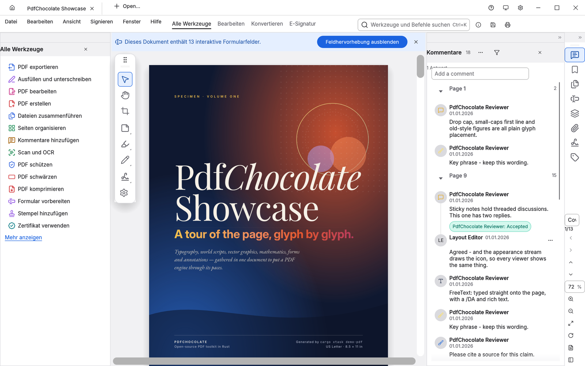

<p align="center">
  
</p>

<h1 align="center">PdfChocolate</h1>

<p align="center">
  <b>Ein PDF-Programm zum Lesen und Bearbeiten, geschrieben in Rust.</b><br>
  Lokal, ohne Konto, ohne Telemetrie, ohne Update-Abfragen und ohne Links ins Netz.
</p>

PdfChocolate ist ein Fork von [PdfCraft](https://github.com/storytold/pdfcraft). Es hat dieselben
PDF-Funktionen, ist aber auf das Programm selbst reduziert:

- **Keine Community-, Web- oder Discord-Links** in Titelleiste, Startseite, Hilfe-Menü, Info-Dialog
  oder Kommandozeile.
- **Kein Update-Check.** Die App fragt nie einen Server nach neuen Versionen.
- **Schlichte Startseite:** zuletzt geöffnete Dateien und angeheftete Ordner, keine Werkzeug-Empfehlungen.
- **Keine Web-Version** (WebAssembly), nur die Desktop-App und die Kommandozeile.
- **Eigener Name, eigenes Icon und eigene Ordner.** PdfChocolate lässt sich neben PdfCraft installieren,
  ohne dass sich die beiden Einstellungen, Registry-Einträge oder Dateizuordnungen teilen.

PdfChocolate wird nicht vom ArtCraft-Team gemacht oder unterstützt.

<p align="center">
  
</p>

## Was es kann

- **Lesen:** präzises Rendering mit Schriften aller Schriftsysteme, vertikalem Japanisch, Farb-Emoji,
  Transparenz und Ebenen. Gekachelte Darstellung, die auch bei starkem Zoom scharf bleibt. Fortlaufende,
  Einzel- und Doppelseiten-Ansicht, Vollbild, Lesemodus, helles und dunkles Design.
- **Finden und kopieren:** Suche während der Eingabe, Textauswahl in richtiger Lesereihenfolge,
  Lesezeichen, Miniaturen und Seitenbeschriftungen.
- **Seiten organisieren:** drehen, löschen, einfügen, verschieben. Dateien zusammenführen, Seiten
  extrahieren und Dokumente aufteilen, wobei Links, Formularfelder, Ebenen und Anhänge erhalten bleiben.
- **Kommentare, Formulare, Ebenen, Anhänge:** Kommentare als Unterhaltungen, Formulare ausfüllen,
  Ebenen ein- und ausschalten, Anhänge öffnen und speichern.
- **Geschützte Dokumente:** der vollständige PDF-Standard-Sicherheitshandler, von RC4 40 Bit bis AES-256.
  Berechtigungen werden respektiert, und Änderungen bleiben verschlüsselt.
- **Texterkennung (OCR)** für gescannte Seiten, mit einer Prüfansicht, in der man erkannte Wörter vor
  dem Übernehmen korrigiert.
- **Sicheres Speichern:** Änderungen werden angehängt, die Originalbytes bleiben erhalten. Dazu
  atomares Schreiben, tiefes Rückgängig-Machen, automatisches Sichern jede Minute und Wiederherstellung
  nach einem Absturz.
- **Alle Werkzeuge per Tastatur:** <kbd>Strg</kbd>+<kbd>K</kbd> durchsucht jeden Befehl.

## Kommandozeile und Automatisierung

`pdfchocolate-cli` kann alles ohne Oberfläche: Dokumente untersuchen, Text auslesen, Seiten bearbeiten,
zusammenführen und aufteilen.

```sh
pdfchocolate-cli info    formular.pdf                                   # Aufbau als JSON
pdfchocolate-cli text    bericht.pdf --page 3                           # Text in Lesereihenfolge
pdfchocolate-cli combine bericht.pdf anhang.pdf --out gesamt.pdf
pdfchocolate-cli split   bericht.pdf --every 10 --out-dir teile/
```

Für KI-Assistenten gibt es einen **MCP-Server** (`pdfchocolate-cli mcp`), über den ein Assistent PDFs
bearbeiten kann. Er ist standardmäßig aus, öffnet keinen Netzwerk-Port und läuft nur, solange ein
Assistent ihn startet. Mit `--root <Ordner>` bleibt jeder Dateizugriff auf diesen Ordner beschränkt.
Wer ihn gar nicht im Programm haben will, baut mit `cargo build -p pdfcraft-cli --no-default-features`.
Details stehen in [crates/automation/README.md](crates/automation/README.md).

## Selbst bauen (Windows)

Voraussetzungen: [Rust](https://rustup.rs) 1.95 oder neuer und die Microsoft C++ Build Tools
(Workload „Desktopentwicklung mit C++“).

```powershell
git clone https://github.com/latechocolate/pdfchocolate
# Übersetzungen: storytold/craft-i18n neben das Repo legen, auf dem Stand aus craft-i18n.rev
git clone https://github.com/storytold/craft-i18n
git -C craft-i18n checkout (Get-Content pdfchocolate\craft-i18n.rev)
cd pdfchocolate
cargo build --release -p pdfcraft
.\target\release\pdfchocolate.exe
```

`.cargo/config.toml` findet die Übersetzungen unter `../craft-i18n`. Fehlt der Ordner, ist die
Oberfläche nur auf Englisch. Der erste Release-Build dauert lange (eine Stunde und mehr auf einem
Laptop), spätere gehen deutlich schneller.

Der Windows-Installer (MSI) entsteht mit `packaging/windows/package.ps1` und braucht WiX 5. Die
Installation landet unter `%LOCALAPPDATA%\Programs\PdfChocolate`, für alle Benutzer unter
`Program Files\PdfChocolate`. Siehe [packaging/windows/INSTALLATION.md](packaging/windows/INSTALLATION.md).

Die Icons erzeugt `packaging/icons.ps1` aus `assets/app-icon/pdfchocolate-512.png`.

## Aufbau

Ein Cargo-Workspace aus Bibliotheks-Crates, die nicht von der Oberfläche abhängen (`crates/`), der
Desktop-App (`apps/pdfcraft`, erzeugt `pdfchocolate.exe`) und der Kommandozeile (`apps/pdfcraft-cli`).
Die Crate- und Modulnamen heißen weiter `pdfcraft*`, damit sich Änderungen aus PdfCraft leicht
übernehmen lassen. Mehr dazu in [docs/architecture.md](docs/architecture.md) und
[docs/development.md](docs/development.md).

## Lizenz und Danksagung

MIT oder Apache-2.0, nach Wahl ([LICENSE-MIT](LICENSE-MIT), [LICENSE-APACHE](LICENSE-APACHE)).

PdfChocolate baut vollständig auf PdfCraft auf. Copyright am Code von PdfCraft liegt beim ArtCraft-Team
und den PdfCraft-Mitwirkenden. Hinweise zu Drittmaterial stehen in [NOTICE](NOTICE) und
[ATTRIBUTION.md](ATTRIBUTION.md).
