[English](https://github.com/storytold/pdfcraft/blob/main/README.md) · Русский · [Français](https://github.com/storytold/pdfcraft/blob/main/README.fr.md)

<p align="center">
  <a href="https://getartcraft.com/">
    <picture>
      <source media="(prefers-color-scheme: dark)" srcset="docs/brand/artcraft-logo-white.svg">
      
    </picture>
  </a>
</p>


<p align="center">
  
</p>

<h1 align="center">PdfCraft</h1>

<p align="center">
  <b>Верстак для PDF; современный открытый просмотрщик и редактор PDF, написанный на чистом Rust.</b><br>
  Читайте, упорядочивайте, объединяйте, разделяйте и защищайте PDF в быстром нативном приложении, созданном на Rust с нуля.<br>
  macOS · Windows · Linux · FreeBSD · веб
</p>

<p align="center">
  
  
  
  
  <br>
  <a href="https://sonarcloud.io/project/overview?id=storytold_pdfcraft"></a>
  <a href="https://coderabbit.ai"></a>
</p>

<p align="center">
  <a href="https://discord.gg/artcraft"></a>
</p>

<p align="center">
  <a href="https://getartcraft.com/apps/pdfcraft"><b>PdfCraft на getartcraft.com</b></a> ·
  <a href="https://getartcraft.com/">ArtCraft</a> ·
  <a href="https://getartcraft.com/apps">Все приложения Crafting</a>
</p>

<br>

<p align="center">
  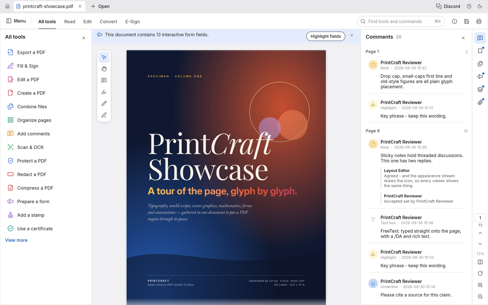
  <br>
  <sub>PdfCraft Showcase — образец PDF из 13 страниц — открыт с панелью «Все инструменты» и вложенными комментариями.</sub>
</p>

> [!NOTE]
> **ArtCraft — сообщество художников из самых разных сфер.** Цифровое искусство, генеративное, музыка,
> игры — если вы создаёте что-то, вы один из нас. **[Загляните в Discord](https://discord.gg/artcraft).**

<p align="center">
  <a href="#главное">Особенности</a> ·
  <a href="#читайте-pdf-с-комфортом">Чтение</a> ·
  <a href="#находите-выделяйте-копируйте">Поиск</a> ·
  <a href="#упорядочивайте-страницы-как-карточки">Организация</a> ·
  <a href="#объединяйте-и-разделяйте-без-потерь">Объединение и разделение</a> ·
  <a href="#открывайте-защищённые-документы-с-соблюдением-ограничений">Защита</a> ·
  <a href="#комментарии-формы-слои-и-вложения">Формы и слои</a> ·
  <a href="#работает-везде-и-остаётся-вашим">Везде</a> ·
  <a href="#подходит-и-для-ии-агентов">Агенты</a> ·
  <a href="#как-устроен-проект">Как устроено</a> ·
  <a href="#начало-работы">Начало работы</a> ·
  <a href="#планы-развития">Что дальше</a> ·
  <a href="#загрузка">Загрузки</a> ·
  <a href="#приложения-crafting">Приложения Crafting</a>
</p>

---

## Сообщество

PdfCraft — часть [ArtCraft](https://getartcraft.com). Заходите поздороваться, получить помощь и следить за разработкой:

- **Discord: [discord.gg/artcraft](https://discord.gg/artcraft)**. Самый быстрый способ получить помощь и поделиться отзывами. В приложении есть кнопка Discord в строке заголовка.
- **Веб-страница:** [getartcraft.com/apps/pdfcraft](https://getartcraft.com/apps/pdfcraft)
- **Исходный код:** [github.com/storytold/pdfcraft](https://github.com/storytold/pdfcraft)

Название ArtCraft и логотипы в `docs/brand/` являются товарными знаками команды ArtCraft и не являются открытыми. Их можно использовать только в неизменном виде и только в составе PdfCraft (см. `docs/brand/LICENSE-brand.txt`). Форки и изменённые версии должны их удалить.

## Главное

<table>
<tr>
<td width="33%" valign="top">

### Точность
Реальная типографика: мировые системы письма, вертикальный японский, цветные эмодзи, градиенты, мягкие маски и прозрачность. Всё отображается так, как задумал автор.

</td>
<td width="33%" valign="top">

### Надёжность
Обычное сохранение добавляет ваши изменения, оставляя исходные байты нетронутыми. Правки повреждённых объектов, у которых поколения xref и заголовка не совпадают, используют полную перезапись, сохраняя обе принятые ссылки, подключённые к одному и тому же восстановленному объекту. Записи атомарны, отмена работает глубоко, и ничего не теряется, если вы закроете окно по ошибке.

</td>
<td width="33%" valign="top">

### Конфиденциальность
Без аккаунта, без телеметрии, без облака. Работает офлайн и открывается мгновенно. Движок, CLI и приложение — всё с открытым исходным кодом.

</td>
</tr>
</table>

---

## Читайте PDF с комфортом

PdfCraft отображает PDF с вниманием к деталям, которые делают страницу правильной: кернинг и лигатуры, письмо справа налево и сложные скрипты, вертикальный CJK, цветные эмодзи, заливки, режимы наложения, мягкие маски и опциональный контент.

<p align="center">
  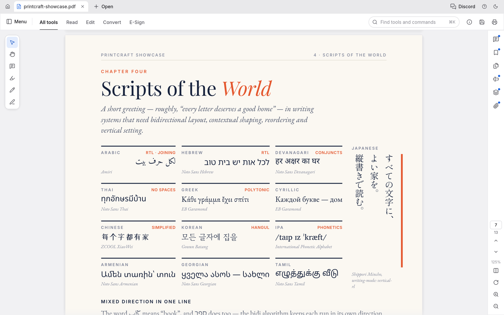
  <br>
  <sub>Двенадцать систем письма на одной странице плюс вертикальный японский при 125%.</sub>
</p>

- **Глубокий зум остаётся чётким.** Большие страницы рендерятся тайлами, поэтому текст остаётся острым при любом увеличении.
- **Создано, чтобы переживать плохие файлы.** Каждая страница рендерится изолированно, повреждённые документы восстанавливаются. На корпусе из 983 файлов pdf.js результат — 0 сбоев.
- **Макеты для любой задачи:** непрерывный, одна страница, разворот, поворот вида, полный экран и режим чтения без отвлечений.
- **Светлая и тёмная темы**, обе спроектированы так, чтобы глаза меньше уставали при долгой работе.

<table>
<tr>
<td width="50%">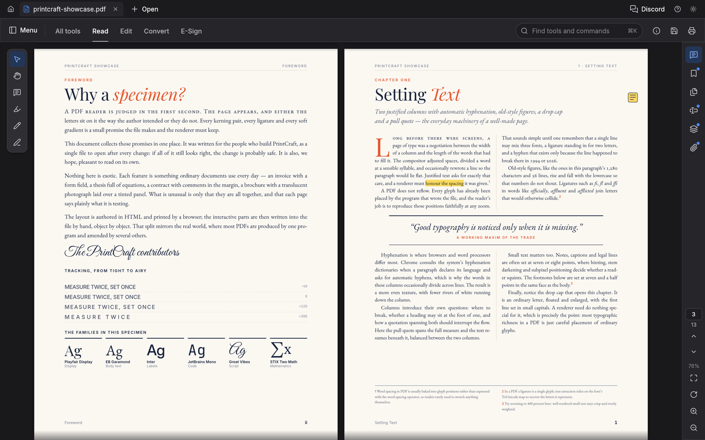</td>
<td width="50%">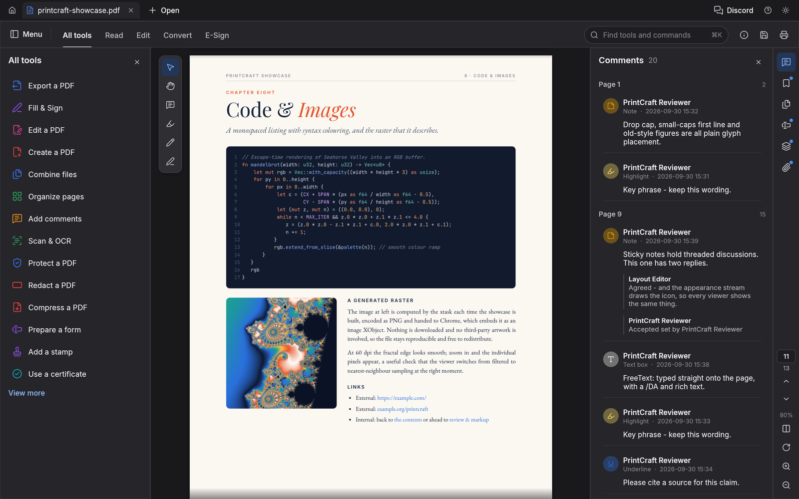</td>
</tr>
<tr>
<td align="center"><sub>Режим чтения разворотом, готов для долгого чтения</sub></td>
<td align="center"><sub>Тёмная тема с открытой панелью комментариев</sub></td>
</tr>
</table>

## Находите, выделяйте, копируйте

Ищите по всему документу по мере ввода, переходите по совпадениям с <kbd>⌘G</kbd> и выделяйте текст в правильном порядке чтения. Это работает и для колонок, и для письма справа налево, и для CJK.

## Навигация по большим документам

Запускайте с `pdfcraft --two-paged file.pdf` (или `pdfcraft file.pdf --two-paged`), чтобы открыть каждый PDF из командной строки в неразрывном двухстраничном виде. Этот необязательный переключатель запуска не меняет сохранённые предпочтения макета по умолчанию и PDF, восстановленные из предыдущей сессии. Явный параметр `--layout` имеет приоритет для активного документа независимо от порядка аргументов; `--default-layout` сохраняет существующее поведение для последующих открываемых документов.

Щёлкните правой кнопкой по вкладке PDF, чтобы закрыть её, открыть заново последнюю закрытую вкладку с файлом или показать файл. При закрытии по-прежнему спрашивается о несохранённых изменениях. Повторное открытие читает сохранённый файл с диска; отброшенные правки не восстанавливаются. «Показать» выделяет файл в Проводнике или Finder. В Linux и FreeBSD запрашивается `org.freedesktop.FileManager1.ShowItems`, с откатом к открытию содержащей папки через `xdg-open`, если служба недоступна. Повторное открытие и «Показать» недоступны в вебе; «Показать» также недоступно для документов без пути.

Закладки, миниатюры страниц и собственные метки страниц документа (i, ii, 1, 2…) помогают ориентироваться в длинных документах. Ищите названия закладок на панели «Закладки», чтобы находить вложенные записи даже при свёрнутых родителях. Совпадения сохраняют предков для контекста; «Очистить» восстанавливает неотфильтрованное дерево без изменения состояния развёрнутости.

В **Inspector > Pages** используйте **Thumbnail size** и кнопки меньше/больше, чтобы показывать больше страниц или рассматривать более крупные превью (50–150%). Это меняет только миниатюры, сохраняя множественный выбор страниц и текущую страницу в поле зрения. Размер принадлежит виду открытого документа и сохраняется при перезагрузке файла; после перезапуска приложения не запоминается. Агенты могут задать его через `ui.set {"key":"thumbnail-zoom","value":"75"}` и прочитать `active.thumbnail_zoom` из `ui.state`.

<table>
<tr>
<td width="50%">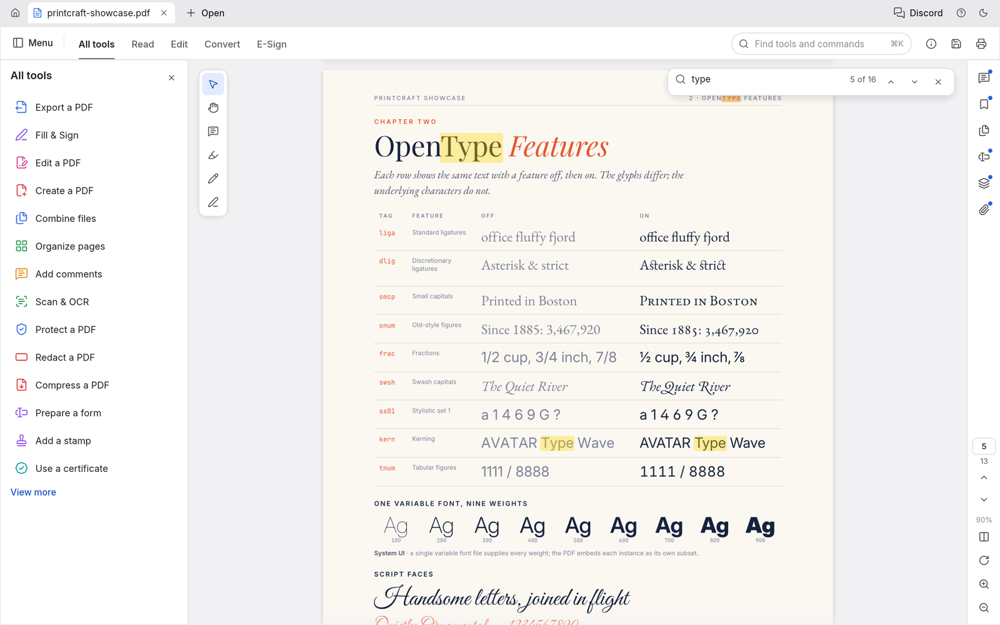</td>
<td width="50%">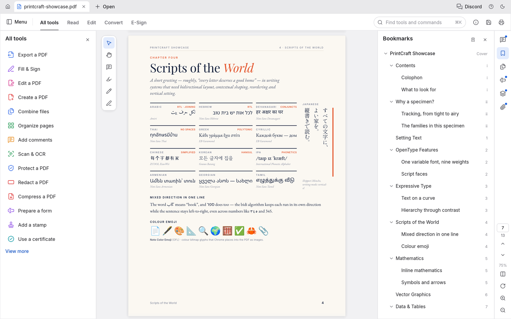</td>
</tr>
<tr>
<td align="center"><sub>Поиск по мере ввода: совпадение 10 из 16</sub></td>
<td align="center"><sub>Вложенные закладки с собственными метками страниц документа</sub></td>
</tr>
</table>

---

## Упорядочивайте страницы как карточки

Откройте **Organize pages**, чтобы видеть все страницы сразу:
- **Выделяйте страницы:** щелчок, <kbd>⌘</kbd>-щелчок или <kbd>⇧</kbd>-щелчок.
- **Изменяйте их:** поворачивайте, удаляйте, вставляйте пустые страницы, вставляйте страницы из другого файла и перемещайте их раньше или позже.
- **Отменяйте что угодно:** <kbd>⌘Z</kbd>, затем сохраняйте.

<p align="center">
  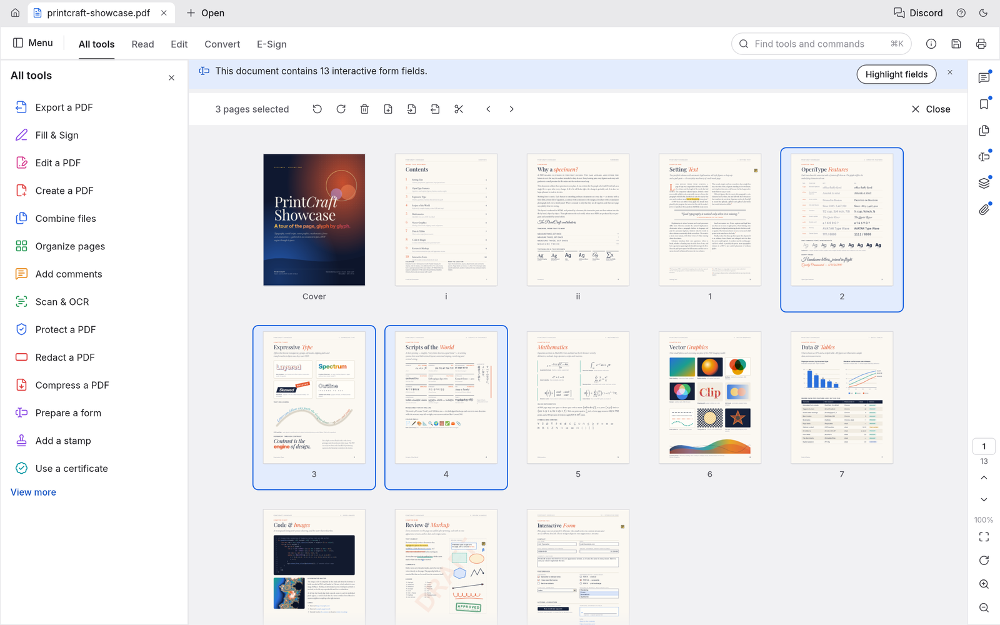
  <br>
  <sub>Организация страниц с тремя выделенными страницами и инструментами страниц на панели сверху.</sub>
</p>

<table>
<tr>
<td width="50%" valign="top">

**Отмена, которая идёт далеко.** Каждое изменение — один шаг в истории, по которой можно идти назад и вперёд. Меню «Правка» называет шаг («Отменить поворот страниц»), и отмена работает даже после сохранения.

**Сохранения, которым можно доверять:**
- *Инкрементальные:* исходные байты остаются байт-в-байт нетронутыми.
- *Атомарные:* файл пишется во временную копию, затем подменяется.
- *Проверенные:* независимо проверяются с помощью qpdf на каждом прогоне CI.

Когда открытые документы не помещаются по ширине окна, прокручивайте полосу вкладок колёсиком мыши или трекпадом либо используйте её горизонтальную полосу прокрутки. Открытие или переключение на документ прокручивает его вкладку в видимую область.

Несохранённые документы отмечаются точкой на вкладке, а закрытие или выход спрашивает перед потерей данных. Изменения автосохраняются каждую минуту. Если PdfCraft когда-либо завершится неожиданно, при следующем запуске предложит восстановить работу. Зашифрованные документы остаются зашифрованными на диске.

</td>
<td width="50%" valign="top">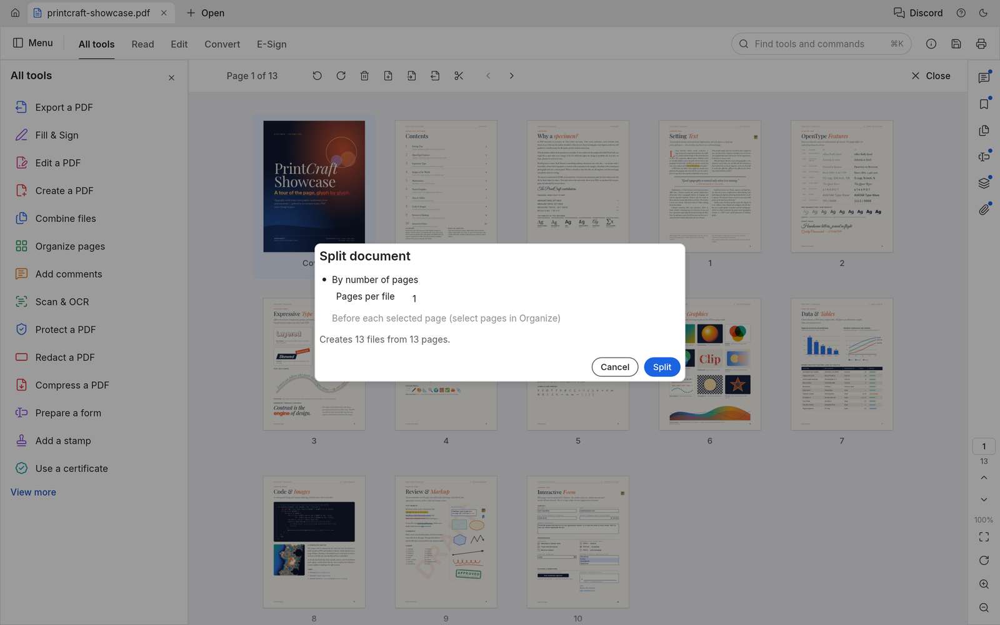<br><sub>Разделение документа: одна страница на файл даёт 13 файлов.</sub></td>
</tr>
</table>

## Объединяйте и разделяйте без потерь

**Combine files** объединяет любое количество PDF в один. Каждый файл получает закладку, а его собственные закладки вкладываются под ней.

**Extract** копирует выбранные страницы в новый документ. **Split** делит документ каждые *n* страниц или перед выбранными страницами.

Ничего тихо не исчезает по пути:
- ссылки и именованные назначения перенаправляются на скопированные страницы;
- поля форм остаются интерактивными;
- слои сохраняют свои значения по умолчанию вкл/выкл;
- вложения переносятся.

Каждая страница объединённого документа рендерится пиксель-в-пиксель идентично источнику.

```sh
pdfcraft-cli combine report.pdf appendix.pdf --out combined.pdf
pdfcraft-cli extract report.pdf --pages 1,3,5-8 --out highlights.pdf
pdfcraft-cli split   report.pdf --every 10 --out-dir parts/
```

---

## Открывайте защищённые документы с соблюдением ограничений

PdfCraft полностью реализует стандартный обработчик безопасности PDF:
- каждую ревизию, от 40-битного RC4 до AES-256;
- пользовательские и владельческие пароли, включая пароли Unicode, нормализованные с SASLprep;
- криптофильтры и шифрование только вложений.

Документы, ограниченные автором, показывают понятное уведомление, и PdfCraft соблюдает их разрешения. Введите пароль владельца — ограничения снимаются. Правки зашифрованных документов сохраняются зашифрованными под теми же ключами.

<table>
<tr>
<td width="50%" valign="top">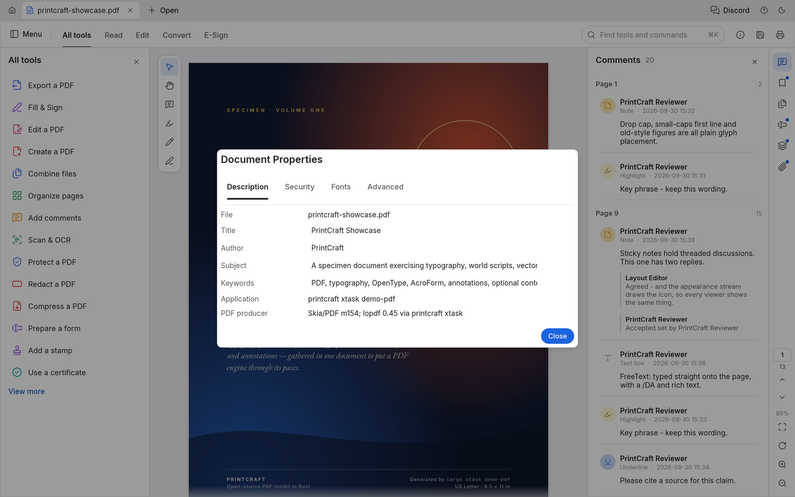<br><sub>Свойства документа, вкладка Description</sub></td>
<td width="50%" valign="top">

**Document Properties** показывает:
- заголовок, автора, тему и ключевые слова документа, которые можно редактировать;
- используемые шрифты и факт встраивания каждого;
- версию PDF, размер страницы, теги, поля, слои и вложения;
- полную картину безопасности: метод шифрования, каким паролем открыт документ и каждое разрешение.

</td>
</tr>
</table>

## Комментарии, формы, слои и вложения

<table>
<tr>
<td width="50%">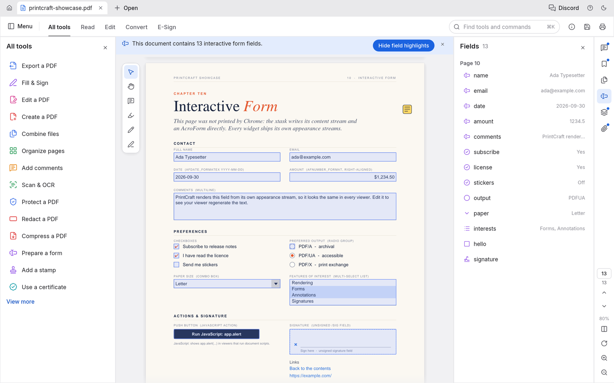</td>
<td width="50%">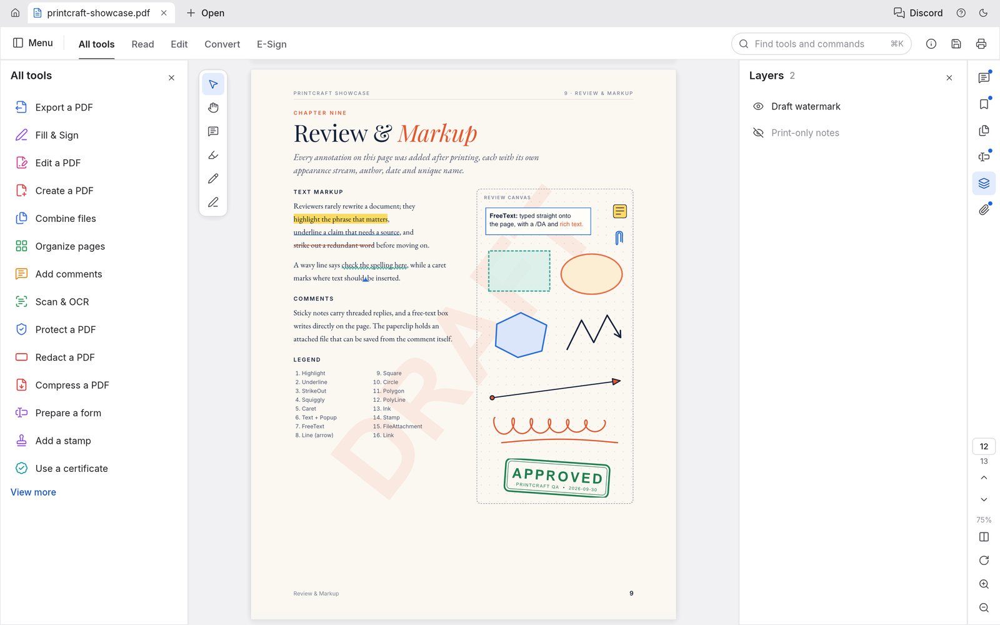</td>
</tr>
<tr>
<td valign="top"><b>Формы</b>: каждое поле с текущим значением, подсветка полей, а также флажки, переключатели, списки и подписи, отрисованные так, как задумал автор.</td>
<td valign="top"><b>Слои</b>: включайте и выключайте опциональный контент — страница перерисовывается мгновенно. <b>Комментарии</b> отображаются как вложенные беседы, а <b>вложения</b> можно открыть или сохранить.</td>
</tr>
</table>

## Сканируйте страницы и проверяйте распознанный текст

**Scan & OCR ▸ Recognize text** превращает скан в поисковый текст — текущую страницу, диапазон или папку файлов, записанных как поисковые копии — с необязательной очисткой перед распознаванием (автоповорот, выравнивание, шумоподавление, бинаризация; рамки слов отображаются обратно на исходный скан) и вторым движком: установленный Tesseract присоединяется к встроенному, объединяясь по вашей стратегии. Поисковый результат применяется как один отменяемый шаг; вывод **Editable text** открывает экран **OCR Verify**, где каждое слово несёт уверенность движка в виде цвета, подозрительные — в одном нажатии, а исправления, пользовательский словарь и повторное OCR области или страницы происходят до Accept, который записывает новый документ. **Scan & OCR ▸ Correct recognized text** проверяет любое распознавание там же до применения.

<p align="center">
  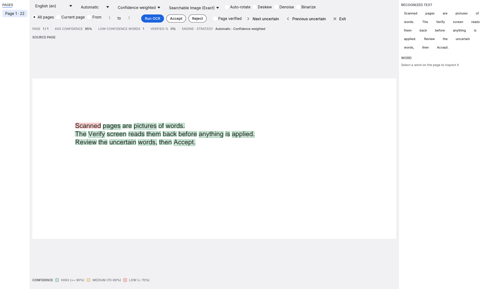
  <br>
  <sub>Экран OCR Verify: слова окрашены по уверенности — легенда объясняет пороги — проверены и исправлены до применения.</sub>
</p>

---

## Все инструменты — в одном нажатии

Нажмите <kbd>⌘K</kbd>, чтобы искать любой инструмент и команду, или просмотрите каталог **All tools**. Инструменты, которые ещё в разработке, помечены вехой, в которой они появятся.

<table>
<tr>
<td width="50%">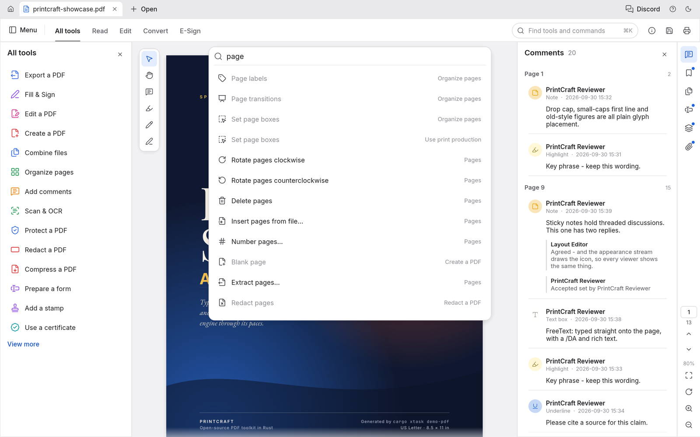</td>
<td width="50%">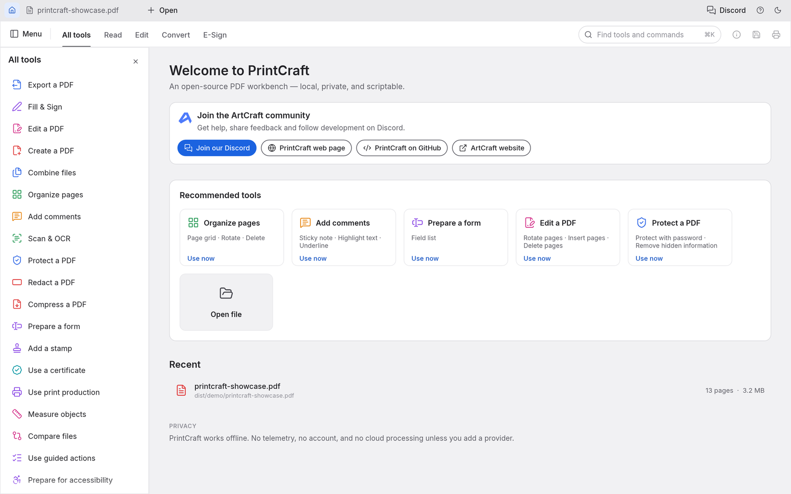</td>
</tr>
<tr>
<td align="center"><sub>Палитра команд <kbd>⌘K</kbd></sub></td>
<td align="center"><sub>Домашний экран и каталог All tools</sub></td>
</tr>
</table>

---

## Работает везде и остаётся вашим

- **Нативно на macOS, Windows, Linux и FreeBSD**, а также **в браузере** через WebAssembly, из одной и той же кодовой базы на Rust. Сборки Windows есть для x64, x86 и ARM64 (Windows on ARM, без эмуляции); каждое изменение ARM64 тестируется на реальном оборудовании ARM64 в CI.
- **Приватность по замыслу.** Документы никогда не покидают ваш компьютер. Нет аккаунта, нет телеметрии и нет облачной обработки.
- **Движок прежде всего.** Разбор, рендеринг и редактирование живут в переиспользуемых библиотечных крейтах. Интерфейс — один сменный слой сверху.
- **Скриптуемо.** Инструмент `pdfcraft-cli` (см. [Built for agents, too](#built-for-agents-too)) покрывает инспекцию, рендеринг, извлечение текста, редактирование, объединение, извлечение страниц и разделение. Проверки устойчивости работают на том же движке, что и приложение.

```sh
pdfcraft-cli info  form.pdf                                  # структура как JSON
pdfcraft-cli text  paper.pdf --page 3                        # текст в порядке чтения
pdfcraft-cli edit  in.pdf --rotate 1,2:90 --delete 5 --title "Q3" --out out.pdf
```

---

## Подходит и для ИИ-агентов

Каждая возможность движка доступна без GUI через одну таблицу инструментов, описанных JSON Schema: открытие, инспекция, рендеринг страниц в PNG, извлечение и поиск текста, поворот, удаление, перемещение и вставка страниц, редактирование закладок и меток страниц, добавление, ответ, изменение стиля и удаление комментариев (выделить фразу — просто назвать её), список и заполнение полей форм, защита паролями, установка метаданных, отмена и повтор, сохранение, объединение, извлечение и разделение. Три входа используют её:

- **`pdfcraft-cli run`**, для разовых вызовов и JSON-скриптов:

  ```sh
  pdfcraft-cli tools                                        # каждый инструмент и его JSON Schema
  pdfcraft-cli run text_find doc=1 query=invoice            # key=value; значения разбираются как JSON
  pdfcraft-cli run --script review.json                     # напр. comment_add {"type": "highlight", "find": "total due"}
  pdfcraft-cli run --script steps.json --root ./work        # несколько шагов в одной сессии
  pdfcraft-cli run --script steps.json --report             # один JSON-документ: для каждого шага номер, инструмент, статус, результат или ошибка
  ```

  С `--root` каждый файл, который шаги скрипта читают или пишут, остаётся в этой директории, включая PNG, который шаг сохраняет с `"out"` (сам скрипт читается откуда угодно, куда вы укажете).

- **MCP-сервер** для ИИ-агентов вроде Claude. **Он включается по желанию:** PdfCraft никогда не запускает его сам и не открывает сетевой порт. Он работает только пока агент запускает `pdfcraft-cli mcp`, общается через stdin/stdout и останавливается при отключении агента. Чтобы включить, добавьте в конфигурацию MCP агента:

  ```json
  { "mcpServers": { "pdfcraft": { "command": "pdfcraft-cli", "args": ["mcp", "--root", "/path/to/your/pdfs"] } } }
  ```

  `--compact` уменьшает список инструментов, который агенту нужно прочитать: `tools/list` возвращает около десяти основных инструментов плюс `tool_search` и `tool_call`, которые находят и запускают все остальные, так что список стоит гораздо меньше токенов. Каждый инструмент по-прежнему работает.

  `--root` ограничивает каждый файл, который агент может читать или писать, одной директорией. Сборки, в которых сервер не должен присутствовать вообще, могут использовать `cargo build -p pdfcraft-cli --no-default-features`.

- **Rust API** (`pdfcraft_automation::Automation::call`) для встраивания.

Правки остаются в памяти, отменяемыми, до `doc_save`. Сохранение в тот же файл добавляет инкрементальное обновление, поэтому исходные байты сохраняются, а запись атомарна. Несохранённые изменения никогда не отбрасываются молча.

### Управление самим приложением

Запустите десктопное приложение с `pdfcraft --control ~/.pdfcraft-control.json`, и агент сможет видеть и управлять реальным интерфейсом: деревом виджетов с метками и позициями (из дерева доступности), щелчками, вводом, клавишами, командами, параметрами вида и скриншотами. Это тоже выключено по умолчанию. Слушает только loopback, и каждое соединение должно предъявить случайный токен, записанный в этот файл, который можете прочитать только вы.

Держите файл управления в папке, в которую можете писать только вы, а не в общей вроде `/tmp`: другой пользователь мог бы создать файл там первым и получать ваши команды. `pdfcraft-cli ui` отказывается от файла управления, который является символической ссылкой, или принадлежит другому пользователю, или который другой пользователь или группа вроде Administrators могут читать или писать: на macOS, Linux и FreeBSD по владельцу и режиму (приложение пишет его с режимом 600), на Windows по владельцу и списку доступа (приложение задаёт список только с вами и SYSTEM). Приложение не запускается, если не может записать файл. В Windows cmd.exe не раскрывает `~`: используйте `%USERPROFILE%\.pdfcraft-control.json`.

```sh
pdfcraft-cli ui --control ~/.pdfcraft-control.json inspect query=rotate      # найти виджеты
pdfcraft-cli ui --control ~/.pdfcraft-control.json click label="Organize pages"
pdfcraft-cli ui --control ~/.pdfcraft-control.json key key=K modifiers='["command"]'
pdfcraft-cli ui --control ~/.pdfcraft-control.json command id=comment.square   # выбрать инструмент, затем рисовать:
pdfcraft-cli ui --control ~/.pdfcraft-control.json drag from='[400,300]' to='[600,420]'
pdfcraft-cli ui --control ~/.pdfcraft-control.json screenshot --out window.png
pdfcraft-cli ui --control ~/.pdfcraft-control.json resize width=1200 height=800
pdfcraft-cli ui --control ~/.pdfcraft-control.json focus label="Read"
pdfcraft-cli ui --control ~/.pdfcraft-control.json inspect focused=true
pdfcraft-cli ui --control ~/.pdfcraft-control.json quit
```

`ui.panel` открывает, закрывает или меняет размер боковой панели: `{"panel":"tools"|"side","open":true|false,"width":320}`.
`tools` — панель Tools, `side` — панель, которую открывает рельс (повторное открытие показывает последнюю открытую).
`width` ограничивается пределами панели (Tools 240–520, боковая панель 260–520 пунктов). `ui.dock.reset`
сбрасывает боковые панели: Tools открыта слева, ширины по умолчанию. Канал управления принимает эти
методы напрямую; `ui.command` также принимает `{"id":"ui.panel","params":{...}}`. Сохранённые предпочтения сохраняют
сторону Tools, открытые панели и их ширины. Некорректные запросы возвращают ошибку, не меняя
документ или панели.


`resize` запрашивает нативный внутренний размер окна в логических пунктах (каждое измерение должно быть между 320 и 8192); оконный менеджер может ограничить. `state` сообщает наблюдаемые `window.width`, `window.height` и `window.pixels_per_point`. `focus` принимает ровно один `id` виджета или уникальную включённую, фокусируемую `label`; последующие запросы `key` перемещаются или активируют реальные виджеты. `inspect` включает фокусируемость и принимает фильтр `focused`. `quit` не принимает параметров: чистые документы выходят нормально, а несохранённые правки или ввод открывают существующий запрос «Сохранить/Не сохранять/Отмена» и возвращают `quitting: false, needs_confirmation: true`. Оно никогда молча не отбрасывает работу. Изменение размера окна и выход из приложения — только нативные.

---

## Как устроен проект

PdfCraft — это Cargo-воркспейс сфокусированных крейтов, слоённый так, что ядро никогда не зависит от UI:

| Крейт | Что делает |
|---|---|
| `pdfcraft-filters` | Каждый фильтр потока PDF (Flate, LZW, ASCII85, RunLength, предикторы), кодирование и декодирование, с property-тестами |
| `pdfcraft-crypt` | Стандартный обработчик безопасности: RC4, AES-128/256, ревизии 2–6, разрешения |
| `pdfcraft-cos` | Слой объектов PDF: толерантный разбор, восстановление, правки copy-on-write, инкрементальная и полная запись |
| `pdfcraft-organize` | Операции со страницами, объединение / извлечение / разделение, закладки, метки страниц, информация о документе |
| `pdfcraft-fonts` | Метрики шрифтов и кодировки для генерируемых appearance |
| `pdfcraft-annot` | Комментарии: построители и appearance-потоки для заметок, текстовой разметки, фигур, чернил и текстовых полей; ответы, статус, правки |
| `pdfcraft-forms` | Интерактивные формы: модель полей, заполнение с регенерированными appearance, Clear form |
| `pdfcraft-render` | Рендеринг, инспекция и извлечение текста с порядком чтения |
| `pdfcraft-engine` | Фасад, который использует каждый фронтенд: сессии, правки, отмена, сохранение, каталог инструментов |
| `pdfcraft-automation` | Управление агентами: таблица headless-инструментов, `pdfcraft-cli run` и opt-in MCP-сервер |
| `pdfcraft-ui-egui` | Интерфейс для десктопа и веба |

**Ворота качества.** Каждое изменение проходит одни и те же автоматические проверки:
- форматирование и Clippy с предупреждениями как ошибками;
- более 200 unit-, property- и UI-тестов;
- правила слоистости крейтов и проверка сборки WebAssembly;
- аудит лицензий ресурсов.

Поверх них два прогона по корпусу реальных файлов:
- **Открытие и рендеринг:** из 983 тестовых файлов pdf.js 963 открываются и рендерятся чисто, с 0 сбоями.
- **Круговые проходы «открыть, править и сохранить»:** 958 успешны.

Вывод проверяется против независимых реализаций: hayro и qpdf на каждом прогоне CI, а
poppler по корпусу по запросу (`cargo xtask text-oracle`).

PdfCraft — реализация с чистого листа. Его поведение основано на спецификации ISO 32000 и наблюдениях «чёрного ящика», никогда — на чужом коде. Каждая иконка, шрифт и изображение открыто лицензированы и перечислены в [ATTRIBUTION.md](ATTRIBUTION.md).

## Начало работы

Для сборки нужен Rust 1.95 или новее.

```sh
git clone https://github.com/storytold/pdfcraft
cd pdfcraft
cargo xtask models                                # загрузить модели OCR, нужные Scan & OCR (релизные сборки включают их)
cargo run --release -p pdfcraft -- some.pdf     # десктопное приложение
cargo xtask demo-pdf                              # собрать showcase PDF, использованный на этих скриншотах
cargo xtask screenshots                           # перегенерировать каждый скриншот в этом README
```

Язык интерфейса выбирается в **Menu → Edit → Preferences…** (Command-comma на macOS,
Ctrl-comma в остальных случаях, также при отсутствии открытого документа; Auto следует системному языку;
см. [docs/localization.md](docs/localization.md)) и сохраняется. Японский покрывает команды,
диалоги, панели и сочетания клавиш. Поиск команд принимает переведённую метку, английскую метку и стабильный id команды; имена файлов, содержимое PDF, имена авторов, имена пользовательских
действий и детали ошибок от движка или операционной системы сохраняют свой текст.

Японские шрифты берутся из [craft-fonts](https://github.com/storytold/craft-fonts), необязательного входа сборки,
который включает каждый релиз. Чтобы собрать с ними (японский текст интерфейса и японский текст в
отредактированных PDF):

```sh
git clone https://github.com/storytold/craft-fonts ../craft-fonts
CRAFT_FONTS_DIR=../craft-fonts cargo run --release -p pdfcraft -- some.pdf
```

Каждый [релиз GitHub](https://github.com/storytold/pdfcraft/releases) содержит готовые сборки для macOS,
Windows, Linux (AppImage, Flatpak, `.deb`, `.rpm` и tarball), FreeBSD и веба; см.
[Downloads](#downloads). На Gentoo сообщество [::snakebyte
overlay](https://github.com/switch87/snakebyte-overlay) упаковывает Linux-релиз как
`app-text/pdfcraft-bin` (не поддерживается командой PdfCraft):

```sh
eselect repository add snakebyte git https://github.com/switch87/snakebyte-overlay.git
emaint sync -r snakebyte
echo 'app-text/pdfcraft-bin ~amd64' >> /etc/portage/package.accept_keywords/pdfcraft
emerge --ask app-text/pdfcraft-bin
```

Логи, переменные окружения и другие заметки по разработке — в [docs/development.md](docs/development.md).

## Планы развития

PdfCraft молод и развивается быстро. Цель — верстак, где можно просматривать, упорядочивать, аннотировать, заполнять, подписывать и редактировать PDF для профессиональных и повседневных рабочих процессов.

**Где он сейчас (октябрь 2026), честно:** PdfCraft — **альфа**. Большинство основных офлайн-возможностей PDF существует в том или ином виде (57% функций, отслеживаемых в [docs/target-app-parity.md](docs/target-app-parity.md), 94% основных). Для повседневной работы (просмотр, комментирование, заполнение и подписание форм, организация страниц) готовность около 55%; по всем профессиональным рабочим процессам — около 49%; для тех, кому нужны только основы, — около 66%. Каждый повседневный рабочий процесс можно завершить, но конвертация и обмен слабы: нет office-document-to-PDF, а экспорт .docx теряет макет.

- **Хорошо сегодня:** просмотр и поиск; организация, объединение и разделение; большинство видов комментариев; заполнение и создание форм (с изолированным JavaScript); пароли, редактирование и санитизация; базовые цифровые подписи; печать; Accessibility Checker; управление агентами через CLI и MCP.
- **Пока заимствовано:** страницы рисует крейт `hayro`, пока строится наш собственный рендерер.
- **Тонко или отсутствует:** надёжное редактирование существующего текста (особенно CJK и справа налево), OCR за пределами латиницы, импорт/экспорт офисных документов, токены подписей и онлайн long-term validation, Preflight и PDF/X/UA, печать из веб-сборки, точность физической печати и полные формы XFA.
- **Укрепление:** фаззинг всё ещё находит сбои и зависания на враждебных файлах; каждое исправляется регрессионным тестом. Качество ещё не сравнивалось бок о бок.

**Далее, по порядку:** office-document-to-PDF и экспорт .docx, сохраняющий макет, заявленные ошибки и китайский шрифт интерфейса, harness точности против эталонного рендерера, редактирование существующего содержимого, затем профессиональные рабочие процессы (OCR, офисные форматы, Preflight, подписи, accessibility tagging) и полировка 1.0.

Сводка — в **[ROADMAP.md](ROADMAP.md)**; полная оценка по измерениям и областям — в [docs/target-app-parity.md](docs/target-app-parity.md), ранжированные пробелы — в [docs/gaps.md](docs/gaps.md), вехи — в [docs/roadmap.md](docs/roadmap.md).

---

## Загрузка

**Новичок в PdfCraft?** Скачайте с [страницы PdfCraft на getartcraft.com](https://getartcraft.com/apps/pdfcraft). Это самый простой способ установить.

**Нужна конкретная сборка или формат?** На GitHub [последний релиз](https://github.com/storytold/pdfcraft/releases/latest) содержит все сборки, перечисленные ниже, а [все релизы](https://github.com/storytold/pdfcraft/releases) — более ранние версии и заметки. `<ver>` в именах файлов — номер версии, а `SHA256SUMS.txt` перечисляет контрольную сумму для каждого файла.

### Windows

| Сборка | Установщик | Портативная |
|---|---|---|
| x64 (64-bit Intel/AMD) | `pdfcraft-<ver>-windows-x64.msi` | `pdfcraft-<ver>-windows-x64-portable.zip` |
| arm64 (Snapdragon и другие ARM ПК) | `pdfcraft-<ver>-windows-arm64.msi` | `pdfcraft-<ver>-windows-arm64-portable.zip` |
| x86 (32-bit) | `pdfcraft-<ver>-windows-x86.msi` | `pdfcraft-<ver>-windows-x86-portable.zip` |

Установщики и исполняемые файлы подписаны кодом.

Портативный zip запускается из любой папки, включая USB-накопитель. Его `portable.txt` держит настройки,
логи и восстановление после сбоя в папке `PdfCraftData` рядом с `pdfcraft.exe`, так что ничего не пишется в
`%APPDATA%`; удалите этот файл, чтобы использовать обычные пользовательские папки.
Windows не предлагает портативную копию как приложение PDF по умолчанию сама по себе, так как она ничего не регистрирует;
в `portable.txt` есть строки PowerShell, которые регистрируют её только для вашего пользователя, и как отменить.

MSI по умолчанию устанавливает только для вашей учётной записи, без прав администратора. Выберите
«Everyone on this computer» на первой странице или передайте `ALLUSERS=1` из повышенного терминала, чтобы установить
для всех пользователей. Он добавляет «Edit with PdfCraft»
и «Combine files in PdfCraft» (выберите несколько PDF: они попадут на вкладку Combine files запущенного PdfCraft) в контекстное меню файлов PDF и «Create PDF with PdfCraft…» в контекстное меню
изображений (.png .jpg .jpeg .tif .tiff .gif .bmp .jp2 .j2k .jpx) в Проводнике (в Windows 11 — под
«Show more options»), не меняя приложение, которое открывает их по умолчанию. Для безрежимного развёртывания
без ярлыка на рабочем столе (добавьте `ALLUSERS=1` из повышенного терминала для установки для всех):

```powershell
msiexec /i "pdfcraft-<ver>-windows-x64.msi" /qn /norestart INSTALLDESKTOPSHORTCUT=0
```

| Свойство | `=0` исключает |
|---|---|
| `INSTALLDESKTOPSHORTCUT` | ярлык на рабочем столе |
| `INSTALLPDFCONTEXTMENU` | «Edit with PdfCraft» и «Combine files in PdfCraft» на файлах PDF |
| `INSTALLIMAGECONTEXTMENU` | «Create PDF with PdfCraft…» на изображениях |

Все три включены при первой установке. Обновление сохраняет то, что есть в установленной версии: ярлык
или пункт меню, который есть, остаётся, а отсутствующий (исключённый при установке или удалённый ярлык)
остаётся отсутствующим, так что не нужно передавать их снова. Значение в командной строке всегда побеждает: `=1` возвращает, `=0` удаляет. Обновление с релиза, у которого ещё не было меню (0.6.0 и ранее для меню PDF, 0.2.1 и ранее для меню изображений)
добавляет его, как при первой установке. Используйте MSI для вашей архитектуры. Переопределения установки для пользователя
не поддерживаются.

Чтобы установить не в папку по умолчанию `ArtCraft\PdfCraft`, измените папку на экране приветствия (введите или Browse…) или передайте в командной строке:
`INSTALLFOLDER="D:\Apps\PdfCraft"`. Устанавливается для того, кого выбрал первый экран (`ALLUSERS=1`
в командной строке для всех). Обновление сохраняет папку установленной версии, если командная строка не задаёт другую.

**Закрепите контрольную сумму, а не только версию.** Кандидаты на релиз версии делят её версию MSI
(версии MSI — только числа, поэтому 1.2.3-rc.1 и 1.2.3 оба 1.2.3), и установщик позволяет MSI той же версии
заменить установленный без вопросов. Два разных MSI `0.7.1` нельзя отличить по версии, поэтому если ваш инструмент развёртывания проверяет файл, закрепите его SHA-256 из
`SHA256SUMS.txt` (`Get-FileHash <file> -Algorithm SHA256`).

**Идентичности подписи.** Windows MSI и оба исполняемых файла подписаны через Azure Trusted
Signing сертификатом, выданным `Learning Machines Inc` (Atlanta, Georgia, US). Приложение macOS
и инструмент командной строки подписаны Developer ID `Learning Machines LLC (DJ6XS33FX8)` и
нотаризованы. Производитель MSI, отображаемый как издатель в Установленных приложениях, —
`Learning Machines LLC`.

### macOS

| Сборка | Файл | Примечания |
|---|---|---|
| Приложение, universal (Apple silicon + Intel) | `pdfcraft-<ver>-macos-universal.dmg` | Подписано и нотаризовано |
| Инструмент командной строки, universal | `pdfcraft-cli-<ver>-macos-universal.zip` | Подписано и нотаризовано |

### Linux

| Формат | x86_64 | aarch64 (ARM64) | Примечания |
|---|---|---|---|
| AppImage | `pdfcraft-<ver>-linux-x86_64.AppImage` | `pdfcraft-<ver>-linux-aarch64.AppImage` | Запускается где угодно; обновляется сам с [AppImageUpdate](https://github.com/AppImageCommunity/AppImageUpdate) (файлы `.zsync`) |
| Flatpak | `pdfcraft-<ver>-linux-x86_64.flatpak` | `pdfcraft-<ver>-linux-aarch64.flatpak` | В песочнице; `flatpak install --user <file>` |
| Debian/Ubuntu | `pdfcraft-<ver>-linux-x86_64.deb` | `pdfcraft-<ver>-linux-aarch64.deb` | |
| Fedora/RHEL/openSUSE | `pdfcraft-<ver>-linux-x86_64.rpm` | `pdfcraft-<ver>-linux-aarch64.rpm` | |
| Tarball | `pdfcraft-<ver>-linux-x86_64.tar.gz` | `pdfcraft-<ver>-linux-aarch64.tar.gz` | Распаковать куда угодно |
| Инструмент командной строки | `pdfcraft-cli-<ver>-linux-x86_64.tar.gz` | `pdfcraft-cli-<ver>-linux-aarch64.tar.gz` | Только `pdfcraft-cli` (и его opt-in MCP-сервер), для серверов, CI и агентов |

Сборки RISC-V (riscv64) идут только как tarball: `pdfcraft-<ver>-linux-riscv64.tar.gz` и `pdfcraft-cli-<ver>-linux-riscv64.tar.gz`. Они кросс-компилируются и требуют glibc 2.39 или новее (Ubuntu 24.04+, Debian 13+).

Каждая другая сборка Linux требует glibc 2.35 или новее (Ubuntu 22.04+, Debian 12+, Fedora 36+, RHEL 10).

### FreeBSD

| Сборка | Файл |
|---|---|
| x86_64 | `pdfcraft-<ver>-freebsd-x86_64.tar.gz` |

### Web (WebAssembly)

| Сборка | Файл | Примечания |
|---|---|---|
| Статический сайт | `pdfcraft-web-<ver>.zip` | Работает в современном браузере; размещайте на любом статическом сервере |

---

## Приложения Crafting

PdfCraft — одно из **приложений Crafting**: бесплатных открытых творческих инструментов от
команды [ArtCraft](https://getartcraft.com/), каждое написано с нуля на Rust и каждое способно
стоять само по себе.

| | Приложение | Для чего | Код | Подробнее |
|:-:|---|---|---|---|
|  | **PhotoCraft** | Редактирование изображений: слои, маски, текст и настоящие PSD-файлы | [GitHub](https://github.com/storytold/photocraft) | [Website](https://getartcraft.com/apps/photocraft) |
|  | **VectorCraft** | Векторная иллюстрация | [GitHub](https://github.com/storytold/vectorcraft) | [Website](https://getartcraft.com/apps/vectorcraft) |
|  | **FilmCraft** | Монтаж видео, цвет и звук | [GitHub](https://github.com/storytold/filmcraft) | [Website](https://getartcraft.com/apps/filmcraft) |
|  | **LightCraft** | Фотобиблиотека и обработка raw | [GitHub](https://github.com/storytold/lightcraft) | [Website](https://getartcraft.com/apps/lightcraft) |
|  | **PdfCraft** | Чтение, организация и защита PDF | [GitHub](https://github.com/storytold/pdfcraft) | [Website](https://getartcraft.com/apps/pdfcraft) |
|  | **EffectCraft** | Моушн-графика и визуальные эффекты | [GitHub](https://github.com/storytold/effectcraft) | [Website](https://getartcraft.com/apps/effectcraft) |
|  | **DesignCraft** | Вёрстка страниц и издательство | [GitHub](https://github.com/storytold/designcraft) | [Website](https://getartcraft.com/apps/designcraft) |
|  | **FigCraft** | Дизайн интерфейсов и прототипирование | [GitHub](https://github.com/storytold/figcraft) | [Website](https://getartcraft.com/apps/figcraft) |
|  | **WordCraft** | Текстовый процессор и документы | [GitHub](https://github.com/storytold/wordcraft) | [Website](https://getartcraft.com/apps/wordcraft) |
|  | **SoundCraft** | Запись и редактирование аудио | [GitHub](https://github.com/storytold/soundcraft) | [Website](https://getartcraft.com/apps/soundcraft) |
|  | **DeckCraft** | Презентации и слайды | [GitHub](https://github.com/storytold/deckcraft) | [Website](https://getartcraft.com/apps/deckcraft) |
|  | **CADCraft** | Автоматизированное проектирование | [GitHub](https://github.com/storytold/cadcraft) | [Website](https://getartcraft.com/apps/cadcraft) |
|  | **GridCraft** | Электронные таблицы и данные | [GitHub](https://github.com/storytold/gridcraft) | [Website](https://getartcraft.com/apps/gridcraft) |
|  | **TextureCraft** | Роспись 3D-текстур | [GitHub](https://github.com/storytold/texturecraft) | [Website](https://getartcraft.com/apps/texturecraft) |
|  | **Craft Anything** | Посмотрите, как работает любое ПО, затем создайте своё | [GitHub](https://github.com/storytold/craft-anything) | [Website](https://getartcraft.com/apps/craft-anything) |
|  | **SolidCraft** | Параметрическое 3D CAD от Tangency Labs (приложение сообщества) | [GitHub](https://github.com/tangency-labs/solidcraft) | |

И сам [**ArtCraft**](https://getartcraft.com/) — наша студия ИИ-изображений и видео для художников, которым нужен настоящий контроль.

<br>

<p align="center">
  <a href="https://discord.gg/artcraft"></a>
</p>

<h3 align="center">Приходите творить вместе с нами</h3>

<p align="center">
  Наш Discord — место, где собираются художники любого рода: те, кто рисует, снимает, чертит, монтирует фильмы,
  набирает текст, и те, кто ещё выясняет, что им нравится создавать. Делитесь тем, над чем работаете,
  просите помощи, рассказывайте, что сломано, или что вы хотите, чтобы эти инструменты умели.
  Какой бы ни был ваш медиум и как долго вы этим занимаетесь — вам здесь рады.
</p>

<p align="center">
  <a href="https://discord.gg/artcraft"><b>discord.gg/artcraft</b></a> ·
  <a href="https://getartcraft.com/">getartcraft.com</a> ·
  <a href="https://getartcraft.com/apps">The Crafting Apps</a> ·
  <a href="https://getartcraft.com/apps/pdfcraft">PdfCraft</a>
</p>

---

## Лицензия и благодарности

PdfCraft распространяется под двойной лицензией [MIT](LICENSE-MIT) или [Apache-2.0](LICENSE-APACHE) на ваш выбор.
Copyright (c) 2026 ArtCraft Team и участники PdfCraft. Необходимые уведомления — в [NOTICE](NOTICE).

Встроенные шрифты, иконки, изображения и другие ресурсы сохраняют свои открытые лицензии; каждый перечислен
с автором, источником и лицензией в [ATTRIBUTION.md](ATTRIBUTION.md). Релизные сборки также встраивают
японские шрифты [craft-fonts](https://github.com/storytold/craft-fonts/blob/main/ATTRIBUTION.md)
(SIL Open Font License 1.1).

Название ArtCraft, словесный знак и логотипы в [`docs/brand/`](docs/brand/) являются товарными знаками
команды ArtCraft и не покрываются этой лицензией. Их можно использовать только в неизменном виде и только как
часть этого репозитория и PdfCraft, в соответствии с [`docs/brand/LICENSE-brand.txt`](docs/brand/LICENSE-brand.txt).
Форки и изменённые версии должны их удалить.

<p align="center">
  <a href="https://getartcraft.com/"></a><br>
  <sub>Сделано командой и сообществом <a href="https://getartcraft.com/">ArtCraft</a>.</sub>
</p>

Панель Tools располагается слева или справа через Preferences ▸ Tools panel side. Навигационная панель остаётся у правого края и открывает рядом одну боковую панель. Перетаскивайте внутренний край панели, чтобы изменить размер; ширины запоминаются. F4 показывает или скрывает боковую панель, а Shift+F4 — панель Tools (также в меню View); View ▸ Reset side panels восстанавливает расположение по умолчанию.
