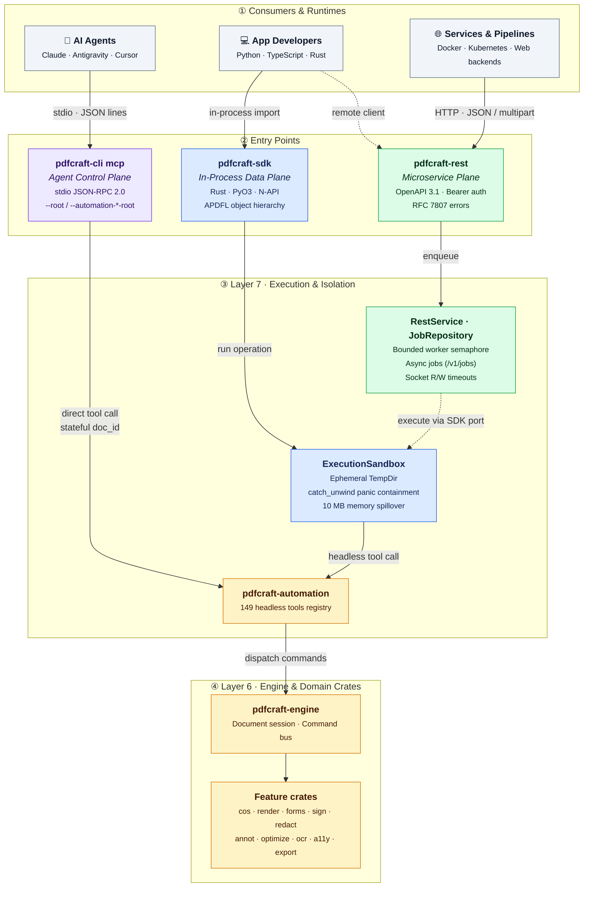

# PdfCraft Control Planes: MCP vs. REST vs. SDK

This document defines the architectural relationship, isolation boundaries, and protocol separation between the three programmatic entry points of PdfCraft:
1. **The Model Context Protocol Server (`pdfcraft-cli mcp`)** — *The Agent Control Plane*
2. **The Document Processing SDK (`pdfcraft-sdk`)** — *The Application Data Plane*
3. **The HTTP REST Service (`pdfcraft-rest`)** — *The Microservice Deployment Plane*

---

## Architectural Overview & Control Planes




---

## The Three Entry Points

### 1. The Agent Control Plane (`pdfcraft-cli mcp`)
- **Primary Audience:** AI coding assistants, LLMs, and autonomous agents (e.g. Claude, Antigravity, Cursor).
- **Transport & Protocol:** Standard I/O (`stdin` / `stdout`) over JSON-RPC 2.0. Runs as an isolated child process; **never opens a network port** (`AGENTS.md` §3).
- **Session Model:** Stateful. Maintains document sessions identified by integer handles (`doc_id`), undo/redo stacks, and interactive inspection commands (`render_preview`, `doc_inspect`).
- **Security & Confinement:** Strictly constrained by `--root`, `--automation-read-root`, and `--automation-write-root`. All file reads and writes outside these paths are rejected.
- **Reference Documentation:** [`docs/mcp.md`](../mcp.md).

### 2. The Application Data Plane (`pdfcraft-sdk`)
- **Primary Audience:** Software engineers building desktop, mobile, or backend applications in **Rust**, **Python**, or **TypeScript**.
- **Transport & Protocol:** In-process library import (Rust native, PyO3 C-extensions, Node.js N-API bindings). Also provides a `RestClient` driver that communicates with `pdfcraft-rest`.
- **Session Model:** Pipeline-oriented and stateless. Takes `DocumentSource` (bytes or paths) and produces `DocumentResult` (in-memory buffer or file-backed result).
- **Commercial Benchmark:** Open-source, memory-safe alternative to **Datalogics Adobe PDF Library (APDFL)**.
- **Security & Confinement:** Executes operations inside an ephemeral `ExecutionSandbox` (`tempfile::TempDir`), with panic containment (`std::panic::catch_unwind`) converting engine errors into typed results, and automatic memory spillover for documents exceeding 10 MB.
- **Reference Documentation:** [`docs/sdk/README.md`](README.md) and [`docs/sdk/api-reference.md`](api-reference.md).

### 3. The Microservice Deployment Plane (`pdfcraft-rest`)
- **Primary Audience:** Cloud architectures, containerized microservices (Docker/Kubernetes), and server-to-server workflows (e.g., FastAPI, Django, Ruby, Go, Java).
- **Transport & Protocol:** Standard HTTP/1.1 and HTTP/2 REST service with OpenAPI 3.1 contracts, JSON & multipart payloads, Bearer token authentication, and RFC 7807 problem details.
- **Session Model:** Asynchronous job lifecycle (`POST /v1/jobs` returning `202 Accepted`, with polling via `GET /v1/jobs/{id}`).
- **Commercial Benchmark:** Open-source, self-hosted alternative to **pdfRest Self-Hosted API Containers** and **Adobe PDF Services Cloud API**.
- **Security & Confinement:** Bounded concurrency semaphores (`429 WORKER_POOL_SATURATED`), max payload limits (`413 QUOTA_EXCEEDED`), 30-second socket read/write timeouts, and durable job journaling.
- **Reference Documentation:** [`crates/rest/README.md`](../../crates/rest/README.md) and [`sdks/openapi.json`](../../sdks/openapi.json).

---

## Comparison Matrix

| Capability | MCP (`pdfcraft-cli mcp`) | SDK (`pdfcraft-sdk`) | REST (`pdfcraft-rest`) |
| :--- | :--- | :--- | :--- |
| **Interface** | CLI JSON-RPC (`stdin`/`stdout`) | Native Library (`import` / `use`) | HTTP Service (`curl`, HTTP clients) |
| **Network Port** | ❌ None (Forbidden by policy) | ❌ In-process (or calls REST) | ✅ Yes (`127.0.0.1:8080`) |
| **In-Memory Buffers** | ❌ Filesystem paths only | ✅ `DocumentSource::Bytes` | ✅ `data_base64` / multipart |
| **Concurrency Model**| Single-process sequential | Multi-threaded (`Send + Sync`) | Bounded worker thread-pool |
| **Error Format** | MCP text `{isError: true}` | Typed Language Exceptions / Enums | RFC 7807 Problem Details JSON |
| **Async Polling** | ❌ Synchronous only | ❌ Synchronous calls | ✅ `202 Accepted` + `/v1/jobs/{id}` |
| **Object Model** | Untyped tool arguments | 15 APDFL typed domain modules | OpenAPI 3.1 Schemas |
| **Tool Count** | **~149 tools** | **149 tools** (`call_tool` + typed methods) | **149 tools** (`POST /v1/operations/{name}` + routes) |

---

## Canonical Dependency Spine (Layering)

As enforced by `xtask/src/layers.rs` (Architecture §3):

```text
Layer 6 (Engine)
    ▲
    │  pdfcraft-engine
    │
Layer 7 (Façades & Services)
    │  pdfcraft-automation (Tool Registry)
    │     ▲                  ▲
    │     │                  │
    │  pdfcraft-cli (MCP)    │
    │                        │
    │                   pdfcraft-sdk (ExecutionSandbox)
    │                        ▲
    │                        │
    │                   pdfcraft-rest (HTTP Service)
```

1. **Zero Engine Duplication:** Neither `pdfcraft-sdk` nor `pdfcraft-rest` contains custom PDF parsing or rendering algorithms. Everything delegates to `pdfcraft-automation` and `pdfcraft-engine`.
2. **Horizontal Edges Allowed at Layer 7:**
   - `pdfcraft-sdk` $\longrightarrow$ `pdfcraft-automation`
   - `pdfcraft-rest` $\longrightarrow$ `pdfcraft-sdk`
   - `pdfcraft-rest` $\longrightarrow$ `pdfcraft-automation`

---

---

## Deterministic Code vs. AI-Agentic Execution: Token Economics & Predictability

A critical architectural distinction between the **Application Planes (`pdfcraft-sdk`, `pdfcraft-rest`)** and the **Agent Plane (`pdfcraft-cli mcp`)** is the separation of **deterministic code execution** from **probabilistic AI reasoning**:

### 1. Zero LLM Token & Credit Overhead
* **The Cost of Overusing AI**: Driving document operations through an LLM via MCP consumes prompt tokens, tool definition schemas, reasoning tokens, and API credits on every single interaction. For high-volume automated workflows (e.g. merging thousands of monthly invoices, rendering preview thumbnails, or batch-filling tax forms), using an LLM introduces unsustainable recurring costs and rate limits.
* **Deterministic Code is Free**: Calling `pdfcraft-sdk` or `pdfcraft-rest` directly executes compiled Rust logic in-process or over HTTP with **zero AI tokens, zero credit consumption, and zero third-party cloud billing**.

### 2. Strict Determinism & Enterprise Compliance
* **Mission-Critical Predictability**: Legal agreements, financial disclosures, and government archival documents require 100% bit-exact repeatability and formal verification. Probabilistic LLMs can hallucinate parameters, misinterpret rigid field mappings, or exhibit subtle behavioral shifts between model checkpoints.
* **Pure Code Invariants**: The SDK and REST pipelines guarantee mathematical determinism: identical inputs, options, and fonts will always generate identical, spec-conformant PDF object graphs (ISO 32000-2 / PDF/A) with `#![forbid(unsafe_code)]` memory safety and zero non-deterministic drift.

### 3. Pragmatic Architecture: "AI Only Where Necessary"
* **Not every application needs AI or MCP**: Standard business software, CI/CD document generators, web app backends, and report formatters should default to the fast, deterministic SDK or REST API.
* **The Hybrid Synergy**: Use the deterministic SDK/REST foundation for 95% of standard pipeline operations (merge, split, optimize, watermark, sign, form-fill). Reserve LLMs and the MCP server strictly for tasks that genuinely require human-like cognitive intelligence—such as summarizing complex multi-page contracts, classifying scanned documents, or semantic cross-document question answering.

---

## Decision Guide: Which Should You Use?

* **Choose the SDK (`pdfcraft-sdk`)** when writing an application in Python, TypeScript, or Rust that needs fast, deterministic, in-process PDF manipulation with zero token costs, zero network latency, zero daemons, and full APDFL object models.
* **Choose the REST Service (`pdfcraft-rest`)** when deploying a self-hosted microservice or Docker container to handle automated, high-throughput document conversion, OCR, signing, and transformation jobs across multiple web servers or non-supported languages (C#, Go, PHP, Java) without LLM overhead.
* **Choose MCP (`pdfcraft-cli mcp`)** when configuring an AI agent or coding assistant (like Claude Desktop or Antigravity) to let the model inspect, read, review, or edit PDFs interactively on your local drive during an agentic session.
