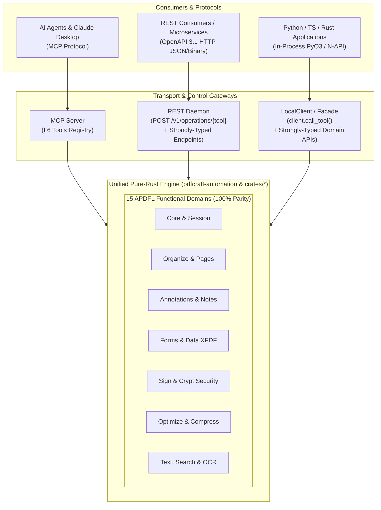

# PdfCraft SDK, REST & MCP Parity Architecture

This document defines the unified execution architecture and feature alignment across the **PdfCraft Document Processing SDK** (`pdfcraft-sdk`, Python, TypeScript), the **REST Service** (`pdfcraft-rest`), and the **MCP Server** (`pdfcraft-automation`).

Across all transports, PdfCraft provides 100% feature parity with the ~149 headless tools exposed by `pdfcraft-automation`, strictly adhering to the [**SDK API Reference Manual**](api-reference.md) (APDFL domain architecture) and Layer 7 isolation boundaries.

---

## 1. Unified Parity Architecture

---

## 2. Core Architectural Pillars

### 2.1 100% Parity: Universal Tool Bridge & Dual Facades
Every capability available to an AI agent via MCP is equally available to developers in pure code via the REST API and native language SDKs. Parity is achieved through two complementary interfaces:
1. **Universal Execution Bridge**:
   - SDK: `client.call_tool(tool_name, params)`
   - REST: `POST /v1/operations/{tool_name}`
   - Immediately exposes all 149 engine tools without awaiting custom wrapper releases.
2. **Strongly-Typed Domain APIs**:
   - Compile-time typed domain classes, builders, and REST endpoints for production-grade static analysis, IDE autocompletion, and compile-time validation.

### 2.2 Token Economics & Mathematical Determinism
- **Zero Token / Credit Burn**: Calling document tools through the SDK or REST API consumes **zero LLM tokens**, incurring zero LLM inference cost and avoiding AI rate limits.
- **100% Mathematical Determinism**: Document operations (form filling, digital signatures, vector redaction, page merging) execute strictly against compiled ISO 32000-2 algorithms with byte-level reproducibility.
- **"AI Only Where Necessary"**: Deterministic document automation runs directly in code, reserving MCP and AI agents for genuine reasoning tasks (such as cognitive summarization or semantic routing).

---

## 3. Domain Parity Matrix

The matrix below documents the end-to-end alignment between the 149 MCP tools and the SDK / REST control planes:

| Functional Domain | MCP Tools | SDK Methods (`LocalClient` / Python / TS) | REST Endpoints (`pdfcraft-rest`) | Parity Status |
| :--- | :--- | :--- | :--- | :--- |
| **Pipeline Core** | `doc_combine`, `doc_split`, `page_render` | `merge()`, `split()`, `render_page()` | `POST /v1/merged-pdf` `POST /v1/split-pdf` `POST /v1/page-preview` | **100% Shipped** (Typed REST) |
| **Batch Processing** | Batch workflow | `batch()` | `POST /v1/batch` | **100% Shipped** (Typed REST) |
| **Universal Bridge** | All 149 tools | `call_tool(name, args)` | `POST /v1/operations/{name}` | **100% Shipped** (Dynamic Bridge) |
| **Async Jobs** | Async status & results | `get_job()`, `cancel_job()` | `GET /v1/jobs/{id}` `GET /v1/jobs/{id}/result` `DELETE /v1/jobs/{id}` | **100% Shipped** (Typed REST) |
| **Document Layer** | `pages_rotate`, `pages_extract`, `pages_delete`, `pages_insert`, `bookmark_*` | `rotate_pages()`, `extract_pages()`, `delete_pages()`, `insert_pages()`, `add_bookmark()`, `list_bookmarks()` | `POST /v1/operations/pages_rotate` etc. (Typed routes planned) | **SDK Shipped** (Universal REST) |
| **Annotations & Notes** | `comment_list`, `comment_add`, `stamp_add`, `comments_summarize` | `add_highlight()`, `add_underline()`, `add_stamp()`, `add_comment()`, `list_comments()` | `POST /v1/operations/comment_add` etc. (Typed routes planned) | **SDK Shipped** (Universal REST) |
| **Forms & Data XFDF** | `form_fields`, `form_fill`, `doc_flatten`, `doc_export_data`, `doc_import_data` | `get_form_fields()`, `fill_form()`, `flatten_form()`, `export_form_data()`, `import_form_data()` | `POST /v1/operations/form_fill` etc. (Typed routes planned) | **SDK Shipped** (Universal REST) |
| **Security & Redact** | `doc_encrypt`, `doc_decrypt`, `redact_apply`, `sign_document`, `sign_verify` | `encrypt()`, `decrypt()`, `redact()`, `sign()` | `POST /v1/operations/doc_encrypt` etc. (Typed routes planned) | **SDK Shipped** (Universal REST) |
| **Optimization** | `doc_optimize`, `doc_reduce` | `optimize()`, `reduce_size()` | `POST /v1/operations/doc_optimize` etc. (Typed routes planned) | **SDK Shipped** (Universal REST) |
| **Text, Search & OCR** | `text_extract`, `text_find`, `ocr_recognize` | `extract_text()`, `find_text()`, `recognize_text()` | `POST /v1/operations/text_extract` etc. (Typed routes planned) | **SDK Shipped** (Universal REST) |

---

## 4. Architectural Invariants

1. **Clean-Room Fidelity (`AGENTS.md` §2)**:
   - All behavior is derived from public standards (ISO 32000-2, Arlington model) and black-box verification.
   - Zero proprietary SDK shims or non-free code.
2. **Never Crash Guarantee (`AGENTS.md` §4)**:
   - All non-test code returns structured `Result<T, SdkError>`.
   - Ephemeral execution sandboxes wrap engine calls in `catch_unwind` panic containment boundaries.
   - Outputs exceeding memory quotas automatically spill to disk.
3. **No Third-Party Mock Shims**:
   - Native language SDKs (Python, TypeScript) invoke compiled Rust FFI (`_native` via PyO3 and N-API) directly into PdfCraft's engine, completely eliminating mock libraries (`pypdf`, `reportlab`, `PIL`).
