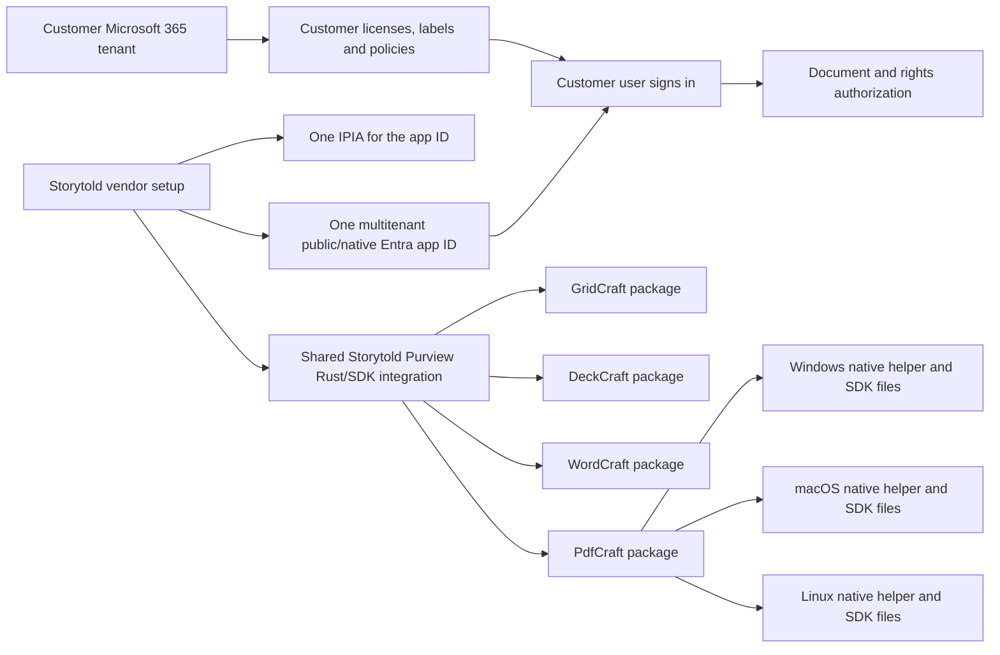
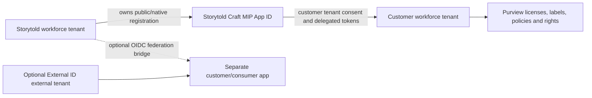

# Storytold Microsoft Purview one-time setup

This runbook is for Storytold employees and maintainers who publish Storytold applications
with Microsoft Purview / Microsoft Information Protection (MIP) support.

Customers do not register a separate MIP app or sign an IPIA for PdfCraft. A customer can
choose whether to license, configure and enforce Microsoft Purview. That tenant-level work
happens in the customer's Microsoft 365 / Purview and Microsoft Entra portals.

This is a public-release runbook. Storytold may use a separate internal-only app for development
and testing, but an internal app must not be distributed as the public application identity.

## Related RFC and application work

This runbook implements the proposed shared standard in
[RFC-0075](https://github.com/storytold/craft-contrib/pull/75), which is still a draft, and
its [RFC discussion](https://github.com/storytold/craft-contrib/issues/73). It is not a
substitute for Storytold's approval or Microsoft's agreements. Storytold
pull requests and issues are the canonical references for suite work; fork
repository URLs are not used in this runbook.

| Application | Tracking | Suggested application of the standard |
|---|---|---|
| PdfCraft | [IRM feature](https://github.com/storytold/pdfcraft/issues/6747), [draft POC](https://github.com/storytold/pdfcraft/pull/7843) | Complete the native SDK integration and live protected-PDF tests first. |
| GridCraft | [label-preservation issue](https://github.com/storytold/gridcraft/issues/865), [label-preservation PR](https://github.com/storytold/gridcraft/pull/1221) | Preserve spreadsheet label metadata and use the shared identity and SDK standard for any protection enforcement. |
| DeckCraft | [label-preservation PR](https://github.com/storytold/deckcraft/pull/535), [password-protected decks PR](https://github.com/storytold/deckcraft/pull/2176) | Preserve presentation labels; keep ordinary password encryption distinct from MIP rights. |
| WordCraft | [password-protected documents issue](https://github.com/storytold/wordcraft/issues/5827) | Keep document passwords separate and adopt the shared standard when adding MIP support. |
| ArtCraft | [enterprise compliance issue](https://github.com/storytold/artcraft/issues/2447) | Coordinate suite-wide identity, policy, consent and compliance requirements. |

Preserving label metadata or supporting ordinary document passwords is not, by itself, MIP
decryption or rights enforcement.

## Executive decision

Use **one multitenant, public/native Microsoft Entra app registration** for all first-party
Storytold desktop Craft applications that share the same Storytold publisher trust boundary.

Recommended identity:

- Application name: `Storytold Craft Applications`
- Supported account types: `Accounts in any organizational directory`
- Public/native client: enabled
- Redirect URI: `http://localhost`
- MIP permissions:
  - `Azure Rights Management Services` - `user_impersonation`
  - `Microsoft Information Protection Sync Service` - `UnifiedPolicy.User.Read`
- App secrets or application certificates: none
- IPIA: one for the Storytold application/app ID

One app ID lets PdfCraft, GridCraft, DeckCraft, WordCraft and later native Craft apps request
consent as the same first-party Storytold application. The app ID is **not** repeated per
customer tenant or per user.

The MIP SDK and its native libraries are still packaged with each application and operating
system build. Microsoft does not provide a single cross-application SaaS SDK instance that
Storytold can configure once on a server and have every desktop application inherit. The
Storytold integration, app registration and IPIA are shared; native SDK binaries and package
signing remain build-and-release responsibilities for each app/platform.

### When a separate app ID is appropriate

Create another app ID only when one of these boundaries is real:

- A product has a separate publisher or legal owner.
- A public app should be consented or revoked independently from the Storytold Craft suite.
- A third-party or customer-specific fork ships under a separate trust name.
- A security review requires separate permission or tenant administration boundaries.

Microsoft requires the IPIA to cover each public application/App ID release. If Storytold
creates a distinct app ID, update Microsoft by following the IPIA update process documented
by Microsoft rather than assuming the existing IPIA covers it automatically.

Do not create separate app IDs for:

- A customer tenant.
- An operating system.
- A PDF, Word, spreadsheet or presentation app inside the shared Storytold suite.
- A test environment that is not publicly distributed.

## What Microsoft requires

| Requirement | Who owns it | Frequency |
|---|---|---|
| Microsoft Entra app registration | Storytold | One suite app, unless Storytold creates a separate trust boundary |
| App permissions and consent configuration | Storytold | At app registration; update only if the integration permissions change |
| IPIA | Storytold, signed with Microsoft | One for the public app identity; update if the application/App ID changes |
| MIP SDK package and redistributables | Storytold | Download/validate per SDK update and platform package |
| Application/package signing and notarization | Storytold | One-time configuration; renew certificates as required |
| Purview licenses and label policies | Each customer tenant | Ongoing customer administration |
| Customer tenant consent | Each customer tenant, when its policy requires admin consent | Usually once for the Storytold app ID; later if permissions or policy change |
| User sign-in and identity | Each end user | At sign-in; MFA/Conditional Access is determined by the tenant |
| Document recipients and usage rights | The label/document publisher | Per document, recipient and policy |

A Microsoft partner relationship is not the same as an IPIA. This setup does not require
Storytold to enroll in CSP or GDAP to use the MIP SDK. It does require the IPIA for public
distribution. Microsoft Marketplace/Partner Center is needed only if Storytold wants to list,
sell or transact through Microsoft Marketplace or publish a Microsoft 365/Copilot offer.

## Architecture



The shared integration contains the Storytold app identity and delegated OAuth/MIP behavior.
Each platform package contains the platform-specific official MIP SDK binaries and native
helper. Each customer tenant owns its Purview policy and license state.

## Prerequisites

Before starting, assign one person to own each area:

- Legal: Microsoft agreement and IPIA authority.
- Microsoft Entra: tenant administrator or Cloud Application Administrator.
- Security: permission review, signing, certificate and tenant consent policy.
- Engineering: SDK build, native helper, shared package and CI.
- Support: critical-incident contacts supplied to Microsoft.

Prepare these values:

- Legal company name.
- Storytold company URL.
- Business and critical-support contacts.
- Storytold Microsoft Entra tenant ID.
- Chosen public application name.
- Short application description.
- A test Microsoft 365 tenant and at least one protected test document.
- The company identity used for Authenticode, Apple notarization or Linux package signing.

Do not use an Azure subscription, Virtual Machine, daemon service identity or confidential
client secret for the desktop sign-in flow.

## Optional prerequisite: workforce tenant and External ID external tenant

For PdfCraft's Purview/MIP integration, **do not create an External ID external tenant merely
to obtain the public App ID**. The required application registration belongs in Storytold's
normal Microsoft Entra workforce tenant and is configured for accounts in any organizational
directory. A customer signs in with the identity in the customer's own workforce tenant; tenant
consent creates the enterprise-application/service-principal object there.

Microsoft distinguishes:

| Tenant | Purpose in this design | Required for PdfCraft Purview |
|---|---|---|
| Storytold workforce tenant | Storytold employees, internal business resources, and the home tenant for the multitenant public/native Craft App ID | Yes |
| External collaboration in the Storytold workforce tenant | B2B guest access for partners/vendors who need Storytold or Microsoft 365 resources | Only when those partners need collaboration access |
| Customer workforce tenant | The customer's employees, Microsoft 365/Purview licenses, labels, policies, recipients, and consent | Yes, for that customer's Purview content |
| Microsoft Entra External ID external tenant | A separate CIAM directory for customers/consumers of Storytold-owned web, API, or mobile experiences; local, social, OTP, or federated customer sign-in | No |

An external tenant is a separate identity boundary, not an extension or subdirectory of the
Storytold workforce tenant. Its customer accounts do not automatically receive Microsoft 365
single sign-on, Purview licenses, label policy, or rights to protected documents. The optional
external-tenant app uses a different App ID and, for this POC, must not replace
`PDFCRAFT_PURVIEW_APP_ID`. Do not assume one IPIA, consent record, token authority, or user
directory covers both identities.



### When the external tenant is useful

Create one only when Storytold needs a distinct customer identity directory for a
customer-facing product, for example:

- A public website or customer portal with self-service sign-up.
- Local email/password, email one-time-passcode, or social identity sign-in.
- Customer-profile data and lifecycle management separate from employees.
- A branded hosted sign-in, embedded native authentication, or custom sign-in UX.
- Workforce employees authenticating to that customer application through a deliberate
  federation provider.

Do not create an external tenant solely to make the Craft app “multitenant.” The public/native
Craft registration already uses any organizational directory, and each customer's workforce
tenant remains authoritative for Purview authorization.

If the actual goal is to give partners/vendors access to Storytold's own Microsoft 365, Teams,
line-of-business, or SaaS resources, use **External ID B2B collaboration in the Storytold
workforce tenant** instead of an external tenant. B2B creates managed guest objects in the
workforce directory; the partner continues to authenticate with its home identity provider.

### Create an optional external tenant

Prerequisites:

- A person with at least the Entra **Tenant Creator** role, scoped to the Azure subscription or
  resource group used for tenant creation.
- An Azure subscription, unless Microsoft offers and the owner accepts the current first-time
  30-day trial tenant.
- A permanent country/region choice. Microsoft currently treats the country/region as
  non-changeable after creation.
- A tenant owner, support owner, data-residency decision, billing owner, and retention/deletion
  procedure.

Procedure:

1. In the Microsoft Entra admin center, select **Entra ID** → **Overview** → **Manage tenants**.
2. Select **Create** → **External** → **Continue**.
3. Choose the free trial only for the approved trial scenario; otherwise select **Use Azure
   Subscription**.
4. Enter an external customer-facing tenant name and domain, choose country/region, and review
   any available Go-Local data-residency option.
5. Select the subscription and resource group that will own billing/resource linkage.
6. Review and create the tenant. Record its tenant ID, primary domain, subscription/resource
   group, owner, and support contacts. Tenant creation can take up to 30 minutes.
7. Use **Directories + subscriptions** to switch to the external tenant.

The external tenant is now available, but no directory synchronization or application sharing
with the workforce tenant has occurred.

### Register and connect a customer app to the external tenant

Inside the external tenant:

1. Register the customer application for its real platform and choose the current
   Microsoft-hosted, embedded-native, or bring-your-own-UX authentication approach.
2. Configure the external-tenant public/client or confidential-client settings. Never place a
   confidential-client secret in a desktop, mobile, browser, or distributed application.
3. Create a sign-up/sign-in user flow.
4. Configure only the customer sign-in methods, claims, terms, and identity providers the
   product requires.
5. Add the application to the user flow, then test customer sign-up, sign-in, reset, MFA, consent,
   account lifecycle, and token claims.

Use a separate server-side federation registration if Storytold workforce employees should use
their existing business accounts in the external tenant:

1. In the **Storytold workforce tenant**, register an identity-provider application for the
   external tenant. Select **Accounts in this organizational directory only**.
2. Add these Web redirect URIs, replacing the placeholders with the external tenant values:

   - `https://<tenant-subdomain>.ciamlogin.com/<external-tenant-id>/federation/oauth2`
   - `https://<tenant-subdomain>.ciamlogin.com/<tenant-subdomain>.onmicrosoft.com/federation/oauth2`
   - If a verified custom external-tenant domain is later configured, add Microsoft's
     corresponding documented federation redirect for that domain.

3. Create a client secret for this **server-side federation bridge only** and store it in the
   approved secret store. Do not put it in PdfCraft, source, CI logs, packages, or a public
   desktop/mobile client.
4. Add delegated Microsoft Graph `email`, `openid`, `profile`, and `User.Read`; grant workforce
   tenant admin consent when policy requires it.
5. Record the bridge App ID and workforce tenant ID.
6. In the **external tenant**, add the Storytold workforce tenant as a custom OpenID Connect
   identity provider:
   - Well-known endpoint:
     `https://login.microsoftonline.com/organizations/v2.0/.well-known/openid-configuration`
   - Issuer:
     `https://login.microsoftonline.com/<workforce-tenant-id>/v2.0`, or the documented
     `onmicrosoft.com`-domain issuer
   - Client ID: the workforce federation bridge App ID
   - Client authentication: `client_secret`
   - Client secret: the bridge secret
   - Scope: `openid profile`
   - Response type: `code`
7. Add this identity provider to the external-tenant user flow. If issuer/provider settings are
   later changed, remove and re-add the provider in the user flow and retest.
8. Test with a workforce user. Authentication and workforce Conditional Access/MFA occur in the
   workforce tenant; an external-tenant user object is created or linked when self-registration
   succeeds. External ID does not currently trust the workforce tenant's completed MFA, so its
   own MFA policy may prompt again. Do not assume the workforce directory, groups, or Purview
   authorization are copied into the external tenant.

Multiple workforce tenants can be separate identity providers in one external tenant. That is an
explicit federation design, not the same behavior as the Craft public/native multitenant App ID.

### Purview recipients are still workforce identities

An external-tenant customer identity does not by itself become a licensed Microsoft 365/Purview
principal in a resource tenant. For protected files:

- External recipients that already have an Entra workforce home tenant authenticate there.
  Cross-tenant access settings can allow or block the Microsoft Rights Management Services
  resource (`00000012-0000-0000-c000-000000000000`), and the resource tenant's Conditional Access
  policy still applies.
- Recipients without an eligible organizational account may need a B2B guest object in the
  resource/customer workforce tenant. The protecting tenant owns that invitation and policy.
- The label/document owner must grant rights to the resolved recipient. Authentication never
  grants document access by itself.

Therefore, never substitute the external-tenant App ID or token for PdfCraft's multitenant
public/native MIP identity. If the product later needs both CIAM and Purview, keep two explicit
identity flows and test the account/account-tenant boundary between them.

Official Microsoft guidance:

- [Microsoft Entra External ID overview](https://learn.microsoft.com/en-us/entra/external-id/external-identities-overview)
- [B2B collaboration in a workforce tenant](https://learn.microsoft.com/en-us/entra/external-id/what-is-b2b)
- [Create an external tenant](https://learn.microsoft.com/en-us/entra/external-id/customers/how-to-create-external-tenant-portal)
- [Plan an External ID deployment](https://learn.microsoft.com/en-us/entra/external-id/customers/concept-planning-your-solution)
- [Federate a Microsoft Entra workforce tenant into an external tenant](https://learn.microsoft.com/en-us/entra/external-id/customers/how-to-entra-id-federation-customers)
- [Entra configuration for Purview-encrypted content](https://learn.microsoft.com/en-us/purview/encryption-azure-ad-configuration)

## Step 1: Create the Storytold app registration

Open the [Microsoft Entra admin center](https://entra.microsoft.com).

1. Select **Identity**.
2. Open **Applications**.
3. Open **App registrations**.
4. Select **New registration**.
5. Enter the stable public application name, for example `Storytold Craft Applications`.
6. Under **Supported account types**, select
   **Accounts in any organizational directory (Any Microsoft Entra ID tenant - Multitenant)**.
7. Leave the initial registration redirect URI blank unless the form requires a platform.
   The MIP/native desktop flow will be configured under **Authentication**.
8. Select **Register**.
9. Record and store:
   - Application (client) ID.
   - Directory (tenant) ID.
   - Application ID URI, if needed by another app registration workflow.
   - Publisher/legal display name.

The application object is in the Storytold tenant. Microsoft creates or links a service
principal when a customer tenant first consents. Storytold should not configure a customer
tenant as part of the app registration.

### Configure the desktop redirect URI

1. Open **App registrations** for the new app.
2. Select **Authentication**.
3. Select **Add a platform**.
4. Choose **Mobile and desktop applications**.
5. Add `http://localhost`.
6. If there are no confidential-client flows, leave certificates and client secrets empty.
7. Under **Advanced settings**, set **Allow public client flows** to **Yes**.
8. Select **Save**.

Why `http://localhost`: PdfCraft opens the system browser, binds a loopback callback, and
uses a PKCE authorization-code flow. The redirect is local to the user's device; it sends
the authorization code to PdfCraft, not to Storytold infrastructure.

Official guidance:

- [Add or configure a redirect URI](https://learn.microsoft.com/en-us/entra/identity-platform/how-to-add-redirect-uri)
- [Configure desktop apps that call web APIs](https://learn.microsoft.com/en-us/entra/identity-platform/scenario-desktop-app-configuration)
- [Redirect URI best practices](https://learn.microsoft.com/en-us/entra/identity-platform/reply-url)

<p align="center">
  <a href="https://learn.microsoft.com/en-us/information-protection/develop/setup-configure-mip">
    
  </a>
</p>

### Add the MIP permissions

Open **API permissions**.

1. Select **Add a permission**.
2. Choose **Azure Rights Management Services**.
3. Select **Delegated permissions**.
4. Add `user_impersonation`.
5. Select **Add permissions**.
6. Select **Add a permission** again.
7. Select **My organization uses**, or **APIs my organization uses**.
8. Search for `Microsoft Information Protection Sync Service`.
9. Select **Delegated permissions**.
10. Expand `UnifiedPolicy` and add `UnifiedPolicy.User.Read`.
11. Select **Add permissions**.

No application-only permission is needed for normal desktop user sign-in. Do not add
`Content.SuperUser`, `Content.DelegatedReader`, `Content.DelegatedWriter` or
`UnifiedPolicy.Tenant.Read` unless a separate documented service/daemon app with a
different security boundary genuinely requires them.

In the Storytold home tenant, grant admin consent for the Storytold app if the tenant
policy allows it:

1. Open **API permissions**.
2. Select **Grant admin consent for Storytold**.
3. Confirm the delegated permissions.

Granting consent in Storytold's tenant does not grant consent in every customer tenant.
Customers decide whether users can consent or whether an administrator must grant consent
for the customer tenant.

Official guidance:

- [Required MIP SDK API permissions](https://learn.microsoft.com/en-us/information-protection/develop/concept-api-permissions)
- [Microsoft Entra consent experience](https://learn.microsoft.com/en-us/entra/identity-platform/application-consent-experience)
- [Convert a single-tenant app to multitenant](https://learn.microsoft.com/en-us/entra/identity-platform/howto-convert-app-to-be-multi-tenant)

<p align="center">
  <a href="https://learn.microsoft.com/en-us/information-protection/develop/setup-configure-mip">
    
  </a>
</p>

### App-registration security checklist

- [ ] Public/native client, not confidential/web service.
- [ ] Accounts in any organizational directory.
- [ ] `http://localhost` redirect URI.
- [ ] No client secret.
- [ ] No application/client certificates for desktop sign-in.
- [ ] Only the two delegated MIP permissions.
- [ ] Home-tenant admin consent granted if permitted.
- [ ] App ID and app name stored in the release configuration inventory.
- [ ] Owners and notification contacts configured in Entra.

## Step 2: Request the IPIA

The IPIA is a Storytold-to-Microsoft agreement. It is not a license required from each
Storytold customer or end user.

Microsoft requests public developers to:

1. Email [IPIA@microsoft.com](mailto:IPIA@microsoft.com?subject=Requesting%20IPIA%20for%20Storytold)
   with:
   - Application/product name.
   - Requester's first and last name.
   - Requester's email address.
2. Wait for Microsoft's IPIA form.
3. Review and return the form with:
   - Legal company name.
   - State/province or country/region of incorporation.
   - Company URL.
   - Contact email.
   - Any additional company addresses.
   - Application name.
   - Short application description.
   - Storytold Azure/Microsoft Entra tenant ID.
   - Storytold app (client) ID.
   - Critical-support contact email and phone.
4. Sign the final IPIA link digitally.
5. Wait for Microsoft to sign and return the agreement.

Internal-only applications do not need the public IPIA step. Do not make an internal build
public. When it becomes a public release, complete the IPIA first.

If Storytold already has a signed IPIA and creates a distinct app ID:

1. Email [IPIA@microsoft.com](mailto:IPIA@microsoft.com?subject=Updating%20IPIA%20for%20Storytold)
   with:
   - Application name.
   - Short application description.
   - Storytold tenant ID.
   - New app ID.
   - Critical-support contact email and phone.
2. Wait for Microsoft's acknowledgment and any agreement update.

The IPIA process does not need to be repeated for:

- Customer tenants.
- Customer users.
- Operating-system packages that use the same app ID.
- PdfCraft, GridCraft, DeckCraft or WordCraft that intentionally share the suite app ID.

Official guidance:

- [MIP SDK setup and IPIA request](https://learn.microsoft.com/en-us/information-protection/develop/setup-configure-mip)
- [IPIA request address](mailto:IPIA@microsoft.com)

## Step 3: Add the official MIP SDK to the build system

Do not replace or hand-roll MIP SDK binaries. Use Microsoft's official SDK package.

Official source:

- [MIP SDK download and setup](https://learn.microsoft.com/en-us/information-protection/develop/setup-configure-mip)
- [MIP SDK binaries](https://aka.ms/mipsdkbinaries)
- [MIP SDK overview](https://learn.microsoft.com/en-us/information-protection/develop/overview)

Download the SDK package for each target:

- Windows x64 and supported x86/ARM configurations.
- macOS x64 and arm64.
- Linux distributions that are supported and used by Storytold release targets.

Microsoft documents x64/ARM package layout as `file/protection/upe/bins/release/<arch>`.
Retain Microsoft's `redist.txt` and package every redistributable dependency it names.

Set one build environment variable:

```text
MIP_SDK_ROOT=/absolute/path/to/official/sdk
PDFCRAFT_PURVIEW_APP_ID=<Storytold application client ID>
```

PdfCraft SDK build example:

```sh
MIP_SDK_ROOT=/path/to/mipsdk \
PDFCRAFT_PURVIEW_APP_ID=<storytold-app-client-id> \
cargo build -p pdfcraft --release --features mip-sdk
```

### PdfCraft SDK package layout

SDK builds stage the native bridge next to the application executable and copy the official SDK
runtime libraries into the platform package:

- macOS: `PdfCraft.app/Contents/MacOS/pdfcraft-purview-helper` and
  `PdfCraft.app/Contents/Frameworks/*.dylib`
- Windows: `pdfcraft-purview-helper.exe` and the MIP redistributable DLLs beside `pdfcraft.exe`
- Linux: `/usr/lib/pdfcraft/pdfcraft-purview-helper` and the MIP SDK shared libraries beside it

Every SDK helper and redistributable is included in nested-code signing or platform package signing.
The macOS build uses app-relative `@rpath` loading; the Linux build uses `$ORIGIN`; Windows uses
DLL search rules for files beside the executable. Ordinary packages do not include SDK helper or
redistributable files.

The app ID is a public client identifier, not a secret. The release pipeline should read it
from CI configuration or a release manifest, but must record it alongside the app registration
and IPIA. Do not put an app secret in a desktop binary or source repository.

### PdfCraft POC live-completion gate

The following inputs are required to turn the PdfCraft POC from an SDK bridge into a live tenant test:

- Validate protected-document saves, recovery, revert and original-plus-edits label/protection
  mutations against a live tenant. Synthetic regressions verify the native protocol and
  fail-closed rights checks. Optimization and digital signing remain disabled for protected
  documents. Continue using synthetic test documents; do not distribute the POC for sensitive
  content.
- Download the official `mip_sdk_file_macos_1.18.148.zip` package for macOS and, for public release,
  the corresponding `file`, `protection`, and `upe` packages for every supported platform.
- Extract the package into a private SDK staging directory outside the Git repository.
- Set `MIP_SDK_ROOT` to the package root and verify `include/` and `bins/release/<arch>/` exist.
- Set `PDFCRAFT_PURVIEW_APP_ID` to the public/native Microsoft Entra application client ID.
- Do not set an app secret in `PDFCRAFT_PURVIEW_APP_ID`, CI environment, source, or packaged binary.
- Complete the public IPIA process before distributing the SDK-enabled public build.
- Sign and notarize the macOS helper and SDK libraries; sign and Authenticode-sign or notarize the Windows helper and package.
- Use a dedicated Microsoft 365 test tenant with a published sensitivity label policy.
- Create test labels for default, mandatory, protected, and unprotected outcomes.
- Test a PFILE/PDF produced from the tenant against the live POC on macOS arm64 first.
- Verify sign-in, MFA/Conditional Access, use-license acquisition, rights and save/re-publish.
  Until protected-document label changes, protection removal and ordinary-password composition
  are implemented, verify that each is refused clearly; then test those operations and downgrade
  justification against the tenant before enabling them.
- Keep the POC fail-close if the SDK, app ID, helper, or tenant policy is missing. Never silently open MIP-shaped bytes in that state.

### Authentication fallback policy

PdfCraft's normal desktop authentication is browser-based Authorization Code
with PKCE through the Storytold public/native app registration. It does not use
or reuse Azure CLI credentials, the Azure CLI client ID, `az login`, or
`az account get-access-token`.

The POC obtains protection and policy tokens separately. Use the same work/school account for
both prompts; sign-in fails if either response lacks an account identifier or they differ. A
failed attempt to add an account leaves any existing signed-in account available.
When a protected file is waiting to open, PdfCraft may accept one optional work/school email as
an OAuth `login_hint`. It is cleared at browser handoff, never persisted, and never asks for a
password. Leaving it empty keeps Microsoft's normal account chooser.
Sign-in and its initial policy load run outside the UI thread; closing the sign-in window does not
cancel them. A later policy refresh when opening the labeling dialog or switching accounts may
still block the interface. Close protected documents and finish queued opens before switching accounts or
signing out, so rights from one account are not reused for another. If another MIP operation
is in progress, wait for it to finish and retry the account change.
If a protected file is denied or unavailable, the dialog identifies the waiting file and offers
Retry opening once an account is ready; it does not offer actions for a different open document.

The POC now retains token expiry and supports browser reauthentication with the same active
account while protected documents are open. A different account is rejected. Reauthentication
preserves current working edits and revalidates every protected original before rights resume;
unknown or failed rights clear the effective rights and suspend the display/cached render output
without discarding private working edits. SDK `NoAuthToken`, expired, and invalid-token errors are
surfaced as sign-in challenges. Do not work around a failure by exporting plaintext.
MFA, Conditional Access, challenge behavior, and renewal with unsaved edits still require a real
tenant before use with sensitive documents.
Live tenant verification of this flow is tracked in
[storytold/pdfcraft#7843](https://github.com/storytold/pdfcraft/pull/7843#discussion_r4687045314).

Azure CLI is useful to Storytold maintainers for tenant/app-registration setup
and Azure resource administration, but it is not the runtime identity for
PdfCraft and does not replace the MIP SDK app registration, IPIA, delegated
MIP permissions, or customer tenant consent.

The OAuth device-code flow is a future fallback only for a CLI/headless or
input-constrained environment. Device code still requires the Storytold app
client ID and the same MIP delegated scopes; it does not remove the app
registration or IPIA requirement. Do not enable device code as a public
desktop default unless the app registration and security review explicitly
approve it.

### Dependency and native-platform standard

The runtime MIP bridge uses Microsoft's official native MIP SDK, not an
independent PDF decryptor, Azure CLI, or third-party MIP SDK wrapper.

Ordinary builds do not compile the native helper or include Purview's optional
authentication stack. They still detect protected files and fail closed. The
`mip-sdk` feature enables `mip-auth`, which can also be enabled independently
to test the Rust authentication code without the SDK.

The optional Rust authentication side keeps only the dependencies needed for:

- Authorization URL, PKCE, redirect callback and token response handling.
- HTTPS token exchange using system trust roots.
- Cross-platform system browser launch.
- Account/ID-token JSON decoding.
- URL parsing.
- The existing Windows owner-only staging helper.

There is no direct UUID, generic Base64, Azure CLI, device-code, or refresh-token
dependency in the POC auth path. App-ID validation is local; ID-token Base64URL
decoding reuses the existing Rust `craft-mime` codec with an input-size limit.
The OAuth and HTTPS libraries may use Base64 as a transitive dependency.
The TLS provider uses `ring`, which includes native C and assembly. Retain the
maintained TLS stack rather than implementing authentication cryptography locally.
Microsoft's SDK and its documented platform-specific runtime dependencies remain
required for SDK-enabled builds; a Rust replacement would not be the official SDK.

Supported native helper builds follow the target platform:

- macOS arm64 and x86_64.
- Windows amd64, x86 and arm64 where the official SDK and toolchain support
  the target.
- Supported Linux distribution and architecture targets.

## Step 4: Build the shared native integration

Recommended Storytold layout:

```text
craft-libs/
  purview/                 shared Rust types and provider contract

pdfcraft/
  native Purview helper
  PDF rights and save integration

gridcraft/
  reuse shared Purview provider

deckcraft/
  reuse shared Purview provider

wordcraft/
  reuse shared Purview provider
```

The shared provider must:

- Accept the Storytold app ID and application name.
- Use `Accounts in any organizational directory`.
- Authenticate with PKCE/system-browser/delegated tokens.
- Acquire the two documented MIP resources/scopes.
- Return tenant labels and usage rights.
- Fail closed for copy, print, export, edit and protection removal.
- Remove temporary decrypted files immediately after use.
- Re-publish edited files without silently stripping protection.
- Request policy-required justification for label downgrade/removal.
- Use the OS credential store for a persistent token cache when implemented.
- Never add `Content.SuperUser` or application-only delegated-admin rights to the desktop app.

The MIP SDK helper should run beside the application or be discoverable by an
application-controlled environment override. Do not search unrelated system directories for
untrusted helper binaries.

Official MIP concepts:

- [MIP profiles and engines](https://learn.microsoft.com/en-us/information-protection/develop/concept-profile-engine-cpp)
- [MIP SDK authentication scenarios](https://learn.microsoft.com/en-us/information-protection/develop/concept-auth-scenario-csharp)
- [MIP SDK consent concept](https://learn.microsoft.com/en-us/information-protection/develop/concept-consent-cpp)

## Step 5: Package platform dependencies

### Windows

- Build in Release.
- Include the MIP SDK release DLLs and redistributables.
- Install or package the Microsoft Visual C++ Runtime component when missing.
- Microsoft documents MSVC 14.44 or higher for current setup guidance.
- Sign the native helper and application with Storytold's Authenticode certificate.
- In MSI/MSIX or installer scripts, place MIP dependencies in the application directory or
  install them with the app; do not depend on a per-user manual SDK setup.
- Verify SmartScreen, antivirus and Windows Defender behavior after signing.

### macOS

- Use the official macOS MIP package for the target architecture.
- Test both x64 and arm64 where Storytold publishes both.
- Package the helper and SDK libraries in the app bundle.
- Configure the runtime library search path appropriately.
- Sign and notarize the application and native helper.
- Test launch from a signed, quarantined DMG and a direct app bundle.

### Linux

- Test supported distributions separately; do not claim distro-wide support from one package.
- Install or package official MIP dependencies:
  - curl
  - libsecret
  - OpenSSL/libssl
  - UUID
  - GMIME for the file SDK
  - Libgsf for the file SDK
- Use package-manager dependencies where the distribution supports them.
- Follow each SDK tarball's `how-to-build-and-run.txt`.
- Sign and validate package metadata and native helper ownership.

FreeBSD and mobile clients do not receive desktop PDF parity merely through Purview SDK
availability. The first supported public scope should match the official MIP File SDK
platform matrix.

## Step 6: Test one tenant and one protected PDF

Use a dedicated Microsoft 365 test tenant and label policy before public testing.

### Test identity and consent

- [ ] Sign in with a work/school account.
- [ ] MFA and Conditional Access prompts complete.
- [ ] `purview_status` reports signed in and native SDK ready.
- [ ] Sign-out removes the in-memory and OS credential-cache session.
- [ ] An external/guest identity receives the rights expected by the label.
- [ ] Tenant admin consent works for a customer that disables user consent.

### Test document operations

- [ ] Open an ordinary PDF and return `NONE` label protection state.
- [ ] Open a protected PDF.
- [ ] Sign in and acquire the use license.
- [ ] Read label name, description, protection state and rights.
- [ ] Apply an available sensitivity label.
- [ ] Downgrade a label and provide required justification.
- [ ] Remove a label only when the rights and policy permit it.
- [ ] Remove protection only when the rights and policy permit it.
- [ ] Edit and save a protected document while retaining protection.
- [ ] Re-publish the correct original/working bytes.
- [ ] Close and reopen the re-published file.
- [ ] Verify offline behavior only for the rights/cache period allowed by the tenant.

### Test rights enforcement

Validate the UI and automation/MCP paths with one label per scenario:

| Rights | Required PdfCraft behavior |
|---|---|
| VIEW only | Open and render; no copy, print or edit |
| VIEW + EXTRACT | Text/image copying is allowed; structural page/object copying and unprotected file exports require EXPORT or OWNER |
| VIEW + PRINT | Printing allowed; copy/edit/export remain subject to rights |
| VIEW + EDIT/DOCEDIT | Editing allowed; export/protection removal remain subject to rights |
| VIEW + EXPORT | Export/re-protection behavior allowed only as the policy permits |
| OWNER/Change Rights | Full control and protection-removal operations subject to SDK policy |

The same checks must pass through desktop UI, CLI and MCP/automation tools.

## Step 7: Publish and distribute

Before public release:

- [ ] IPIA is signed.
- [ ] App registration is multitenant and public/native.
- [ ] Home-tenant consent is granted or the approval process is documented.
- [ ] Official SDK release binaries and `redist.txt` dependencies are packaged.
- [ ] The application, native helper and installers are signed/notarized.
- [ ] Protected-PDF tests pass on every supported OS.
- [ ] Customer consent instructions link to the correct app ID.
- [ ] No app secret or private key exists in source or package artifacts.
- [ ] The public support team has the critical incident contacts supplied to Microsoft.

Do not publish a public SDK build until the app registration and IPIA are complete.
Do not add customer tenant IDs to the build. The app should discover the customer tenant
at sign-in and return to the correct authority.

## Customer onboarding

The customer performs these tenant tasks:

1. Assign eligible Microsoft Purview / Information Protection licenses to users who benefit
   from labeling or protection features.
2. Create sensitivity labels and protection settings.
3. Publish label policies to the user or group scope that should see and apply labels.
4. Configure Azure Rights Management protection, external recipients and usage rights.
5. Decide whether tenant users may consent to the Storytold app or require tenant admin consent.
6. If tenant admin consent is required, grant consent for the Storytold app in the customer's
   tenant.
7. Test protected content with the customer's support and security teams.

Customers do not add a separate App ID for PdfCraft or other Craft applications that use the
shared suite registration.

Tenant-wide admin consent is a customer-specific one-time setup for that app ID, unless
tenant policy or app permissions change later. Individual users still sign in and may
receive different label policies and document rights.

## Maintenance

### Stable item: app ID

Keep the suite app ID stable. Changing the app ID is a customer consent change and may require
a new IPIA update. Removing or rotating public-client app credentials is usually not required
because public desktop apps do not use client secrets.

### SDK maintenance

- Track the official MIP SDK release and deprecation schedule.
- Test SDK updates in a branch and dedicated tenant before release.
- Rebuild and re-sign every application/platform package that uses the SDK.
- Revalidate `redist.txt` dependencies and native helper linkage.
- Retest label, decryption, re-publishing and rights behavior after each SDK upgrade.

### App-registration maintenance

Review at least when:

- The suite adds or removes delegated MIP permissions.
- Microsoft changes an API permission or resource scope.
- Branding, support contacts or publisher ownership changes.
- A separate app ID is introduced.
- Tenant consent policy or Conditional Access requirements change.
- The app is transferred to another legal entity or tenant.

If Storytold creates a separate app ID, update Microsoft and the IPIA, not only the source code.

### Optional external-tenant maintenance

If Storytold creates the separate External ID tenant:

- Assign primary/backup tenant and billing owners; review access and critical contacts.
- Track the external-tenant region, subscription, resource group, and data-residency decision as
  immutable setup evidence.
- Rotate the confidential federation-bridge secret before expiration without copying it into a
  public client. Update the external tenant's OIDC provider, then test the complete user flow.
- Retest user flows after changing identity providers, claims, issuer, redirect URIs, MFA, or
  Conditional Access.
- Review the external tenant's customer account deletion/retention, support, and billing/MAU
  controls independently from the workforce tenant.
- Keep the external customer-app inventory distinct from the public/native MIP App ID and IPIA
  record.
- If external recipients need Purview content, review workforce-tenant B2B, cross-tenant access,
  Microsoft Rights Management Services permissions, label policy, and recipient rights in the
  resource tenant. Reauthentication in the CIAM app does not refresh Purview authorization.

### Certificate and package maintenance

- Renew Windows Authenticode certificates before expiration.
- Renew macOS signing/notarization credentials and Apple certificates before expiration.
- Re-sign Linux packages and native helpers when signing metadata or credentials change.
- Retain a traceable mapping from release artifact to SDK version and app ID.

### Customer maintenance

Customers maintain:

- Purview licenses.
- Sensitivity label taxonomy.
- Label publication and user/group scope.
- Protection permissions and external recipient accounts.
- Microsoft Entra consent and identity synchronization.
- Conditional Access, MFA and access review.

No customer maintenance should require changing PdfCraft's Storytold app ID.

## Troubleshooting

| Symptom | Most likely cause | Correct owner/action |
|---|---|---|
| Protected PDF is detected but sign-in fails | Public client registration, redirect, app ID or authority misconfigured | Storytold Engineering and Entra security |
| App is not available in another tenant | App registration is single-tenant or customer has no consent | Change to multitenant and grant customer consent if required |
| Admin consent is blocked | Tenant policy or permission is application-only or extra privilege is being requested | Reduce permissions and follow delegated consent guidance |
| External-tenant users cannot see workforce SSO | The external tenant's workforce OIDC provider or user flow is missing/stale | Reconfigure the separate federation bridge, issuer, redirect, claims, and user-flow assignment |
| An External ID app identity cannot obtain Purview labels | The external-tenant app/token is being substituted for the workforce/MIP identity | Use the Storytold public/native MIP App ID and authenticate in the user's eligible workforce tenant |
| Labels are missing after sign-in | Label policy is not published, account is out of scope or licensing/policy propagation is incomplete | Customer Purview administrator |
| Protected PDF opens as plain with no rights | SDK/helper unavailable or app build lacks `mip-sdk` | Storytold Engineering |
| Copy/print/edit unexpectedly denied | Rights in the publishing license are restrictive | Document/policy owner |
| External recipient cannot open | Recipient identity is not authorized or client identity method is unsupported | Customer label/policy and recipient administrator |
| Package starts without the SDK helper | Installer omitted native helper or SDK libraries | Release engineering |
| macOS blocks the helper | Signing/notarization or runtime search path | macOS release engineering |
| Linux helper or dependencies are missing | Distribution package dependencies incomplete | Linux release engineering |

## Partner program and Microsoft Marketplace decision

### AI Cloud Partner Program / Partner Center

Storytold may need to enroll in the [Microsoft AI Cloud Partner Program](https://partner.microsoft.com/)
if it wants Microsoft partner benefits, formal co-sell relationships or Support/Benefits
programs. This is separate from MIP SDK technical setup and is not required to request the IPIA.

### Microsoft Marketplace

If Storytold wants to publish or sell through Microsoft Marketplace:

1. Enroll or use an existing Partner Center account.
2. Complete the appropriate legal/publisher profile.
3. Choose the offer type.
4. Accept the publisher and marketplace agreements.
5. Add App ID and sign-in configuration only for offer types that use Microsoft Entra apps.
6. Link or document the Purview/IPIA setup in the offer architecture and support process.

Official partner links:

- [Partner Center documentation](https://learn.microsoft.com/en-us/partner-center/)
- [Microsoft AI Cloud Partner Program enrollment](https://learn.microsoft.com/en-us/partner-center/enroll/partner-center-enroll-overview)
- [Enroll in Microsoft Marketplace or Microsoft 365 and Copilot](https://learn.microsoft.com/en-us/partner-center/account-settings/create-account)
- [Microsoft Marketplace overview](https://learn.microsoft.com/en-us/partner-center/marketplace-offers/overview)
- [Microsoft Marketplace partner documentation](https://learn.microsoft.com/en-us/partner-center/marketplace-offers/)

Marketplace and MAICPP do not replace the IPIA. The IPIA remains required for public release
of the MIP SDK application identity.

## One-time setup completion checklist

- [ ] One shared suite app ID is chosen.
- [ ] The app is registered in the Storytold tenant as multitenant/public.
- [ ] `http://localhost` is registered.
- [ ] Public client flows are enabled.
- [ ] Only delegated MIP permissions are configured.
- [ ] Home-tenant consent is granted.
- [ ] No client secret or application-only permission is used.
- [ ] IPIA information is sent to Microsoft.
- [ ] Microsoft IPIA is digitally signed.
- [ ] Official MIP SDK release packages are recorded for supported platforms.
- [ ] Shared Rust/provider integration is in place.
- [ ] Native helper is in every supported app package.
- [ ] SDK dependencies and redistributables are packaged.
- [ ] Windows/macOS/Linux signing configuration is complete.
- [ ] Protected-PDF test matrix passes.
- [ ] Customer consent instructions are documented.
- [ ] A maintenance owner and SDK-update process are assigned.

## Official source index

- [MIP SDK setup and configuration](https://learn.microsoft.com/en-us/information-protection/develop/setup-configure-mip)
- [MIP SDK overview](https://learn.microsoft.com/en-us/information-protection/develop/overview)
- [MIP SDK API permissions](https://learn.microsoft.com/en-us/information-protection/develop/concept-api-permissions)
- [MIP SDK profile and engine concepts](https://learn.microsoft.com/en-us/information-protection/develop/concept-profile-engine-cpp)
- [MIP SDK authentication scenarios](https://learn.microsoft.com/en-us/information-protection/develop/concept-auth-scenario-csharp)
- [MIP SDK consent concept](https://learn.microsoft.com/en-us/information-protection/develop/concept-consent-cpp)
- [Microsoft Entra desktop app configuration](https://learn.microsoft.com/en-us/entra/identity-platform/scenario-desktop-app-configuration)
- [Microsoft Entra consent experience](https://learn.microsoft.com/en-us/entra/identity-platform/application-consent-experience)
- [Convert an app registration to multitenant](https://learn.microsoft.com/en-us/entra/identity-platform/howto-convert-app-to-be-multi-tenant)
- [Get started with sensitivity labels](https://learn.microsoft.com/en-us/purview/get-started-with-sensitivity-labels)
- [Apply encryption using sensitivity labels](https://learn.microsoft.com/en-us/purview/encryption-sensitivity-labels)
- [Azure Rights Management user/group requirements](https://learn.microsoft.com/en-us/purview/rights-management-users-groups)
- [Microsoft Purview service description](https://learn.microsoft.com/en-us/office365/servicedescriptions/microsoft-365-service-descriptions/microsoft-365-tenantlevel-services-licensing-guidance/microsoft-purview-service-description)
- [Compatible SharePoint PDF readers](https://learn.microsoft.com/en-us/purview/sp-compatible-pdf-readers-for-irm)
